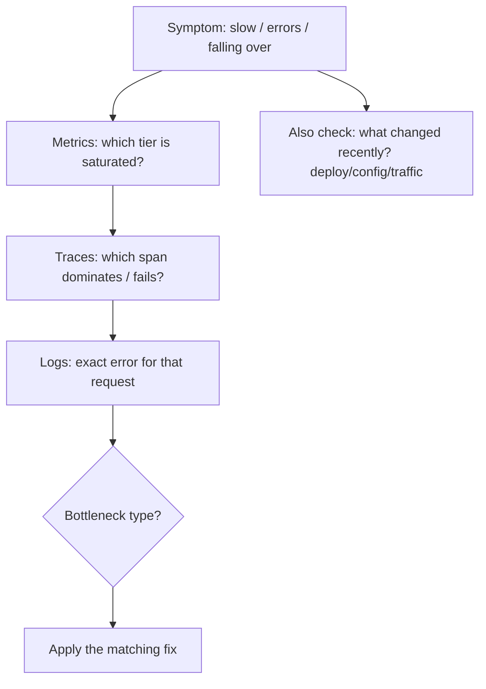

# Scaling Bottleneck Diagnosis

> Prerequisites: all prior `11-estimation-and-bottleneck-analysis/` chapters, [09-observability-and-operations/logs-metrics-and-traces](../09-observability-and-operations/logs-metrics-and-traces.md)
> Related: [00-foundations/architecture-fundamentals](../00-foundations/architecture-fundamentals.md) · [09-observability-and-operations/incident-response-and-root-cause-analysis](../09-observability-and-operations/incident-response-and-root-cause-analysis.md)

The capstone: a diagnosis playbook for "it's slow / falling over" that identifies *which* component is the bottleneck from signals, and *what type* of fix it needs — so you fix the real problem instead of randomly adding servers. This is the single most important operational skill for interviews.

---

## A. The core skill

The master prompt's recurring demand: "identify the failing component from metrics and traces rather than randomly increasing server capacity." Given a vague "the system is slow/overloaded," a strong engineer *diagnoses* — localizes the bottleneck from signals, identifies its type, and applies the matching fix. The weak answer is "add more servers" (which often makes a DB-bound problem *worse* — see [horizontal-vs-vertical-scaling](../02-compute-and-architecture/horizontal-vs-vertical-scaling.md)).

---

## B. The diagnosis flow

1. **Metrics** — which tier is saturated? (app CPU, DB CPU/connections, cache latency, queue lag, network). See [logs-metrics-and-traces](../09-observability-and-operations/logs-metrics-and-traces.md).
2. **Traces** — which span dominates the latency or fails? (localizes to a component.)
3. **Logs** — the exact error for that request (via correlation id).
4. **"What changed?"** — most incidents follow a deploy/config/traffic change.
5. **Classify the bottleneck type** and apply the matching fix (below).

---

## C. Bottleneck-type → fix (the decision table)

| Signal / symptom | Likely bottleneck | Fix type |
|---|---|---|
| One endpoint slow, DB CPU high, slow-query log hits | **Slow query / missing index** | Index/query fix (cheapest) — [indexing](../03-databases-and-data-modeling/indexing-and-query-optimization.md) |
| Many tiny repeated queries per request | **N+1** | Join/batch fetch |
| High read load on DB, repeated reads | **Read volume** | Cache + read replicas |
| DB connections maxed, rejections | **Connection exhaustion** | Smaller pools + connection pooler + replicas — [db-capacity](./database-capacity-and-connection-pools.md) |
| Single primary write CPU/IO maxed, data huge | **Write throughput / data size** | Shard (last resort) — [sharding](../03-databases-and-data-modeling/partitioning-and-sharding.md) |
| App CPU high, DB fine | **App compute** | Scale app tier horizontally |
| CPU-heavy work on request path | **Work on the hot path** | Async + workers — [sync-vs-async](../02-compute-and-architecture/synchronous-vs-asynchronous-processing.md) |
| Queue lag growing | **Consumer throughput** | More workers/partitions, backpressure — [backpressure](../05-messaging-and-event-driven-systems/backpressure-and-consumer-lag.md) |
| One cache node hot, others idle | **Hot key** | Local cache / split key — [stampedes-hot-keys](../04-caching/stampedes-hot-keys-and-penetration.md) |
| p99 high, p50 fine, intermittent | **Tail (GC/locks/cold cache/slow dep)** | Fix tail cause; reduce fan-out — [latency-budgets](./latency-budgets-and-tail-latency.md) |
| Latency up → in-flight up → pool exhausted everywhere | **Cascading overload** | Timeouts + circuit breaker + bulkhead — [circuit-breakers](../06-distributed-systems/circuit-breakers-and-bulkheads.md) |

**The master principle:** match the fix to the bottleneck *type*. Don't reach for sharding when an index would do; don't add app servers when the DB is the bottleneck (it worsens it).

---

## D. The fix ladder (cheapest first)

For a DB-bound read problem, the order is: **index/query fix → cache → read replica → shard.** Each rung is more expensive/complex than the last; climb only when the cheaper fix is exhausted (verified by measurement). This ladder (from [indexing-and-query-optimization](../03-databases-and-data-modeling/indexing-and-query-optimization.md)) prevents the over-engineering of jumping to sharding. For write/compute/queue bottlenecks, the fix type differs (async, more workers, sharding) — classify first.

---

## E. Example — DMS "uploads are slow"

Symptom: upload p99 up. **Metrics:** app CPU normal, DB connections climbing, DB CPU high. **Traces:** the metadata-write span is slow (1.5s). **Logs:** "lock wait timeout." **"What changed?":** a migration is running a long transaction. **Diagnosis:** DB lock contention from the migration — *not* an app-capacity problem. **Fix:** the correct fix is to the migration (batch it — see [schema-migrations-and-data-evolution](../03-databases-and-data-modeling/schema-migrations-and-data-evolution.md)), *not* adding app servers (which would add more connections and worsen the DB). This is the whole skill in one example: diagnose → correct fix, not reflexive scaling.

---

## F. Common wrong moves (what diagnosis prevents)

- **"Add more servers"** to a DB-bound problem → multiplies DB connections, worsens it.
- **Sharding** for a missing-index problem → massive complexity for a one-index fix.
- **Guessing** without checking metrics/traces → fixing the wrong thing.
- **Ignoring "what changed?"** → missing the obvious cause (a recent deploy).
- **Optimizing average when p99 is the problem** → not addressing the actual user pain.

---

## G. Interview preparation

**Basic**
- Q: "The system is slow — what do you do first?" → *A: Diagnose from signals: metrics (which tier is saturated?), traces (which span?), logs (exact error), and "what changed?" — then apply the fix matching the bottleneck *type*. Not "add servers" blindly.*

**Intermediate**
- Q: "DB CPU is high and one endpoint is slow — what's the likely cause and fix?" → *A: Likely a missing index / slow query (confirm via EXPLAIN + slow-query log). Fix with an index/query change — the cheapest rung — before caching/replicas/sharding.*
- Q: "You added app servers and it got worse — why?" → *A: The bottleneck was the DB; more app instances multiplied connections and load, worsening it. Diagnose first; the fix was a connection pooler + cache/replicas, not more app servers.*

**SDE-2 / scenario**
- Q: "p99 doubled but p50 is fine, intermittently." → *A: A tail problem — GC pauses, lock contention, cold cache, or a slow dependency hit by some requests. Use traces to find the slow span and logs for the cause; fix the tail cause and/or reduce fan-out. Not an average-latency or capacity issue.*
- Q: "Queue lag is growing and the DB is also slow." → *A: Two signals — consumers can't keep up AND the DB is a bottleneck (possibly consumers hammering it). Diagnose: is the DB slow because of a bad query or because recovery/consumers overload it? Fix the DB bottleneck (index/pooler) and scale consumers within downstream limits — avoid a recovery that worsens the DB.*

**Common wrong answers:** "add servers"; sharding for an index problem; guessing without signals; ignoring recent changes; optimizing average not p99.

---

## H. Hands-on exercise

For each symptom, state the likely bottleneck type, the signals you'd check, and the matching fix: (a) one report endpoint slow, DB CPU high; (b) app CPU maxed, DB idle; (c) DB connections rejected after a scale-up; (d) notifications delayed, queue lag rising; (e) p99 spiky, p50 fine. Then explain why "add more app servers" is wrong for (a), (c), and (d).

---

## I. Revision summary

**Key takeaways**
- Diagnose from signals (metrics → traces → logs) + "what changed?" — never "add servers" blindly.
- Classify the bottleneck *type* (slow query / N+1 / read volume / connections / write throughput / app compute / hot-path work / consumer lag / hot key / tail / cascade) and apply the matching fix.
- DB-read fix ladder (cheapest first): index/query → cache → replica → shard.
- "Add more app servers" to a DB-bound problem worsens it (connection multiplication) — the recurring trap.

**Rapid-fire**
1. First step for "it's slow"? → Diagnose from metrics/traces/logs (+ what changed).
2. DB CPU high, one slow endpoint → ? → Missing index/slow query.
3. DB-read fix ladder? → Index → cache → replica → shard.
4. App servers for a DB bottleneck? → Wrong (worsens it).
5. p99 spiky, p50 fine → ? → Tail cause (GC/locks/cold cache/slow dep).

**Section complete.** Phase 3 (operational curriculum) done. Next: Phase 4 — the system design problems library ([12-system-design-problems](../12-system-design-problems/url-shortener.md)).
