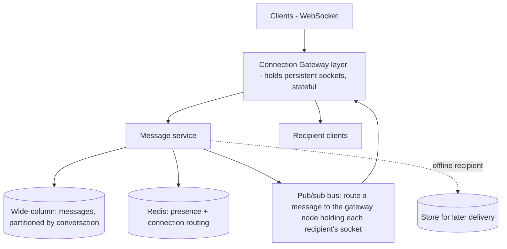
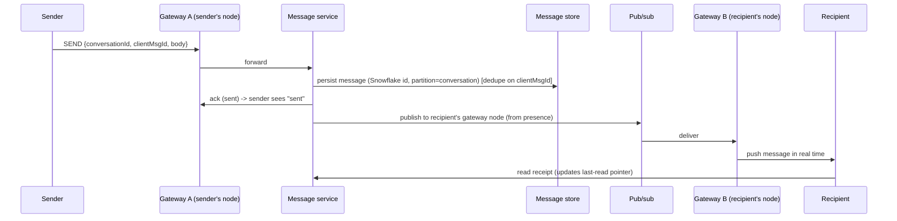

# Design a Chat / Messaging System

> Difficulty: Intermediate→Advanced · Core SDE-2 problem
> Related concepts: [stateless-vs-stateful-services](../02-compute-and-architecture/stateless-vs-stateful-services.md) (WebSocket layer) · [sql-vs-document-vs-key-value-vs-wide-column](../03-databases-and-data-modeling/sql-vs-document-vs-key-value-vs-wide-column.md) · [ordering-and-consumer-groups](../05-messaging-and-event-driven-systems/ordering-and-consumer-groups.md)

Chat tests real-time delivery (WebSockets — a stateful layer), huge write volume (wide-column store), per-conversation ordering, and fan-out. A rich, frequently-asked design.

---

## A. Problem statement

Build a messaging system for 1:1 and group chats: send/receive messages in real time, message history, delivery/read receipts, online presence, and offline delivery (messages sent while a user is offline are delivered on reconnect).

## B. Requirement clarification

**Functional:** 1:1 and group chat; real-time delivery; persistent history; delivery + read receipts; online presence; offline users receive on reconnect; (optionally) media messages.
**Non-functional (ask):**
- Scale? → DAU, messages/day, group sizes. Assume **50M DAU, 40 msgs/user/day**.
- Latency? → real-time (**sub-second** delivery).
- Ordering? → messages within a conversation must be **in order**.
- Delivery guarantee? → don't lose messages; at-least-once + dedupe (duplicates annoying but acceptable; loss not).
- Group size? → cap (e.g., 500) or support huge broadcast channels? Assume capped groups + separate handling for huge channels.
**Scope:** send/deliver/store/presence/receipts. **Non-goals:** voice/video calls, end-to-end encryption details (mention).
**Assumptions:** 50M DAU, 40 msgs/day → 2B msgs/day, capped groups, per-conversation ordering, at-least-once + dedupe.

## C. Scale estimation

- **Messages:** 2B/day ≈ **~23,000 writes/sec** average; peak (×3) ≈ **~70,000 writes/sec** — huge write volume → write-optimized store.
- **Storage:** 2B × 200 bytes × 365 × 3 replication ≈ **~438 TB/year** → far beyond one node → **sharded, wide-column store** (see [sql-vs-document-vs-key-value-vs-wide-column](../03-databases-and-data-modeling/sql-vs-document-vs-key-value-vs-wide-column.md)).
- **Connections:** 50M DAU, say 10M concurrent → **10M persistent WebSocket connections** → a dedicated, horizontally-scaled connection layer.
- **Fan-out:** a group message fans out to all members.
- **Implication:** write-heavy + massive persistent connections + ordering → wide-column store (Cassandra) + a stateful WebSocket gateway layer + per-conversation ordering.

## D. API / protocol

- **WebSocket** (persistent connection) for real-time send/receive (not request/response HTTP — see protocol choice below).
- Messages over the socket: `{type: SEND, conversationId, clientMsgId, body}` → server assigns a server message id + timestamp, persists, delivers.
- **REST** for history/pagination: `GET /conversations/{id}/messages?cursor=&limit=` (cursor pagination — see [pagination-filtering-and-sorting](../01-networking-and-api-design/pagination-filtering-and-sorting.md)).
- `clientMsgId` for **idempotency/dedupe** (resend on reconnect doesn't duplicate).

## E. Data modeling

- **Messages (wide-column, e.g., Cassandra):** partition by `conversation_id`, clustered by `(timestamp, message_id)` → a conversation's messages co-located and ordered; recent-messages reads are single-partition (the common access pattern). Append-heavy writes → LSM engine fits (see [database-internals-for-system-design](../03-databases-and-data-modeling/database-internals-for-system-design.md)).
- **Message id:** Snowflake-style (time-ordered, unique, no central bottleneck — see [id-generation-and-sequences](../06-distributed-systems/id-generation-and-sequences.md)) → gives ordering within a partition.
- **Conversations/membership (relational):** who's in which conversation, roles.
- **Presence (in-memory KV, Redis):** userId → online status + which connection node they're on; ephemeral, TTL'd via heartbeats.
- **Per-user inbox / delivery pointers:** track last-delivered/last-read per user per conversation (receipts + offline delivery).

## F. High-level architecture

Key components:
- **Connection gateway (stateful):** holds the millions of persistent WebSocket connections. This is the *stateful* layer (see [stateless-vs-stateful-services](../02-compute-and-architecture/stateless-vs-stateful-services.md)) — a user's socket lives on a specific gateway node; presence/routing tracks which node. Scaled horizontally with connection affinity.
- **Message service (stateless):** validates, assigns id (Snowflake), persists to the wide-column store, routes delivery.
- **Pub/sub bus:** routes a message to the gateway node(s) holding the recipients' sockets (since the sender's gateway node ≠ recipient's node). This is how messages cross nodes.
- **Presence (Redis):** who's online + which gateway node, via heartbeats.
- **Offline delivery:** if a recipient is offline, the message is persisted; on reconnect, the client fetches messages since its last-delivered pointer.

## G. Critical data flows

**Send a 1:1 message:**

- **Ordering:** per-conversation partition + Snowflake ids → messages ordered within the conversation.
- **Dedupe:** `clientMsgId` prevents a resend (on reconnect/retry) from duplicating.
- **Offline recipient:** skip the pub/sub push; the message is persisted; on reconnect, B fetches messages since its last-delivered pointer.

**Group message:** fan out to all members' gateway nodes via pub/sub (for online members) + persist for offline members to fetch.

## H. Bottleneck analysis

- **Persistent connections (10M+):** the connection gateway is the scaling challenge — horizontally scale gateway nodes, each handling a slice of connections; presence tracks routing. Connection count, not RPS, is the pressure.
- **Write volume (~70K/sec peak):** wide-column store sharded by conversation handles it (LSM write path); a single relational primary could not.
- **Hot conversation (huge group / viral channel):** a hot partition (see [ordering-and-consumer-groups](../05-messaging-and-event-driven-systems/ordering-and-consumer-groups.md)) — fan-out amplifies; mitigate with a separate broadcast path for very large channels (don't fan out per-member synchronously; let clients pull).
- **Fan-out for large groups:** write amplification; cap group size or use pull-based delivery for huge channels.
- **Cross-node routing:** the pub/sub bus must efficiently route to the right gateway node (presence lookup).

## I. Failure handling

- **Message not lost:** persisted before/at ack; at-least-once delivery; dedupe on clientMsgId.
- **Gateway node crash:** its connections drop; clients reconnect (to another node); on reconnect they fetch missed messages since their last-delivered pointer (offline delivery path handles this). Presence updated.
- **Recipient offline:** persist + deliver on reconnect (not lost).
- **Duplicate on reconnect/retry:** clientMsgId dedupe.
- **Ordering under redelivery:** per-conversation ordering + message ids let the client order/dedupe.
- **Presence stale (node died):** heartbeat TTL expires → presence corrected.

## J. Trade-offs and alternatives

| Decision | Chosen | Alternative | Why |
|---|---|---|---|
| Transport | WebSocket (persistent) | HTTP polling | Real-time push; polling is wasteful/high-latency (see [webhooks-and-callbacks](../01-networking-and-api-design/webhooks-and-callbacks.md)) |
| Message store | Wide-column (Cassandra), partition by conversation | Relational | ~70K writes/sec + 438 TB/yr; relational can't; access pattern is recent-per-conversation |
| Connection layer | Dedicated stateful gateway + pub/sub routing | Stateless everywhere | Connections are inherently stateful; isolate statefulness, keep the rest stateless |
| Delivery | At-least-once + clientMsgId dedupe | Exactly-once | Delivery exactly-once is a myth; dedupe gives effectively-once |
| Large groups | Pull-based for huge channels | Fan-out per member | Avoid hot-partition/write-amplification for broadcast channels |

## K. Security and observability

- **AuthZ:** only conversation members can send/read; checked per message.
- **E2E encryption** (optional, mention): the server routes ciphertext; it can't read messages — adds key-management complexity.
- **Abuse:** rate-limit messages per user (spam); block/report.
- **Observability:** connection count per gateway, message send/deliver latency, delivery success rate, presence accuracy, hot-conversation metrics, store write latency/lag.

## L. Evolution of the design

- **Small:** a single server with WebSockets + a relational DB (fine for thousands of users).
- **Growth:** scale the connection gateway + pub/sub routing; move messages to a wide-column store as write volume grows.
- **Scale:** shard by conversation; handle hot conversations/large groups with pull-based delivery; presence in Redis cluster.
- **Advanced:** multi-region (route users to a nearby gateway; cross-region message routing), media messages (object storage + CDN — see [image-and-video-processing](../10-storage-and-content-delivery/image-and-video-processing.md)), typing indicators/presence at scale (ephemeral, high write amplification — the assessment in [INTERVIEW-CHECKLIST](../INTERVIEW-CHECKLIST.md)).

## M. Interview walkthrough (abbreviated)

**I:** "Design a chat system." **C:** "Clarify: 1:1 and groups, scale, latency, ordering, delivery guarantee, group sizes?" **I:** [the assumptions]. **C:** "~2B messages/day = ~23K writes/sec avg, ~70K peak, ~438 TB/year — far beyond one relational node, so a wide-column store (Cassandra) partitioned by conversation_id, which also gives per-conversation ordering and single-partition recent-message reads. ~10M concurrent connections → a dedicated stateful WebSocket gateway layer; the sender's gateway node differs from the recipient's, so a pub/sub bus routes each message to the recipient's gateway node, looked up via presence in Redis."
**C:** "Send: persist the message (Snowflake id for ordering, dedupe on clientMsgId), ack the sender, then pub/sub to the recipient's node → real-time push. If the recipient is offline, persist and deliver on reconnect via their last-delivered pointer — so no messages are lost. At-least-once + clientMsgId dedupe gives effectively-once."
**I:** "A gateway node crashes." **C:** [reconnect + fetch-missed answer]. **I:** "A 100K-member broadcast channel." **C:** [pull-based delivery to avoid hot-partition fan-out].

## N. Follow-up questions (with model answers)

1. **WebSocket vs polling?** → WebSocket for real-time push with a persistent connection; polling is wasteful and higher-latency.
2. **Why a wide-column store for messages?** → ~70K writes/sec + hundreds of TB/year; append-heavy with a recent-per-conversation access pattern — Cassandra's LSM write path + conversation partitioning fits; a relational primary can't take the write volume.
3. **How is ordering guaranteed?** → Partition by conversation_id + Snowflake (time-ordered) message ids → ordered within a conversation; clients order/dedupe by id.
4. **How are offline users handled?** → Messages are persisted; each user has a last-delivered pointer; on reconnect they fetch messages since it. Not lost.
5. **How does a message reach a recipient on a different gateway node?** → Presence (Redis) maps recipient → gateway node; a pub/sub bus routes the message to that node, which pushes it over the socket.
6. **A gateway node dies — what happens?** → Its sockets drop; clients reconnect (to another node) and fetch missed messages via their pointer; presence TTL corrects routing.
7. **Duplicate messages on reconnect?** → clientMsgId dedupe at persist time → no duplicate stored/delivered.
8. **How do you handle a huge group / broadcast channel (hot partition)?** → Pull-based delivery (clients poll recent messages) rather than per-member fan-out; separate the broadcast path from normal chats to avoid hot-partition write amplification.
9. **Presence at scale?** → Redis with heartbeats + TTL; it's ephemeral and tolerant of some staleness (eventual).
10. **Read receipts?** → Per-user last-read pointer per conversation; updating it emits a receipt event to the sender.
11. **How do you scale 10M+ persistent connections?** → Horizontally scale the stateful gateway layer (each node holds a slice), with connection affinity and presence-based routing; keep the message service stateless.
12. **Exactly-once delivery?** → Not possible at the delivery layer; at-least-once + clientMsgId dedupe → effectively-once (see [exactly-once-processing](../06-distributed-systems/exactly-once-processing.md)).
13. **Media messages?** → Upload to object storage (pre-signed URL), send a message referencing the object key, serve via CDN (see [image-and-video-processing](../10-storage-and-content-delivery/image-and-video-processing.md)).
14. **End-to-end encryption?** → The server routes ciphertext (can't read); clients manage keys — adds key-exchange/management complexity; the server loses the ability to search/scan content.
15. **Multi-region?** → Route users to a nearby gateway; cross-region message routing for conversations spanning regions (eventual cross-region, see [multi-region-architecture](../06-distributed-systems/multi-region-architecture.md)).

## O. Common mistakes

- Treating it as stateless HTTP request/response (missing the persistent-connection/WebSocket + stateful gateway reality).
- A relational DB for messages at scale (can't take ~70K writes/sec / hundreds of TB).
- Not partitioning messages by conversation (loses ordering + single-partition reads).
- Per-member synchronous fan-out for huge groups (hot partition / write amplification).
- No offline-delivery mechanism (messages lost when a recipient is offline).
- No dedupe (clientMsgId) → duplicate messages on reconnect.
- Claiming exactly-once delivery.

## P. Practice exercise

Design the **presence + typing-indicator subsystem** at massive fan-out (who's online, who's typing, shown to all conversation members in real time). This is ephemeral, extremely high-write, loss-tolerant state. How do you avoid write amplification (a typing event to a 500-member group), what store/TTL do you use, and how do you keep it from overwhelming the message pipeline? Compare with the presence assessment in [INTERVIEW-CHECKLIST](../INTERVIEW-CHECKLIST.md).
