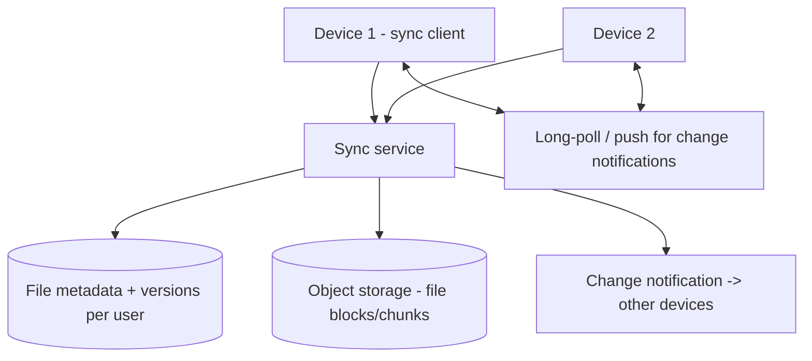
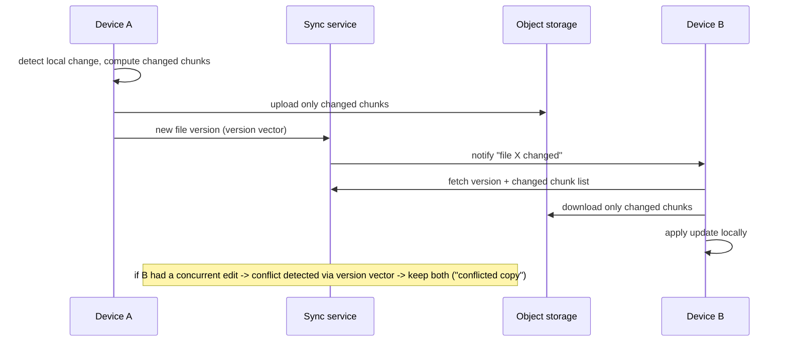

# Design a Cloud File Sync Service

> Difficulty: Advanced
> Related: [file-storage-service](./file-storage-service.md) (the storage base) · [06-distributed-systems/clock-skew-and-logical-clocks](../06-distributed-systems/clock-skew-and-logical-clocks.md) · [03-databases/consistency-models](../03-databases-and-data-modeling/consistency-models.md)

A Dropbox/Google-Drive *sync* service (not just storage): keep files consistent across a user's multiple devices, syncing changes efficiently and resolving conflicts. Builds on [file-storage-service](./file-storage-service.md), adding the hard sync + conflict-resolution problem.

> Extends [file-storage-service](./file-storage-service.md) (storage/metadata/upload). Here we focus on the *sync* problem across devices.

## A. Problem statement
A user has files on multiple devices (laptop, phone, desktop). When a file changes on one device, propagate the change to the others efficiently, handle offline edits, and resolve conflicts (two devices edit the same file).

## B. Requirements
**Functional:** sync file changes across a user's devices; efficient sync (don't re-upload whole files for small edits); offline edits sync on reconnect; conflict detection + resolution.
**Non-functional (ask):** efficiency (bandwidth — large files, small edits); scale (users × devices × files); consistency (eventual across devices; detect conflicts); offline support.
**Assumptions:** multiple devices per user, offline edits, efficient delta sync, conflict handling.

## C. Estimation
- The storage side is [file-storage-service](./file-storage-service.md) (object storage + metadata). The *sync* adds: change notifications per device, delta transfer, and version/conflict tracking.
- Efficient sync (deltas, not whole files) is critical for bandwidth with large files + frequent small edits.

## D. Architecture

- **Sync clients** on each device watch local changes and talk to the sync service.
- **Chunking + content-addressed storage:** files are split into chunks (content-hashed); only *changed chunks* are uploaded/downloaded (delta sync) — efficient for small edits to large files (see [file-storage-service](./file-storage-service.md) dedup). This also dedups identical chunks.
- **Change notification:** when one device uploads a change, notify the user's other devices (push/long-poll) to pull it.
- **Version/conflict tracking:** per-file version vectors / revision history to detect concurrent edits.

## E. The core: efficient sync + conflict resolution
1. **Delta/chunk sync:** split files into chunks; sync only changed chunks (not the whole file) — critical bandwidth optimization for large files. Content-addressed chunks also dedup.
2. **Change propagation:** device A uploads changed chunks + new file version → the service notifies devices B, C → they pull the changed chunks and update locally.
3. **Conflict resolution (the hard part):** two devices edit the same file while offline → both have a new version of the same base. Detect via **version vectors** (not wall-clock timestamps — clock skew would mis-resolve, see [clock-skew-and-logical-clocks](../06-distributed-systems/clock-skew-and-logical-clocks.md)). Resolve by: keeping both versions (create a "conflicted copy" — Dropbox's approach, safe/no data loss) or last-writer-wins (risky — can lose edits). Eventual consistency across devices (see [consistency-models](../03-databases-and-data-modeling/consistency-models.md)).

## F. Critical flow — edit on one device

## G. Bottlenecks
- **Bandwidth (large files, small edits):** chunk/delta sync — upload/download only changed chunks (not whole files); content-dedup chunks.
- **Change notification fan-out:** notify a user's devices efficiently (push/long-poll); scale per user (few devices).
- **Conflict detection:** version vectors per file; conflict rate is usually low but must be handled safely.
- **Many files/metadata:** sharded by user (like [file-storage-service](./file-storage-service.md)).

## H. Failure handling
- **Offline edits:** queued locally; synced on reconnect; conflicts detected via version vectors.
- **Conflict:** keep both versions ("conflicted copy") — no data loss (the safe default); or LWW (riskier). Never silently lose an edit via wall-clock LWW (clock skew — see [clock-skew-and-logical-clocks](../06-distributed-systems/clock-skew-and-logical-clocks.md)).
- **Interrupted sync:** resumable chunk transfer (re-sync only missing chunks).
- **Partial upload:** version isn't committed until all chunks are uploaded (status lifecycle).

## I. Trade-offs
| Decision | Chosen | Why |
|---|---|---|
| Sync granularity | Chunk/delta (changed chunks only) | Bandwidth efficiency for large files + small edits; dedup |
| Conflict detection | Version vectors | Clock-skew-safe; detects concurrent edits (not wall-clock LWW) |
| Conflict resolution | Keep both ("conflicted copy") | No data loss (safe); LWW risks losing edits |
| Consistency | Eventual across devices | Devices converge; detect/resolve conflicts |
| Change propagation | Push/long-poll notifications | Timely sync without constant polling |

## J. Follow-ups
1. **How do you sync efficiently for a small edit to a large file?** → Chunk the file (content-addressed); sync only the changed chunks (delta sync), not the whole file — a major bandwidth win; chunks also dedup.
2. **How do you detect conflicts (two devices edit the same file)?** → Version vectors per file (not wall-clock timestamps — clock skew would mis-resolve); concurrent edits show as non-dominating versions.
3. **How do you resolve a conflict?** → Keep both versions ("conflicted copy") — the safe, no-data-loss default; LWW risks silently losing an edit (especially with clock skew).
4. **Why not last-writer-wins by timestamp?** → Clock skew across devices means the "later" timestamp isn't reliably the later edit → silent data loss. Use version vectors (see [clock-skew-and-logical-clocks](../06-distributed-systems/clock-skew-and-logical-clocks.md)).
5. **Offline edits?** → Queued locally; synced on reconnect; conflicts detected via version vectors on sync.
6. **How are other devices notified of a change?** → The sync service pushes/long-polls a "file changed" notification to the user's other devices, which pull the changed chunks.
7. **Interrupted sync?** → Resumable chunk transfer — re-sync only missing chunks (not restart the whole file).
8. **Consistency model?** → Eventual across devices (they converge); conflicts detected and resolved; it's not strongly consistent in real time.
9. **How does this build on file storage?** → Storage/metadata/upload is [file-storage-service](./file-storage-service.md); sync adds chunking/delta, change notification, version vectors, and conflict resolution.
10. **How do you dedup across users (identical chunks)?** → Content-addressed chunks (by hash) can dedup globally — saves storage; handle privacy/security of cross-user dedup carefully.

## K. Common mistakes
Re-uploading whole files on small edits (bandwidth waste — use delta/chunk sync); wall-clock last-writer-wins (clock-skew data loss); silently discarding a conflicting edit (keep both); non-resumable sync; not detecting conflicts (version vectors needed).

## L. Practice exercise
Design the **conflict-resolution engine** in detail: two devices edit the same document offline, then both come online. Walk through version-vector detection, the "conflicted copy" resolution, and how you'd handle a three-way conflict. When might you use operational transforms / CRDTs instead (for real-time collaborative editing)? Compare with [clock-skew-and-logical-clocks](../06-distributed-systems/clock-skew-and-logical-clocks.md).
