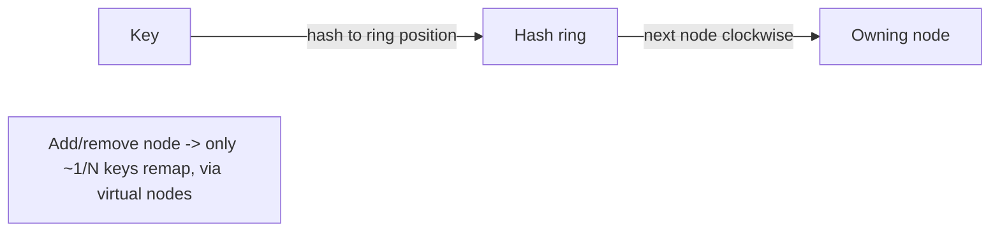
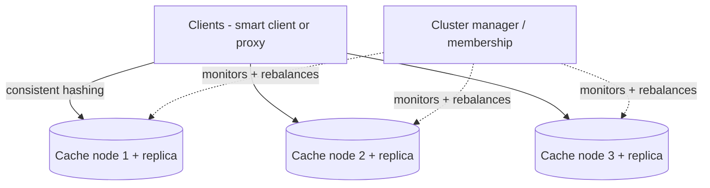

# Design a Distributed Cache

> Difficulty: Intermediate→Advanced
> Related: [04-caching](../04-caching/caching-fundamentals.md) (whole section) · [04-caching/redis-design-and-failure-modes](../04-caching/redis-design-and-failure-modes.md) · [03-databases/partitioning-and-sharding](../03-databases-and-data-modeling/partitioning-and-sharding.md) (consistent hashing)

Design the cache itself (a Redis/Memcached-like system), not just use one. Tests consistent hashing, replication/failover, eviction, and the hot-key problem from the *implementer's* side.

## A. Problem statement
Build a distributed in-memory key-value cache: get/put by key, low latency, scalable across many nodes, with eviction and fault tolerance.

## B. Requirements
**Functional:** get/put/delete by key; TTL; eviction when full.
**Non-functional (ask):** scale (keys, ops/sec, total memory beyond one node); latency (sub-ms); availability (node failures tolerated); consistency (is stale OK? usually yes — it's a cache); durability (usually none — it's a cache, source of truth elsewhere).
**Assumptions:** many nodes, sub-ms, tolerate node failure, cache (lossy OK), eventual consistency fine.

## C. Estimation
- Memory beyond one node (TB-scale cache) → shard across nodes.
- Ops/sec beyond one node (millions) → distribute load.
- Each node ~100K+ ops/sec, tens–hundreds of GB RAM (heuristic).

## D. API
`GET key`, `PUT key value [ttl]`, `DELETE key`. Clients talk to the cluster; a routing layer (or smart client) maps keys to nodes.

## E. Data distribution — consistent hashing
The core design decision: how to map keys to nodes so that adding/removing a node moves minimal keys.
- **Naive `hash(key) % N`:** adding/removing a node changes N → nearly *all* keys remap (cache-wide miss storm). Bad.
- **Consistent hashing:** nodes and keys placed on a hash ring; a key goes to the next node clockwise. Adding/removing a node remaps only ~1/N of keys (its neighbors), not all (see [partitioning-and-sharding](../03-databases-and-data-modeling/partitioning-and-sharding.md)). **Virtual nodes** (each physical node = many ring points) smooth distribution and avoid hot spots.

## F. Architecture

- **Smart client or proxy** computes the owning node via consistent hashing (client-side avoids a proxy hop; proxy centralizes logic).
- **Replication:** each shard has replicas for availability (failover on node death); async replication (lossy OK for a cache).
- **Cluster membership:** detect node join/leave (gossip/coordination service), trigger minimal rebalancing.
- **Eviction** per node (LRU/LFU) + TTL (see [ttl-eviction-and-memory-management](../04-caching/ttl-eviction-and-memory-management.md)).

## G. Critical flow
GET: client hashes key → routes to owning node → returns value or miss. Node add: it joins the ring, takes ~1/N keys from neighbors (which repopulate lazily on miss — it's a cache). Node death: its replica is promoted; the ring routes around it.

## H. Bottlenecks
- **Hot key:** one key = one node (consistent hashing) → that node overloaded. Mitigate: replicate the hot key across nodes, client-side caching of hot keys, or key splitting (same hot-key problem as [stampedes-hot-keys-and-penetration](../04-caching/stampedes-hot-keys-and-penetration.md)).
- **Rebalancing storms:** adding/removing nodes remaps keys; consistent hashing + virtual nodes minimize this; still a transient miss bump (cold new node).
- **Uneven distribution:** without virtual nodes, keys cluster unevenly → virtual nodes smooth it.
- **Memory per node:** eviction + sizing to the working set.

## I. Failure handling
- **Node death:** replica promoted; ring routes around it; lost keys (if un-replicated) repopulate lazily (it's a cache — source of truth elsewhere).
- **Network partition:** a partitioned node is treated as down; clients route to replicas (AP-leaning — stale/missing is acceptable for a cache).
- **Rebalance:** gradual key movement; new node serves misses from the source until warm.
- **Hot key:** replicate/split (above).

## J. Trade-offs
| Decision | Chosen | Why |
|---|---|---|
| Key distribution | Consistent hashing + virtual nodes | Minimal remap on membership change; even distribution |
| Routing | Smart client or proxy | Client avoids a hop; proxy centralizes logic |
| Replication | Async replicas (lossy) | Availability; durability not needed (it's a cache) |
| Consistency | Eventual (AP-leaning) | Cache tolerates staleness/misses |
| Hot key | Replicate/split hot keys | One key = one node otherwise |

## K. Follow-ups
1. **Why consistent hashing, not `hash % N`?** → `hash % N` remaps nearly all keys when N changes (cache-wide miss storm); consistent hashing remaps only ~1/N (the new node's neighbors).
2. **What are virtual nodes?** → Each physical node occupies many ring positions → smoother key distribution and less imbalance/hot-spotting when nodes change.
3. **How do you handle a hot key (one key, one node)?** → Replicate the hot key across nodes, client-side cache it, or split it — a single key can't be spread by hashing alone.
4. **A node dies — what happens?** → Its replica is promoted; the ring routes around it; un-replicated keys repopulate lazily (it's a cache). AP-leaning.
5. **How do you route a key to its node?** → Smart client (computes the ring position, no proxy hop) or a proxy layer (centralized routing).
6. **Rebalancing when adding a node?** → It takes ~1/N keys from ring neighbors; those keys repopulate lazily on miss; a transient miss bump as the new node warms.
7. **Replication consistency?** → Async (lossy) is fine for a cache; a brief loss window on failover is acceptable since the source of truth is elsewhere.
8. **Eviction?** → Per-node LRU/LFU + TTL; size to the working set (see [ttl-eviction-and-memory-management](../04-caching/ttl-eviction-and-memory-management.md)).
9. **How is this different from using Redis?** → This *is* building a Redis-like system; the design decisions (consistent hashing, replication/failover, eviction) are what Redis Cluster implements. Interviewers test whether you understand the mechanisms.
10. **Partition behavior?** → AP-leaning: a partitioned node is treated as down, clients use replicas; stale/missing cache data is acceptable.

## L. Common mistakes
`hash % N` (remap storm on membership change); no virtual nodes (uneven distribution/hot spots); ignoring the hot-key problem; expecting strong consistency/durability from a cache; no replication (node death = large cold miss burst).

## M. Practice exercise
Design the cache's **cluster membership + rebalancing** in detail: how nodes detect each other (gossip vs coordination service), how a node join triggers minimal key movement (consistent hashing), and how you avoid a thundering-herd of misses when a cold node joins. Compare with [redis-design-and-failure-modes](../04-caching/redis-design-and-failure-modes.md).
