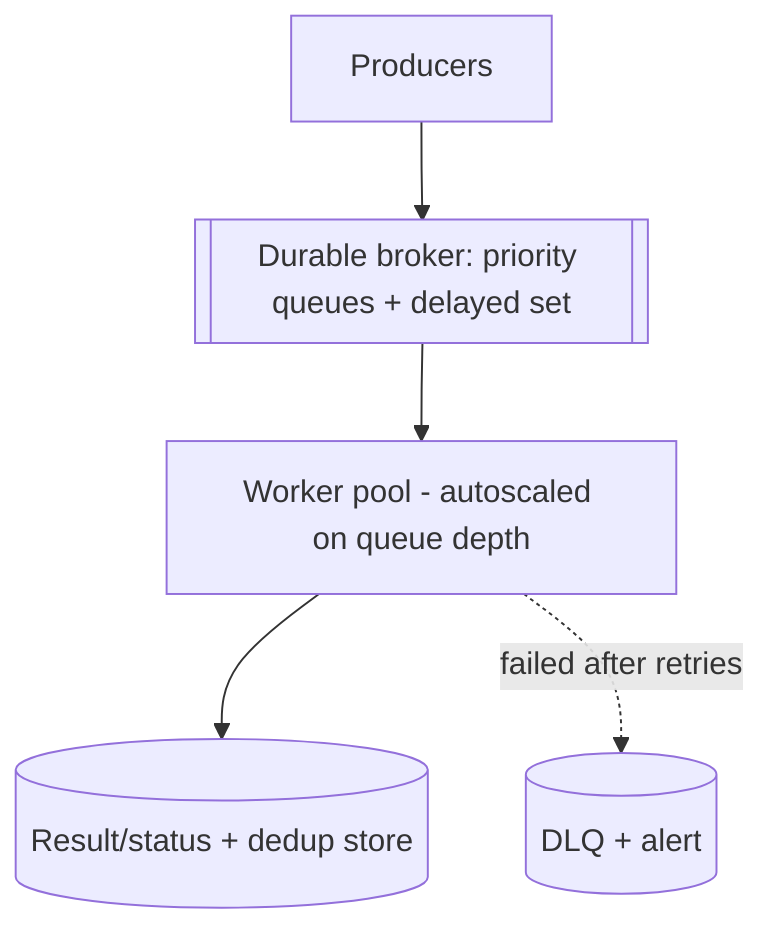

# Design a Distributed Task Queue

> Difficulty: Intermediate
> Related: [05-messaging](../05-messaging-and-event-driven-systems/queues-vs-pub-sub-vs-event-streams.md) (whole section) · [05-messaging/dead-letter-queues](../05-messaging-and-event-driven-systems/dead-letter-queues.md) · [05-messaging/backpressure-and-consumer-lag](../05-messaging-and-event-driven-systems/backpressure-and-consumer-lag.md)

A system (Celery/Sidekiq-style) for enqueuing background tasks and executing them on workers, with retries, priorities, scheduling, and reliability. Ties together most of the messaging section.

## A. Problem statement
Let applications enqueue background tasks (send email, generate a report, process an upload) and have workers execute them reliably — with retries, priorities, delayed/scheduled tasks, and no lost or duplicated effects.

## B. Requirements
**Functional:** enqueue tasks; workers execute; retries with backoff; priorities; delayed/scheduled tasks; DLQ; status/result tracking.
**Non-functional (ask):** scale (tasks/sec); delivery guarantee (at-least-once → idempotent tasks); ordering (per-key where needed); durability (don't lose tasks).
**Assumptions:** high task volume, at-least-once + idempotent tasks, priorities, durable.

## C. Estimation
- Task volume spikes (batch jobs); peak tasks/sec drives worker count. Tasks are small; the pressure is throughput + reliable execution.

## D. API
```
POST /tasks { type, payload, priority?, delay?, idempotencyKey } -> {taskId}
GET /tasks/{id} -> status/result
```

## E. Data model
- Tasks on durable queues (persisted), one queue per priority (or a priority field). Delayed tasks in a scheduled set (released when due — like [job-scheduler](./job-scheduler.md)).
- Dedup/result store keyed by task id / idempotency key.

## F. Architecture

- **Durable broker** (RabbitMQ/SQS/Redis-with-persistence/Kafka) persists tasks so a broker/worker restart doesn't lose them.
- **Workers** pull tasks, execute idempotently (dedup on task id), ack on success; autoscale on queue depth (see [backpressure-and-consumer-lag](../05-messaging-and-event-driven-systems/backpressure-and-consumer-lag.md)).
- **Priorities:** separate high/low queues (high drained first) so urgent tasks don't wait behind bulk ones.
- **Delayed/scheduled:** a scheduled set releases tasks to the queue when due.
- **Retries + DLQ:** backoff+jitter; poison tasks → DLQ (see [dead-letter-queues](../05-messaging-and-event-driven-systems/dead-letter-queues.md)).

## G. Critical flow — at-least-once + idempotency
Enqueue (durable) → worker pulls → executes → on success, record result + ack; on failure, retry with backoff; after N, DLQ. A worker crash before ack → redelivery (at-least-once) → idempotent execution (dedup on task id) makes the re-run safe → effectively-once (see [message-delivery-semantics](../05-messaging-and-event-driven-systems/message-delivery-semantics.md)).

## H. Bottlenecks
- **Spike / consumer lag:** autoscale workers on queue depth; shed/deprioritize low-priority tasks (see [backpressure-and-consumer-lag](../05-messaging-and-event-driven-systems/backpressure-and-consumer-lag.md)).
- **Poison tasks:** retry limit → DLQ (avoid head-of-line blocking).
- **Downstream limits:** tasks hitting an external API/DB → concurrency limiter so recovery doesn't overwhelm it.
- **Priority starvation:** ensure low-priority tasks eventually run (don't starve them completely).

## I. Failure handling
- **Worker crash:** visibility timeout re-queues the task → idempotent re-run.
- **Broker outage:** durable persistence; HA broker (replication/failover).
- **Poison task:** DLQ + alert; inspect/replay after fix (idempotent → safe replay).
- **Duplicate effect:** idempotency (dedup on task id).

## J. Trade-offs
| Decision | Chosen | Why |
|---|---|---|
| Delivery | At-least-once + idempotent | Exactly-once impossible; idempotency → effectively-once |
| Broker | Durable (persisted) | Don't lose tasks on restart |
| Priorities | Separate queues | Urgent tasks not blocked by bulk |
| Backlog | Autoscale + shed low-priority | Absorb/recover spikes |
| Poison | Retry limit → DLQ | Avoid head-of-line blocking |

## K. Follow-ups
1. **How do you guarantee a task isn't lost?** → Durable (persisted) broker + at-least-once delivery (ack after success) + HA broker.
2. **How do you prevent double execution of a task?** → Idempotent tasks keyed by task id / idempotency key (dedup before the effect); at-least-once + idempotency = effectively-once.
3. **A worker crashes mid-task?** → Visibility timeout re-queues it; idempotent execution re-runs safely.
4. **Priorities?** → Separate high/low queues (drain high first); guard against starving low-priority tasks.
5. **Delayed/scheduled tasks?** → A scheduled set releases tasks when due (like a job scheduler).
6. **Poison task?** → Retry with backoff; after N attempts → DLQ + alert; pipeline keeps flowing.
7. **Spike in tasks?** → Autoscale workers on queue depth; shed/deprioritize low-priority; limit concurrency to downstream dependencies.
8. **Which broker?** → RabbitMQ for rich routing/priorities + per-message ack; SQS for managed simplicity; Kafka if you need replay/multiple consumers (see [rabbitmq vs kafka](../05-messaging-and-event-driven-systems/rabbitmq-internals-and-routing.md)).
9. **Ordering?** → Per-key ordering via keyed partitions where needed (most background tasks don't need ordering).
10. **How is this different from a job scheduler?** → Overlapping; a task queue focuses on immediate background execution + retries/priorities; a scheduler focuses on time-based triggering. They compose (scheduler enqueues to a task queue).

## L. Common mistakes
Non-durable broker (lost tasks on restart); non-idempotent tasks (double effects on redelivery); no DLQ (poison tasks block); no backpressure/priority under spikes; no visibility timeout (lost in-flight tasks on crash).

## M. Practice exercise
Design the task queue to support **task chains and fan-out** (task A, on success, triggers B and C; results aggregated). How do you track chain state, handle a mid-chain failure (compensate/retry), and keep each step idempotent? Compare with [saga-pattern](../05-messaging-and-event-driven-systems/saga-pattern.md).
