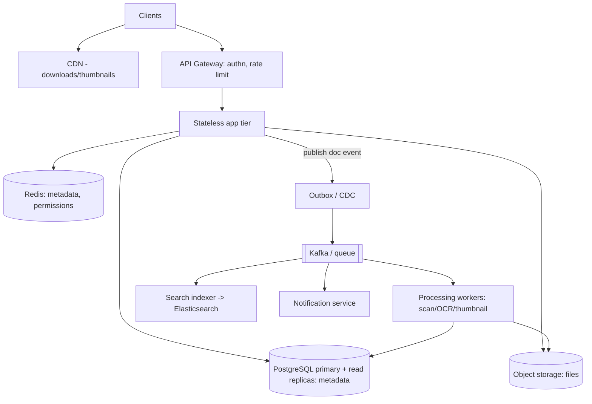
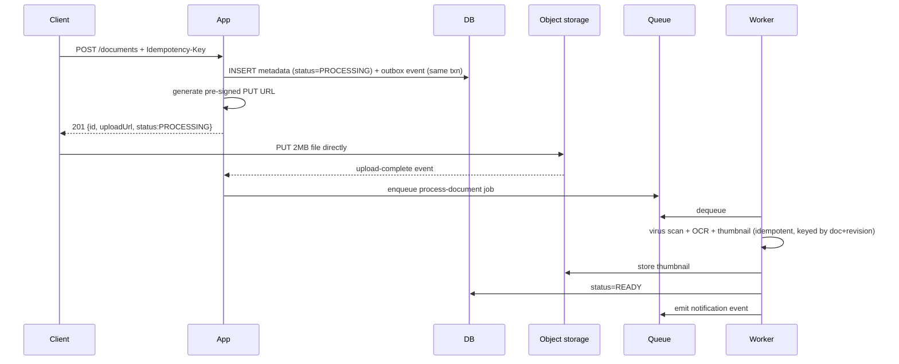

# Design a Document Management System (DMS)

> Difficulty: Intermediate · Core SDE-2 problem · **The repository's running example**
> Related concepts: [architecture-fundamentals](../00-foundations/architecture-fundamentals.md) (full scaling journey) · [object-storage-and-file-uploads](../10-storage-and-content-delivery/object-storage-and-file-uploads.md) · [multi-tenant-isolation](../08-security/multi-tenant-isolation.md) · [search-indexing-and-search-engines](../10-storage-and-content-delivery/search-indexing-and-search-engines.md)

This is the system used as the running example throughout the repository, so this design ties together nearly every concept. It maps directly to your background (enterprise workflows, documents, async processing, notifications).

---

## A. Problem statement

Build a multi-tenant system where users upload documents, store versions (revisions), download, search by metadata/content, share with permissions, and get notified when background processing (virus scan, OCR, thumbnail) completes.

## B. Requirement clarification

**Functional:** upload documents (2MB avg); versioning (revisions); download; metadata + full-text search; share with roles (OWNER/EDITOR/VIEWER); background processing (scan/OCR/thumbnail); notify owner on completion. Multi-tenant (companies).
**Non-functional (ask) → assumed answers:**
- Scale: **100K users, 50M documents**, 20:1 read:write.
- Avg document 2MB; metadata ~1KB.
- Latency: metadata reads **p99 < 200ms**; downloads can be slower.
- Consistency: **read-your-write** for a just-uploaded doc; search can lag a few seconds.
- Durability: **files must never be lost** (legal/compliance).
- Multi-tenant isolation: one tenant must never see another's documents.
**Scope:** upload/download/metadata/search/share/notify. **Non-goals:** real-time collaborative editing, billing, the web UI.
**Assumptions:** single region to start; enterprise multi-tenant.

## C. Scale estimation

(From [back-of-the-envelope-estimation](../00-foundations/back-of-the-envelope-estimation.md).)
- **Uploads:** 100K users × 5 docs/month ≈ 500K/month ≈ **~0.2 writes/sec** avg — tiny. Peak maybe ~a few/sec.
- **Reads (20:1):** modest — low hundreds of RPS at peak. **Keep it simple.**
- **File storage:** 500K/month × 2MB = 1 TB/month → 5 years = 60 TB → ×3 replication = **~180 TB** → **object storage** (not a DB).
- **Metadata:** 500K/month × 1KB × 60 months × 3 = **~90 GB** → **single SQL node** for years (no sharding).
- **Implication:** modest RPS (simple architecture); 2000× storage difference between files (180 TB) and metadata (90 GB) → **files in object storage, metadata in SQL** — the defining architectural decision.

## D. API design

```
POST   /documents            -> create metadata + pre-signed upload URL (201, status PROCESSING)
GET    /documents/{id}       -> metadata
GET    /documents?owner=&status=&cursor=&limit=  -> paginated list (cursor)
POST   /documents/{id}/revisions -> new revision (pre-signed URL)
GET    /documents/{id}/download  -> pre-signed download URL (or CDN)
GET    /search?q=&cursor=    -> full-text/metadata search
POST   /documents/{id}/shares -> grant (user, role)
DELETE /documents/{id}       -> soft-delete
```
- **Pre-signed URLs** so 2MB files go directly to/from object storage, not through the app (see [object-storage-and-file-uploads](../10-storage-and-content-delivery/object-storage-and-file-uploads.md)).
- `POST /documents` uses an **idempotency key** (retry-safe).
- **Cursor pagination** (large lists — see [pagination-filtering-and-sorting](../01-networking-and-api-design/pagination-filtering-and-sorting.md)).
- Every endpoint enforces **authn + resource authz + tenant scoping** (see [authentication-and-authorization](../01-networking-and-api-design/authentication-and-authorization.md)).

## E. Data modeling

```
tenants(id, ...)
users(id, tenant_id, ...)
documents(id, tenant_id, owner_id, name, status, latest_revision_no, created_at, deleted_at)
revisions(id, document_id, revision_no, object_key, size, content_type, created_at)
shares(id, document_id, user_id, role)              -- RBAC
sent_dedup(notification_id)                          -- idempotent notifications
```
- `object_key` points to the file in object storage; the DB holds metadata only.
- **Indexes:** `(tenant_id, owner_id, status, created_at, id)` for the paginated list (composite — see [indexing-and-query-optimization](../03-databases-and-data-modeling/indexing-and-query-optimization.md)); `(document_id, revision_no)` for revisions.
- **Shard key (if ever needed):** `tenant_id` (keeps a tenant's data together — see [partitioning-and-sharding](../03-databases-and-data-modeling/partitioning-and-sharding.md)). Not needed at 90 GB.
- **Multi-tenant:** `tenant_id` on every row + row-level security backstop (see [multi-tenant-isolation](../08-security/multi-tenant-isolation.md)).
- A **denormalized "document summary" read model** (name, owner_name, latest revision, thumbnail, status) for the dashboard list, updated via CDC (see [normalization-and-denormalization](../03-databases-and-data-modeling/normalization-and-denormalization.md)).

## F. High-level architecture


Each component justified: object storage (180 TB of files), SQL primary+replicas (90 GB metadata, read-heavy), Redis (cache the hot metadata/permissions reads), CDC/outbox (reliably fan out document changes — see [transactional-outbox-and-cdc](../05-messaging-and-event-driven-systems/transactional-outbox-and-cdc.md)), queue+workers (CPU-heavy scan/OCR off the request path), search index (full-text search — fed via CDC), notification service (the [notification-service](./notification-service.md) design). This matches **Stage 4** of the [scaling journey](../00-foundations/architecture-fundamentals.md).

## G. Critical data flows

**Upload (async processing):**

Upload returns fast (~50ms); heavy work is async + idempotent (a redelivered job re-runs harmlessly). The user sees status via `GET /documents/{id}` (reading from the **primary** for read-your-write — see [replication-and-read-replicas](../03-databases-and-data-modeling/replication-and-read-replicas.md)).

**Read (list/metadata):** cache-aside in Redis (invalidate on update via CDC); replicas for most reads; primary for just-written docs (read-your-write).

## H. Bottleneck analysis

- **At current scale (modest RPS, 90 GB metadata): no real bottleneck** — a strong candidate says so and resists over-engineering. The design above is already Stage 4; even simpler (no Kafka, just a queue) would do initially.
- **Download bandwidth:** served via CDN + pre-signed URLs (not through the app).
- **CPU-heavy OCR:** async workers (autoscaled on queue depth), never on the request path.
- **Search `LIKE` at scale:** replaced by Elasticsearch fed via CDC (see [full-text-search-vs-database-search](../10-storage-and-content-delivery/full-text-search-vs-database-search.md)).
- **If a huge tenant appears (Stage 5):** hot shard risk → shard by tenant_id, isolate the big tenant.
- **Read-your-write:** route post-upload reads to the primary.

## I. Failure handling

- **Upload partial failure:** file in object storage but metadata not finalized → orphan; reconciliation cleans orphans; status lifecycle handles dangling metadata (see [object-storage-and-file-uploads](../10-storage-and-content-delivery/object-storage-and-file-uploads.md)).
- **Worker crash:** at-least-once redelivery → idempotent processing (keyed by doc+revision) → safe re-run.
- **Dual-write (DB + event):** transactional outbox → no lost events.
- **Redis down:** metadata reads fall back to the DB with a concurrency limiter (see [redis-design-and-failure-modes](../04-caching/redis-design-and-failure-modes.md)).
- **Search index drift:** reconcile DB↔index; rebuildable (see [search-indexing-and-search-engines](../10-storage-and-content-delivery/search-indexing-and-search-engines.md)).
- **DB failover:** replica promoted; files are safe in object storage regardless (durability-critical data not dependent on the metadata DB's failover).

## J. Trade-offs and alternatives

| Decision | Chosen | Alternative | Why |
|---|---|---|---|
| File storage | Object storage + metadata in SQL | Blobs in the DB | 180 TB files vs 90 GB metadata; DB can't/shouldn't hold blobs |
| Processing | Async workers | Synchronous OCR | OCR is slow/CPU-heavy; async keeps uploads fast + resilient |
| Event fan-out | Outbox/CDC → Kafka | Direct dual-writes | Avoids dual-write inconsistency; reliable fan-out to search/notify/cache |
| Search | Elasticsearch via CDC | SQL LIKE | LIKE full-scans at scale; inverted index + relevance |
| Tenancy | Shared-everything + tenant_id + RLS | DB-per-tenant | Scales to many tenants cheaply; RLS backstops leaks |
| Consistency | Read-your-write on primary; eventual elsewhere | Strong everywhere | Weakest-correct per path; preserves read scaling |

## K. Security and observability

- **Multi-tenant isolation:** tenant_id from the token on every query + RLS backstop; tenant-namespaced cache/queue keys (see [multi-tenant-isolation](../08-security/multi-tenant-isolation.md)).
- **AuthZ:** RBAC (OWNER/EDITOR/VIEWER) via shares; resource-level checks prevent IDOR (see [authentication-authorization-and-rbac](../08-security/authentication-authorization-and-rbac.md)).
- **Encryption:** TLS in transit, object storage + DB encrypted at rest, encrypted backups; per-tenant keys for crypto-shredding on offboarding (see [encryption-and-data-protection](../08-security/encryption-and-data-protection.md)).
- **Uploads:** virus scan, content-type/size validation.
- **Observability:** upload/download/search p99, cache hit ratio, queue depth/consumer lag, DB connections/replica lag, DLQ depth, indexing lag. Alert on symptoms (see [alerting-and-dashboards](../09-observability-and-operations/alerting-and-dashboards.md)).

## L. Evolution of the design

This design *is* the [scaling journey](../00-foundations/architecture-fundamentals.md): Stage 1 (monolith + DB + local disk) → Stage 3 (LB + stateless app + shared storage) → Stage 4 (replicas, cache, queue, object storage, CDN — the diagram above) → Stage 5 (search engine, connection pooler, hot-tenant handling) → Stage 6 (shard metadata by tenant_id, multi-region for residency/global users — only if required). The key is introducing each piece only when a measured bottleneck or requirement justifies it.

## M. Interview walkthrough (abbreviated)

**I:** "Design a document management system." **C:** "Clarify: scale, document size, read:write, consistency (read-your-write after upload?), durability, multi-tenant?" **I:** [the assumptions above]. **C:** "Estimating: uploads are tiny (~500K/month), reads modest — so a simple architecture. But storage math is decisive: 180 TB of files vs 90 GB of metadata → files go in object storage, metadata in a single SQL node (no sharding for years). Downloads via CDN + pre-signed URLs so files don't flow through the app."
**C:** "Upload returns 201 fast with a pre-signed URL and status PROCESSING; the client uploads directly to object storage; a worker does virus-scan/OCR/thumbnail async (idempotent) and marks READY + notifies. I write the metadata and an outbox event in one transaction, and CDC fans the event out to the search indexer, cache invalidator, and notification service — avoiding dual-write inconsistency."
**C:** "Read-your-write: route a just-uploaded doc's read to the primary. Search: Elasticsearch fed via CDC (SQL LIKE would full-scan). Multi-tenant: tenant_id on every row + RLS backstop."
**I:** "A huge enterprise tenant with 10M docs appears." **C:** [hot-shard answer: shard by tenant_id, isolate the big tenant]. **I:** "OCR is slow and uploads are blocking." **C:** [async worker answer — it already is].

## N. Follow-up questions (with model answers)

1. **Why files in object storage, not the DB?** → 180 TB of files vs 90 GB metadata; the DB would bloat, slow backups, and cost far more. Store the file in object storage, the key+metadata in SQL.
2. **How do uploads stay fast despite OCR?** → Return 201 immediately with a pre-signed URL + PROCESSING status; the client uploads directly to object storage; a worker does OCR async (idempotent); the user polls status / gets notified.
3. **How do you keep search in sync?** → CDC from the metadata DB → Elasticsearch indexer; eventual consistency (seconds); rebuildable; reconcile for drift.
4. **A user says their just-uploaded doc isn't showing.** → Replica lag — route post-write reads to the primary (read-your-write); search can lag a few seconds (acceptable).
5. **How do you prevent one tenant from seeing another's docs?** → tenant_id from the token on every query + row-level security backstop + tenant-namespaced cache/queue keys; resource-level authz.
6. **A worker crashes mid-OCR — duplicate processing?** → At-least-once redelivery re-runs the job, but it's idempotent (keyed by doc+revision), so re-running is harmless.
7. **When would you shard the metadata DB?** → Only when write rate/size exceeds a single primary (not at 90 GB). Shard by tenant_id so per-tenant queries stay single-shard.
8. **A giant tenant creates a hot shard — fix?** → Isolate them onto a dedicated shard or sub-partition by (tenant_id, folder); cache their hot data.
9. **How do you handle versioning?** → A `revisions` table with object_keys per revision; `latest_revision_no` on the document; downloads fetch a specific/latest revision's object.
10. **Dual-write problem (DB + search/notify)?** → Transactional outbox: write the event in the same transaction as the metadata change; CDC relays it — no lost events.
11. **Redis down — impact?** → Metadata reads fall back to the DB with a concurrency limiter; slower but serving (immutable file content served via CDN regardless).
12. **Compliance deletion ("delete my data")?** → Soft-delete then purge; crypto-shred per-tenant keys for data in immutable backups; propagate deletion to search index + caches.
13. **How do you serve downloads globally and cheaply?** → CDN + pre-signed/signed URLs from object storage; tier old files to colder storage (see [data-archival-and-retention](../03-databases-and-data-modeling/data-archival-and-retention.md)).
14. **Orphaned files (upload crashed)?** → Reconciliation job finds object-storage files with no finalized metadata and cleans them; status lifecycle handles dangling metadata.
15. **How does the whole thing evolve from day 1?** → It's the scaling journey: monolith → LB+stateless → replicas/cache/queue/object storage/CDN → search engine → shard/multi-region if required; add each piece on measured need.
16. **Multi-region for an EU tenant with residency law?** → Partition by tenant home region; EU tenant's data + keys stay in the EU region; reads local, writes to the home region; eventual cross-region (see [multi-region-architecture](../06-distributed-systems/multi-region-architecture.md)).

## O. Common mistakes

- Storing files in the DB (the biggest one — bloat/cost/backups).
- Synchronous OCR blocking uploads.
- Dual-writing to DB + search/notify instead of outbox/CDC (drift).
- `LIKE` search at scale.
- Forgetting tenant scoping / RLS (cross-tenant leak).
- Over-engineering (sharding/multi-region/Kafka when RPS is modest) — this system is *modest scale*; resist complexity.
- Reading just-uploaded docs from a lagging replica (read-your-write violation).

## P. Practice exercise

Extend the DMS with **folder hierarchy and inherited permissions** (editor of a folder → editor of all its documents, recursively). How does this change the authorization model (RBAC → ReBAC — see [authentication-authorization-and-rbac](../08-security/authentication-authorization-and-rbac.md)), the data model, and permission checks on a deeply nested document? How do you keep permission checks fast (caching) while promptly reflecting a revoked folder grant?
