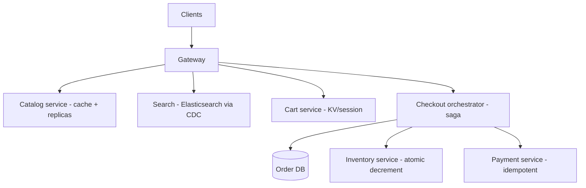
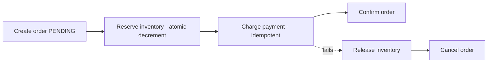

# Design an E-Commerce Platform

> Difficulty: Advanced
> Related: [03-databases/transactions-and-isolation](../03-databases-and-data-modeling/transactions-and-isolation.md) (oversell) · [05-messaging/saga-pattern](../05-messaging-and-event-driven-systems/saga-pattern.md) · [payment-system](./payment-system.md) · [search-autocomplete](./search-autocomplete.md)

A broad commerce design (Amazon-style) composing catalog, search, cart, inventory (no overselling), checkout (saga across services), and payment. Tests composition, inventory concurrency, and distributed checkout.

## A. Problem statement
Browse/search a product catalog, add to cart, place an order (reserve inventory, charge payment, create the order) without overselling, at scale.

## B. Requirements
**Functional:** product catalog + search; cart; inventory with reservation; checkout (order + inventory + payment); order history.
**Non-functional (ask):** scale (browse read-heavy; checkout write-critical); no overselling (inventory correctness); flash sales (spikes); payment correctness; catalog read latency.
**Assumptions:** read-heavy browse, correctness-critical checkout/inventory, flash-sale spikes.

## C. Estimation
- **Browse/search:** very read-heavy (cache + replicas + CDN for product images).
- **Checkout:** lower RPS but correctness-critical (no oversell, no double-charge); flash sales spike inventory contention.
- **Catalog:** large, read-heavy; search via Elasticsearch.

## D. Architecture (composition)

Sub-designs: catalog (read-heavy, cached — [caching-fundamentals](../04-caching/caching-fundamentals.md)); search ([search-indexing-and-search-engines](../10-storage-and-content-delivery/search-indexing-and-search-engines.md)); cart (KV/session store); **checkout = a saga** across order/inventory/payment ([saga-pattern](../05-messaging-and-event-driven-systems/saga-pattern.md)); payment ([payment-system](./payment-system.md)); inventory (atomic decrement — the oversell problem).

## E. The two hard correctness problems
1. **No overselling (inventory):** concurrent orders for the last item must not both succeed. Use an **atomic conditional decrement** `UPDATE inventory SET qty = qty - 1 WHERE sku = ? AND qty > 0` (0 rows → out of stock) — never read-check-then-write (see [transactions-and-isolation](../03-databases-and-data-modeling/transactions-and-isolation.md)). Under flash-sale contention, reservations + a queue may be needed (like [ticket-booking-system](./ticket-booking-system.md)).
2. **Checkout across services (order + inventory + payment):** no single transaction spans them → a **saga**: create order (pending) → reserve inventory → charge payment → confirm; on payment failure, compensate (release inventory, cancel order). Payment is idempotent (see [payment-system](./payment-system.md)). 2PC avoided (external payment provider, availability).

## F. Critical flow — checkout saga

Each step is a local transaction; compensations undo on failure; the user sees "order pending" briefly (eventual consistency — see [saga-pattern](../05-messaging-and-event-driven-systems/saga-pattern.md)).

## G. Bottlenecks
- **Flash-sale inventory contention (hot row):** everyone decrementing the same popular SKU → a hot row. Mitigate: atomic decrement + possibly reservation queue + sharded inventory counters + caching "in stock" status.
- **Browse read volume:** cache + replicas + CDN for images.
- **Checkout correctness under concurrency:** atomic decrement (oversell) + idempotent payment (double-charge).
- **Search sync:** CDC → Elasticsearch, eventual.

## H. Failure handling
- **Oversell:** prevented by atomic conditional decrement (and reservations under extreme contention).
- **Checkout partial failure:** saga compensation (release inventory, cancel order, refund).
- **Payment double-charge:** idempotency keys (see [payment-system](./payment-system.md)).
- **Stuck orders:** reconciliation sweeps pending orders.
- **Catalog/search eventual:** acceptable (a stale price caught at checkout — validate price at checkout).

## I. Trade-offs
| Decision | Chosen | Why |
|---|---|---|
| Inventory | Atomic conditional decrement (+ reservations under contention) | Prevents oversell; never read-check-then-write |
| Checkout | Saga + compensation | No cross-service transaction; 2PC avoided for availability + external payment |
| Catalog/search | Cache + replicas + CDC-fed search | Read-heavy; eventual OK; validate price at checkout |
| Payment | Idempotent (see payment-system) | No double-charge |
| Cart | KV/session | Fast, ephemeral, high availability |

## J. Follow-ups
1. **How do you prevent overselling the last item?** → Atomic conditional decrement `SET qty=qty-1 WHERE qty>0` (0 rows = out of stock); never read-check-then-write (races). Under flash-sale contention, add reservations/a queue.
2. **How do you keep checkout consistent across order/inventory/payment?** → A saga: create order (pending) → reserve inventory → charge (idempotent) → confirm; compensate (release/cancel/refund) on failure. 2PC avoided.
3. **Flash-sale hot row on a popular SKU?** → Atomic decrement + reservation queue + sharded counters + cached in-stock status (like [ticket-booking-system](./ticket-booking-system.md)).
4. **How do you avoid double-charging?** → Idempotency keys in the payment service (see [payment-system](./payment-system.md)).
5. **Stale price in the cache/search?** → Validate the authoritative price at checkout (read the source of truth) — browse can be eventual, checkout must confirm.
6. **How does browse scale?** → Cache + read replicas + CDN for product images; catalog is read-heavy.
7. **Search sync?** → CDC → Elasticsearch; eventual; rebuildable.
8. **A checkout step fails after payment?** → Compensate: refund + cancel order; the saga handles it; the user sees the failure.
9. **Stuck pending orders?** → Reconciliation sweep resolves them (check payment status, complete or cancel).
10. **How would you scope this in an interview?** → Clarify the focus (usually checkout correctness: oversell + distributed transaction); treat catalog/search/cart as sub-designs.

## K. Common mistakes
Read-check-then-write inventory (oversell); 2PC across services (avoid — saga); synchronous checkout coupling order+inventory+payment without compensation; trusting cached prices at checkout; missing the flash-sale hot-row problem.

## L. Practice exercise
Design the **flash-sale inventory system** for a limited-stock item with 1M concurrent buyers for 100 units. How do you guarantee exactly 100 sales (no oversell), handle the hot row, queue/reject excess buyers fairly, and keep the rest of the site responsive? Compare with [ticket-booking-system](./ticket-booking-system.md).
