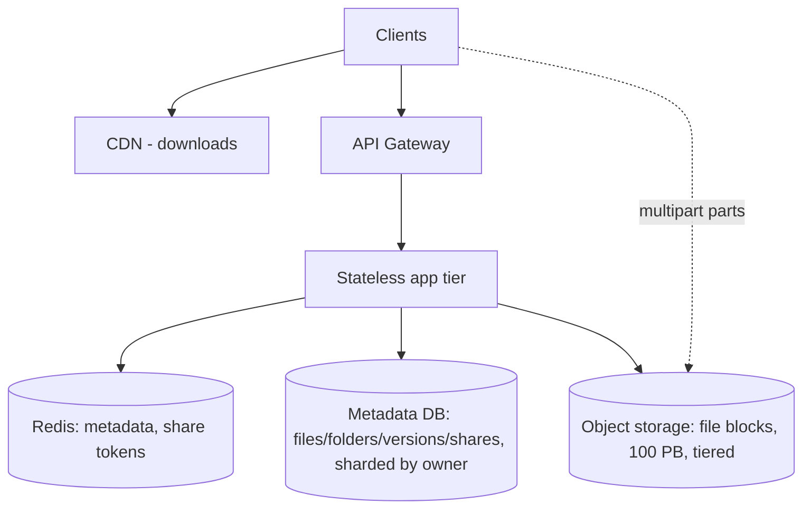
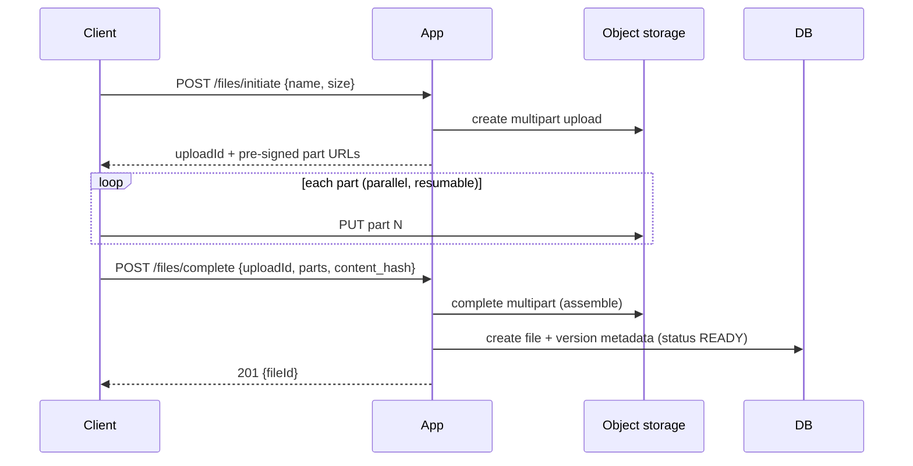

# Design a File Storage / Cloud Storage Service

> Difficulty: Intermediate · Core SDE-2 problem
> Related concepts: [object-storage-and-file-uploads](../10-storage-and-content-delivery/object-storage-and-file-uploads.md) · [cdn-and-edge-caching](../10-storage-and-content-delivery/cdn-and-edge-caching.md) · [data-archival-and-retention](../03-databases-and-data-modeling/data-archival-and-retention.md)

A Dropbox/Google-Drive-style service. Closely related to the DMS but with sharing, large/resumable uploads, and (optionally) sync/dedup. Tests object storage, metadata/file separation, and large-file handling.

---

## A. Problem statement

Build a service where users upload, store, download, organize (folders), and share files of varying sizes (KB to GB), with versioning and reliable large-file uploads.

## B. Requirement clarification

**Functional:** upload/download files (wide size range), folder organization, sharing (links/permissions), versioning, large/resumable uploads.
**Non-functional (ask):** scale (users, files, total storage); file sizes (small docs to multi-GB videos); durability (**never lose a file**); read:write (read-heavy); latency (downloads fast, global). Optionally dedup (identical files stored once) and sync (desktop client).
**Scope:** store/retrieve/share/version large files. **Non-goals:** real-time collaborative editing, the full desktop sync-conflict engine (mention).
**Assumptions:** 10M users, avg 10 GB each, files from KB to multi-GB, read-heavy, durability paramount, global users.

## C. Scale estimation

- **Total storage:** 10M × 10 GB = **~100 PB** (×replication) → object storage, tiered (see [data-archival-and-retention](../03-databases-and-data-modeling/data-archival-and-retention.md)).
- **Metadata:** per-file (name, size, folder, object key, version) ~1KB × billions of files → tens–hundreds of GB → relational, possibly sharded by user.
- **Uploads:** large files + resumable (multi-GB over flaky connections) → multipart upload.
- **Downloads:** read-heavy, global → CDN.
- **Implication:** files in object storage (100 PB), metadata in a (possibly sharded) relational DB, multipart/resumable uploads, CDN for downloads — the DMS pattern at larger file sizes with sharing + dedup options.

## D. API design

```
POST   /files/initiate      -> start upload (multipart), returns uploadId + pre-signed part URLs
PUT    (part URLs)          -> upload parts directly to object storage (resumable, parallel)
POST   /files/complete      -> finalize (assemble parts), create metadata, 201
GET    /files/{id}          -> metadata
GET    /files/{id}/download -> pre-signed/CDN URL
GET    /folders/{id}        -> list (paginated)
POST   /files/{id}/share    -> share link / grant (user, role)
POST   /files/{id}/versions -> new version
```
- **Multipart + pre-signed part URLs** so GB files upload directly to object storage, in parallel, resumably (see [object-storage-and-file-uploads](../10-storage-and-content-delivery/object-storage-and-file-uploads.md)).
- Idempotency on initiate/complete; cursor pagination on listings.

## E. Data modeling

```
files(id, owner_id, folder_id, name, size, content_hash, latest_version_id, created_at, deleted_at)
versions(id, file_id, version_no, object_key, size, content_hash, created_at)
folders(id, owner_id, parent_folder_id, name)
shares(id, file_id|folder_id, user_id|link_token, role)
blocks(content_hash -> object_key, ref_count)   -- optional: dedup
```
- `object_key` → file bytes in object storage; metadata in the DB.
- **Dedup (optional):** store a `content_hash`; identical content → one physical object with a ref count (saves storage for duplicate files). Chunk-level dedup for partial-overlap sync.
- **Shard key:** `owner_id` (a user's files together). Folders are a tree (parent_folder_id).

## F. High-level architecture


Files upload directly to object storage via pre-signed multipart URLs; the app handles only metadata (initiate/complete). Downloads via CDN + signed URLs. Metadata DB sharded by owner_id; cache hot metadata + share-link lookups. (Same shape as the [DMS](./document-management-system.md), scaled for larger files + sharing + dedup.)

## G. Critical data flows

**Large resumable upload:**

- Resumable: if the connection drops, re-upload only the missing parts (not the whole GB).
- Dedup: on complete, if `content_hash` already exists, skip storing (point to the existing object, bump ref count).

**Download:** metadata lookup → pre-signed/CDN URL → client downloads directly from object storage/edge (not through the app).

## H. Bottleneck analysis

- **Large-file bandwidth:** pre-signed multipart URLs keep GB transfers off the app; parallel parts speed it up; CDN offloads download bandwidth globally.
- **Metadata at billions of files:** shard by owner_id; cache hot metadata.
- **Storage cost (100 PB):** tiering (hot→cold), optional dedup (ref-counted content hashes) to avoid storing duplicate files.
- **Metadata/file consistency:** multipart complete + metadata create can partially fail → reconciliation for orphaned uploads (incomplete multiparts) and dangling metadata.
- **Share-link lookups:** cache share tokens (hot read path).

## I. Failure handling

- **Interrupted upload:** resumable multipart — re-upload missing parts; incomplete multiparts expire/cleaned (object-storage lifecycle rule) → no orphan storage leak.
- **Partial failure (file stored, metadata not finalized):** reconciliation; status lifecycle.
- **Durability:** object storage's high durability + versioning (recover from accidental overwrite/delete) + cross-region replication for region loss (see [disaster-recovery](../07-reliability-and-resilience/disaster-recovery.md)).
- **Dedup ref-count:** deleting one reference must not delete the object if others reference it (decrement ref count; delete at zero).
- **CDN stale:** versioned object keys (new version = new key) avoid stale-download issues.

## J. Trade-offs and alternatives

| Decision | Chosen | Alternative | Why |
|---|---|---|---|
| File storage | Object storage + metadata DB | Blobs in DB | 100 PB; DB can't hold blobs |
| Large uploads | Multipart + pre-signed parts (resumable) | Single-shot through the app | Resumable, parallel, offloads the app for GB files |
| Dedup | Content-hash ref-counting (optional) | Store every copy | Saves storage for duplicate files; costs ref-count complexity |
| Downloads | CDN + signed URLs | Serve from the app | Global low latency + origin offload |
| Metadata | Sharded by owner_id | Single node | Billions of files exceed one node |

## K. Security and observability

- **Sharing:** share tokens (time-limited, revocable); resource-level authz on shared files; prevent enumeration of share links.
- **Encryption:** at rest (object storage) + in transit; per-user keys enable crypto-shred on account deletion.
- **Abuse:** scan uploads (malware), quota per user, rate-limit.
- **Observability:** upload/download throughput + success rate, multipart completion rate, storage growth/cost per tier, dedup ratio, CDN hit ratio, metadata DB load.

## L. Evolution of the design

- **Small:** app + DB + object storage (like early DMS).
- **Growth:** CDN for downloads, multipart for large files, cache metadata/share tokens.
- **Scale:** shard metadata by owner; storage tiering; optional dedup; cross-region replication for durability/global latency.
- **Advanced:** desktop sync (chunk-level dedup + a sync protocol + conflict resolution — the sync-conflict engine is a design in itself, see [cloud-file-sync](./cloud-file-sync.md)); collaborative features.

## M. Interview walkthrough (abbreviated)

**I:** "Design a cloud file storage service." **C:** "Clarify: scale, file sizes (KB to GB?), durability, read:write, global, dedup/sync?" **I:** [assumptions]. **C:** "100 PB of files → object storage, tiered; billions of metadata records → a relational DB sharded by owner_id. GB files need resumable multipart uploads via pre-signed part URLs straight to object storage — the app only does initiate/complete, so GB transfers don't flow through it, and a dropped connection re-uploads only missing parts. Downloads via CDN + signed URLs for global speed and origin offload."
**C:** "Durability is paramount: object storage's high durability + versioning (recover accidental overwrites/deletes) + cross-region replication for region loss. Optional dedup via content-hash ref-counting saves storage for identical files. Metadata/file partial failures (stored but not finalized) are caught by reconciliation + object-storage lifecycle rules that expire incomplete multiparts."
**I:** "A 5 GB upload keeps failing on a flaky connection." **C:** [resumable multipart — re-upload missing parts]. **I:** "How do you avoid storing the same file twice?" **C:** [content-hash dedup + ref counting].

## N. Follow-up questions (with model answers)

1. **How do you handle multi-GB uploads reliably?** → Multipart upload with pre-signed part URLs: upload parts in parallel directly to object storage, resumable (re-upload only missing parts on failure); the app only initiates/completes.
2. **Where do files vs metadata live?** → Files in object storage (100 PB, tiered); metadata in a relational DB sharded by owner_id. Never blobs in the DB.
3. **How do you dedup identical files?** → Store a content_hash; identical content maps to one physical object with a ref count; deleting one reference decrements the count, delete the object at zero.
4. **How do you guarantee durability?** → Object storage's high durability + versioning (recover overwrites/deletes) + cross-region replication for region loss + tested backups.
5. **How do you serve downloads globally and cheaply?** → CDN + signed URLs; versioned object keys avoid stale edge caches; tier cold files.
6. **An upload crashed midway — orphan storage?** → Object-storage lifecycle rules expire incomplete multipart uploads; reconciliation cleans dangling metadata. No permanent leak.
7. **How do share links work securely?** → Time-limited, revocable share tokens; resource-level authz; non-enumerable tokens; cache hot token lookups.
8. **Versioning?** → A versions table with object_keys per version + latest_version_id; downloads fetch a specific/latest version.
9. **When would you shard metadata?** → When billions of files exceed one node; shard by owner_id so a user's files/queries stay single-shard.
10. **Dedup trade-offs?** → Saves storage for duplicate files but adds ref-counting complexity and a privacy consideration (content-hash collisions / cross-user dedup must be handled carefully).
11. **Desktop sync?** → Chunk-level dedup + a sync protocol tracking file states per device + conflict resolution — a larger design (see [cloud-file-sync](./cloud-file-sync.md)).
12. **Compliance deletion?** → Soft-delete then purge; crypto-shred per-user keys for data in immutable backups; decrement dedup ref counts.
13. **Download bandwidth bottleneck?** → CDN offloads it (edges serve files); pre-signed URLs keep it off the app origin.
14. **Metadata/file consistency?** → Status lifecycle + reconciliation (orphans, dangling); object-storage events confirm uploads.
15. **How does this differ from the DMS?** → Larger files (multipart/resumable), heavier sharing + (optional) dedup/sync; same core (object storage + metadata DB + CDN).

## O. Common mistakes

- Streaming large files through the app (no multipart/pre-signed → bandwidth/memory blowup).
- Blobs in the DB.
- No resumability for GB uploads (whole upload restarts on failure).
- No lifecycle cleanup for incomplete multiparts (orphan storage leak).
- Forgetting versioning (can't recover an accidental overwrite).
- Dedup without ref-counting (delete one copy, break others).

## P. Practice exercise

Design the **sharing + collaboration permission model** for nested folders (sharing a folder grants access to all contents; a sub-share can narrow it). How do you model inherited vs overridden permissions, check access on a deeply nested file quickly (caching), and promptly revoke a folder share across all its contents? (Hint: ReBAC — see [authentication-authorization-and-rbac](../08-security/authentication-authorization-and-rbac.md).)
