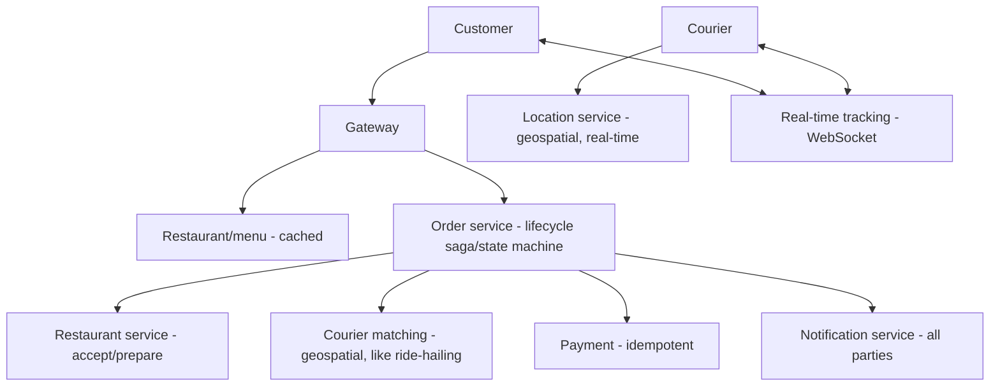
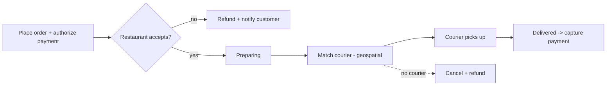

# Design a Food Delivery Platform

> Difficulty: Advanced
> Related: [ride-hailing-system](./ride-hailing-system.md) (geospatial + courier matching) · [05-messaging/saga-pattern](../05-messaging-and-event-driven-systems/saga-pattern.md) · [notification-service](./notification-service.md)

A DoorDash/Swiggy-style system combining e-commerce ordering, real-time courier matching/tracking (like ride-hailing), and a multi-party workflow (customer, restaurant, courier). Tests composition and a long-running order lifecycle (saga).

## A. Problem statement
Customers browse restaurants, place orders; the system sends the order to the restaurant, matches a courier, tracks delivery in real time, and handles payment — coordinating three parties.

## B. Requirements
**Functional:** browse restaurants/menus; place order; restaurant accepts/prepares; match a courier; real-time delivery tracking; payment; notifications to all parties.
**Non-functional (ask):** scale; real-time (tracking, matching); the order lifecycle spans parties over ~30-60 min (long-running); correctness (payment, no double-courier-assignment).
**Assumptions:** regional, real-time courier tracking, long-running multi-party order flow.

## C. Estimation
- Browse read-heavy (cache menus). Orders modest but the lifecycle is long and multi-party. Courier location = high-write geospatial (like [ride-hailing](./ride-hailing-system.md)).

## D. Architecture (composition)

Sub-designs: browse (cached — [caching-fundamentals](../04-caching/caching-fundamentals.md)); courier matching + location (geospatial, real-time — [ride-hailing-system](./ride-hailing-system.md)); payment (idempotent — [payment-system](./payment-system.md)); notifications ([notification-service](./notification-service.md)); the **order lifecycle = a long-running saga/state machine**.

## E. The order lifecycle (long-running saga / state machine)
An order moves through states over ~30-60 min across three parties:
`PLACED → PAYMENT_AUTHORIZED → RESTAURANT_ACCEPTED → PREPARING → COURIER_ASSIGNED → PICKED_UP → DELIVERED` (with failure branches: restaurant rejects, no courier, cancellation).

This is a **long-running orchestration** (a saga / state machine — see [saga-pattern](../05-messaging-and-event-driven-systems/saga-pattern.md)): each transition is driven by an event (restaurant accepts, courier picks up); failures trigger compensations (refund if the restaurant rejects after payment auth; re-match if a courier drops). The order state is persisted (durable, so a crash resumes the saga). Each party's action is an event advancing the state machine.

## F. Critical flow

Real-time tracking (courier location → customer) via a WebSocket channel + geospatial location service (like [ride-hailing](./ride-hailing-system.md)). Notifications at each transition (order accepted, courier assigned, arriving) via the [notification-service](./notification-service.md).

## G. Bottlenecks
- **Courier matching + location:** geospatial index, high-write loss-tolerant location (like [ride-hailing-system](./ride-hailing-system.md)); match the nearest available courier atomically (no double-assign).
- **Long-running order state:** durable, resumable saga; many concurrent orders in various states.
- **Browse read load:** cache menus/restaurants.
- **Peak hours (lunch/dinner):** demand spikes → surge/batching; courier supply constraints.

## H. Failure handling
- **Restaurant rejects (after payment auth):** compensate — refund (or don't capture), notify customer.
- **No courier available:** retry matching, widen radius, or cancel + refund.
- **Courier drops mid-delivery:** re-match; the saga handles the transition.
- **Payment:** authorize at order, capture on delivery; idempotent (see [payment-system](./payment-system.md)).
- **Crash mid-order:** persisted saga state resumes; idempotent transitions.

## I. Trade-offs
| Decision | Chosen | Why |
|---|---|---|
| Order lifecycle | Long-running saga/state machine (durable) | Multi-party, ~30-60 min, needs compensation + resumability |
| Courier matching | Geospatial + atomic assignment | Nearest available, no double-assign (like ride-hailing) |
| Payment | Authorize at order, capture on delivery, idempotent | Don't charge for an order that may be rejected |
| Location | High-write, loss-tolerant, in-memory geospatial | Slight staleness OK; huge volume |
| Browse | Cached | Read-heavy menus |

## J. Follow-ups
1. **How do you model the order lifecycle?** → A durable, resumable saga/state machine: states advanced by party events (restaurant accepts, courier picks up), with compensations on failure (refund if rejected); persisted so a crash resumes.
2. **How do you match couriers?** → Geospatial index of courier locations + atomic assignment of the nearest available courier (no double-assign) — like [ride-hailing](./ride-hailing-system.md).
3. **Payment timing?** → Authorize at order placement, capture on delivery; idempotent — so you don't capture money for an order the restaurant rejects.
4. **Restaurant rejects after payment authorized?** → Compensate: void the authorization / refund + notify the customer (saga compensation).
5. **No courier available?** → Retry matching, widen the search radius, or cancel + refund; the saga handles the dead-end.
6. **Courier drops mid-delivery?** → Re-match a new courier; the saga transitions; the customer is notified.
7. **Peak-hour demand spikes?** → Surge/incentives for courier supply, order batching, demand-based matching; cache browse.
8. **Real-time tracking?** → WebSocket channel pushing courier location (geospatial) to the customer — like chat/ride-hailing.
9. **Crash mid-order?** → Persisted saga state resumes; idempotent transitions prevent double-effects.
10. **How does this compose other designs?** → Browse (caching) + courier matching/tracking (ride-hailing geospatial) + payment (idempotent) + notifications + a long-running order saga. The saga + three-party coordination is the distinctive part.

## K. Common mistakes
Treating the order as a single synchronous transaction (it's a long-running multi-party saga); capturing payment before delivery/acceptance; no compensation for restaurant rejection / no courier; not reusing ride-hailing geospatial matching; non-resumable order state (crash loses the order).

## L. Practice exercise
Design the **order-state saga** in detail: enumerate the states, the events that transition them, the compensations for each failure branch (restaurant rejects, no courier, customer cancels, courier drops), and how you persist + resume the saga after a crash. Compare with [saga-pattern](../05-messaging-and-event-driven-systems/saga-pattern.md).
