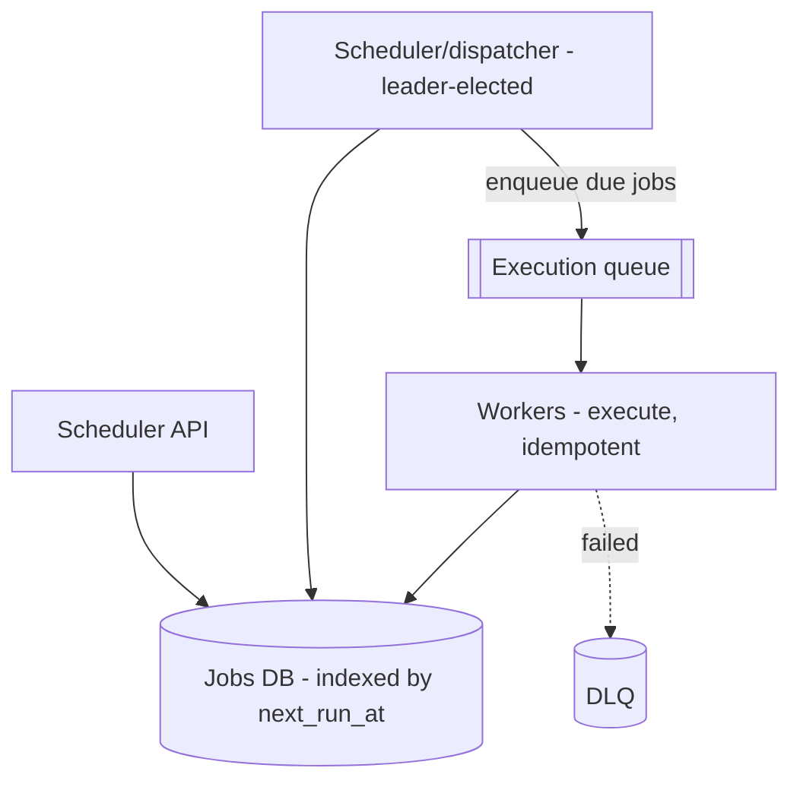

# Design a Job Scheduler

> Difficulty: Intermediate
> Related: [05-messaging/queues-vs-pub-sub-vs-event-streams](../05-messaging-and-event-driven-systems/queues-vs-pub-sub-vs-event-streams.md) · [06-distributed-systems/leader-election-and-split-brain](../06-distributed-systems/leader-election-and-split-brain.md) · [05-messaging/idempotency-and-deduplication](../05-messaging-and-event-driven-systems/idempotency-and-deduplication.md)

A system that runs jobs at scheduled times (cron-like) or after a delay, reliably and exactly-once-in-effect, at scale. Tests scheduling, leader election (avoid double-runs), and idempotency.

## A. Problem statement
Schedule jobs to run at a specific time or on a recurring schedule (cron), or after a delay; execute them reliably; retry failures; don't run a job twice; scale to many jobs/executions.

## B. Requirements
**Functional:** one-off (at time T), delayed (after N), and recurring (cron) jobs; execute via workers; retry on failure; cancel; status tracking.
**Non-functional (ask):** scale (jobs, executions/sec); timing precision (exact second vs best-effort minute?); exactly-once execution (critical — a billing job must not run twice); durability (don't lose scheduled jobs).
**Assumptions:** millions of jobs, best-effort-seconds precision, exactly-once-in-effect, durable.

## C. Estimation
- Millions of scheduled jobs; executions spike at common times (top of the hour/midnight → a thundering-herd of due jobs). Peak executions/sec drives worker count.
- Job metadata is small (relational, time-indexed). The pressure is the "find due jobs" query at scale and the execution fan-out at popular times.

## D. API
```
POST /jobs { type, payload, scheduleAt | cron | delay, idempotencyKey } -> 201 {jobId}
DELETE /jobs/{id}         -> cancel
GET /jobs/{id}            -> status
```

## E. Data model
- `jobs(id, type, payload, next_run_at, cron, status, attempts, idempotency_key)` indexed on `next_run_at` (find due jobs).
- `executions(id, job_id, scheduled_for, status, worker_id, result)` — one row per execution attempt (dedup/audit).

## F. Architecture

- A **dispatcher** periodically scans for due jobs (`WHERE next_run_at <= now`) and enqueues them to an execution queue; workers execute.
- The dispatcher is a **singleton (leader-elected)** so due jobs aren't scanned/enqueued twice (see [leader-election-and-split-brain](../06-distributed-systems/leader-election-and-split-brain.md)) — or jobs are claimed atomically (`UPDATE ... WHERE status='DUE' RETURNING` / `SELECT FOR UPDATE SKIP LOCKED`) so multiple dispatchers don't double-claim.
- Recurring jobs: after execution, compute `next_run_at` from the cron and reschedule.

## G. Critical flow — exactly-once-in-effect
1. Dispatcher atomically claims due jobs (atomic status transition / SKIP LOCKED) → avoids two dispatchers enqueuing the same job.
2. Worker executes; records the execution (unique on `(job_id, scheduled_for)`) → **idempotent** so a redelivered queue message doesn't double-run (see [idempotency-and-deduplication](../05-messaging-and-event-driven-systems/idempotency-and-deduplication.md)).
3. At-least-once queue + idempotent execution = effectively-once (not exactly-once delivery — see [exactly-once-processing](../06-distributed-systems/exactly-once-processing.md)).

## H. Bottlenecks
- **Thundering herd at popular times** (midnight/top-of-hour): many jobs due at once → spread load (jitter schedules), scale workers on queue depth, partition the scan.
- **"Find due jobs" query at scale:** index on `next_run_at`; partition by time; batch-claim.
- **Timing precision vs scan interval:** finer precision needs more frequent scans (cost); best-effort-seconds is usually enough.
- **Double execution:** prevented by atomic claim + idempotent execution.

## I. Failure handling
- **Dispatcher crash:** leader election promotes another (fencing to avoid two dispatchers — split-brain); or stateless dispatchers using atomic claims.
- **Worker crash mid-job:** at-least-once redelivery → idempotent execution re-runs safely; a visibility timeout re-queues unacked jobs.
- **Missed window (dispatcher down):** on recovery, overdue jobs (`next_run_at < now`) are picked up (late but not lost).
- **Poison job:** retries → DLQ.

## J. Trade-offs
| Decision | Chosen | Why |
|---|---|---|
| Dispatcher | Leader-elected singleton OR stateless + atomic claims | Avoid double-enqueue/double-run |
| Execution guarantee | At-least-once + idempotent | Exactly-once delivery impossible; idempotency gives effectively-once |
| Precision | Best-effort seconds (scan interval) | Finer precision costs more frequent scans |
| Thundering herd | Schedule jitter + worker autoscale | Smooth popular-time spikes |

## K. Follow-ups
1. **How do you prevent a job running twice?** → Atomic claim by the dispatcher (SKIP LOCKED / atomic status transition) + idempotent execution keyed on `(job_id, scheduled_for)`; at-least-once + idempotency = effectively-once.
2. **Dispatcher is a SPOF — fix?** → Leader-elect it (with fencing to avoid split-brain double-dispatch), or run stateless dispatchers that claim jobs atomically.
3. **Everyone schedules jobs at midnight (thundering herd).** → Jitter schedules, partition the scan, autoscale workers on queue depth, batch-claim due jobs.
4. **A worker crashes mid-execution.** → Visibility timeout re-queues the job; idempotent execution makes the re-run safe.
5. **How do recurring (cron) jobs work?** → After execution, compute the next `next_run_at` from the cron expression and reschedule.
6. **Scheduler was down for an hour — are jobs lost?** → No — overdue jobs (`next_run_at < now`) are picked up on recovery (late but not lost).
7. **Timing precision?** → Bounded by the scan interval; best-effort seconds is usually fine; sub-second needs tighter scans (cost).
8. **How do you scale to millions of jobs?** → Index/partition by `next_run_at`, batch-claim, partition the dispatcher scan, autoscale workers; the DB holds metadata (small), the pressure is the due-job scan + execution fan-out.
9. **Exactly-once execution guarantee?** → Effectively-once via atomic claim + idempotency + visibility timeouts; not a hard exactly-once (which is impossible with redelivery).
10. **How do you cancel a scheduled job?** → Mark it cancelled; the dispatcher skips cancelled jobs when claiming; an already-enqueued job checks status before executing.

## L. Common mistakes
Multiple dispatchers double-enqueuing (no atomic claim/leader election); non-idempotent execution (double-runs on redelivery); ignoring the thundering herd; losing overdue jobs on recovery; treating exactly-once delivery as achievable.

## M. Practice exercise
Design a **distributed cron for 10M recurring jobs** where some jobs are "run exactly once globally per schedule" (e.g., a daily billing run). How do you guarantee a single global execution per schedule (leader election + fencing + idempotent execution), and how do you spread the thundering herd of jobs all due at 00:00? Compare with [distributed-task-queue](./distributed-task-queue.md).
