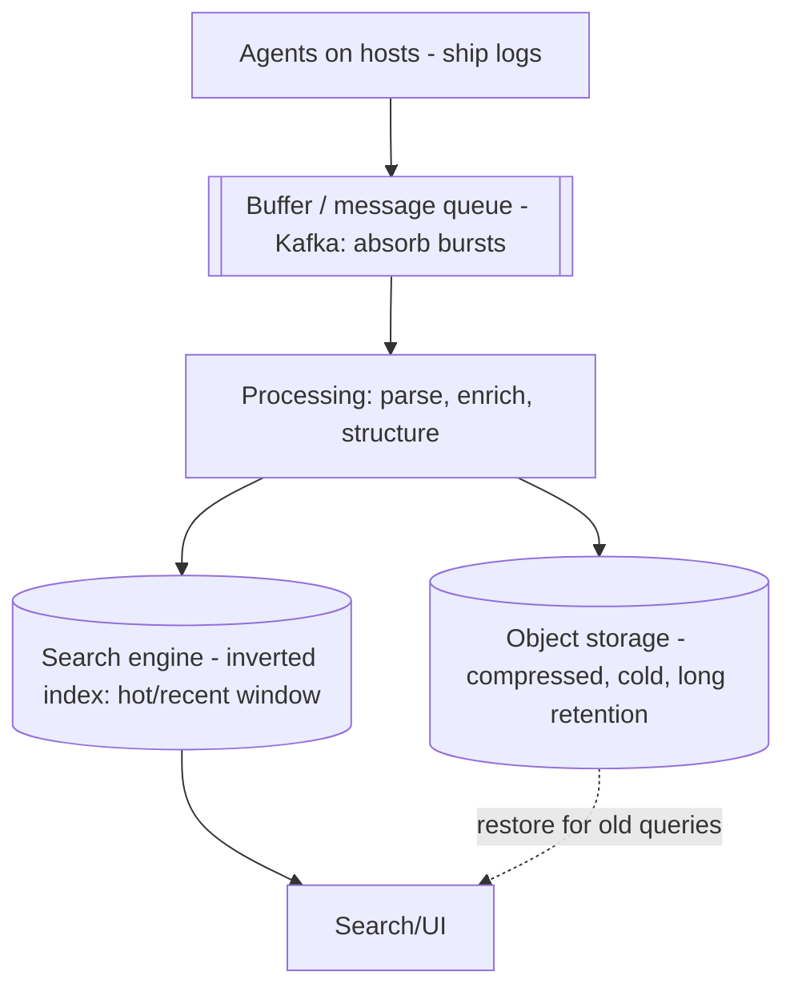

# Design a Logging Platform

> Difficulty: Advanced
> Related: [03-databases/time-series-and-search-databases](../03-databases-and-data-modeling/time-series-and-search-databases.md) · [10-storage/search-indexing-and-search-engines](../10-storage-and-content-delivery/search-indexing-and-search-engines.md) · [05-messaging/backpressure-and-consumer-lag](../05-messaging-and-event-driven-systems/backpressure-and-consumer-lag.md)

An ELK/Splunk-style platform: collect logs from many services, store them, and make them searchable. Tests high-volume ingestion, full-text search at scale, retention/cost, and a buffering pipeline.

## A. Problem statement
Collect log lines from thousands of services, aggregate them centrally, store them, and let engineers search/filter logs (by text, service, time range) for debugging.

## B. Requirements
**Functional:** ingest log lines (service, level, timestamp, message, structured fields); search by text + fields + time range; tail live logs; retention.
**Non-functional (ask):** ingest scale (millions of lines/sec, bursty); search latency (debugging — seconds OK); retention + cost (logs are huge); loss tolerance (some loss acceptable, but not for audit logs).
**Assumptions:** millions of lines/sec, bursty, search in seconds, retention tiered for cost, mostly loss-tolerant.

## C. Estimation
- Millions of lines/sec × ~500 bytes → hundreds of MB–GB/sec ingest → a buffering pipeline + a search-indexed store (see [storage-and-retention-calculations](../11-estimation-and-bottleneck-analysis/storage-and-retention-calculations.md)).
- **Storage dominates cost:** billions of lines/day → hot (searchable, short retention) + cold (compressed in object storage, long retention).

## D. API / pipeline
- **Ingest:** agents on each host ship logs to a buffer (push).
- **Search:** `GET /logs?q=&service=&from=&to=` (full-text + fields + time range).

## E. Data model
- Logs indexed in a search engine (inverted index — see [search-indexing-and-search-engines](../10-storage-and-content-delivery/search-indexing-and-search-engines.md)) for the hot/recent window; cold logs compressed in object storage.
- Time-partitioned (retention via partition drop — see [data-archival-and-retention](../03-databases-and-data-modeling/data-archival-and-retention.md)).
- Structured logs (JSON) for field-based queries (see [logs-metrics-and-traces](../09-observability-and-operations/logs-metrics-and-traces.md)).

## F. Architecture

- **Buffer (Kafka) between agents and storage** absorbs bursts and decouples ingestion from indexing (if the search engine lags, the buffer holds logs — see [backpressure-and-consumer-lag](../05-messaging-and-event-driven-systems/backpressure-and-consumer-lag.md)).
- **Hot window** indexed in a search engine (fast full-text/field search over recent logs); **cold logs** compressed in object storage (cheap, long retention, slower to query).
- Time-partitioned; drop/archive by partition for retention.

## G. Critical flow
Agent ships logs → Kafka buffer → processing parses/enriches → indexes recent logs in the search engine + writes to object storage → engineers search the hot index (seconds); old-log queries restore from cold storage. The buffer absorbs ingest spikes so a lagging indexer doesn't drop logs (up to buffer retention).

## H. Bottlenecks
- **Ingest bursts:** Kafka buffer absorbs them; indexer autoscales on lag; shed/sample under extreme overload (loss-tolerant).
- **Search index cost/size:** the search engine is expensive at scale → index only the hot window; cold logs in cheap object storage.
- **Storage cost (dominant):** compression + tiered retention (hot short, cold long, then drop).
- **High-cardinality/structured fields:** index selectively (not every field) to control index size.
- **Indexer lag:** if indexing can't keep up, the buffer grows → eventual search freshness; scale the indexer.

## I. Failure handling
- **Log loss:** mostly loss-tolerant (sampling/shedding under overload); the Kafka buffer prevents loss up to its retention; audit logs (not loss-tolerant) get a durable path.
- **Indexer down/lagging:** buffer holds logs; search is eventually fresh; catch up when the indexer recovers.
- **Search engine node failure:** replicate index shards; rebuildable from the buffer/object storage.
- **Storage overflow:** retention/drop; alert on ingest rate.

## J. Trade-offs
| Decision | Chosen | Why |
|---|---|---|
| Buffer | Kafka between agents and storage | Absorb bursts, decouple ingest from indexing, prevent loss |
| Hot vs cold | Search index (hot) + object storage (cold) | Index is expensive; most queries are recent |
| Retention | Tiered + drop (time-partitioned) | Logs are huge; bound cost |
| Loss | Loss-tolerant (except audit) | Debug logs tolerate sampling; audit logs don't |
| Indexing | Selective fields | Control index size/cost |

## K. Follow-ups
1. **How do you absorb bursty ingest without losing logs?** → A Kafka buffer between agents and storage decouples ingestion from indexing and holds logs (up to retention) if the indexer lags.
2. **Why not index everything in the search engine?** → It's expensive at scale; index only the hot/recent window; store cold logs compressed in object storage (cheap, slower queries).
3. **How do you control storage cost (the dominant cost)?** → Compression + tiered retention (hot short, cold long, then drop); time-partitioned so retention is a partition drop.
4. **Is log loss acceptable?** → For debug logs, yes (sample/shed under overload); audit/compliance logs need a durable, loss-free path.
5. **Indexer can't keep up?** → The buffer grows (eventual search freshness); autoscale the indexer; shed/sample under extreme overload.
6. **How do you search old logs?** → Restore from cold object storage (slower); the hot index covers recent logs.
7. **Why a search engine (inverted index) over SQL?** → Full-text search over billions of lines; SQL LIKE would full-scan (see [full-text-search-vs-database-search](../10-storage-and-content-delivery/full-text-search-vs-database-search.md)).
8. **How do you tail live logs?** → Stream from the buffer (Kafka) to the UI; or a live-tail subscription.
9. **Search index node failure?** → Replicate shards; the index is rebuildable from the buffer/object storage (it's a secondary store).
10. **How is this different from the metrics platform?** → Logs are unstructured/semi-structured text searched full-text (search engine); metrics are numeric time-series aggregated (TSDB). Both are high-volume ingestion pipelines but with different stores and query models.

## L. Common mistakes
No buffer (bursts drop logs / overwhelm the indexer); indexing everything (index cost explosion); no retention/tiering (unbounded cost); treating all logs as loss-tolerant (audit logs aren't); SQL for full-text search at scale.

## M. Practice exercise
Design the **retention + cost-optimization strategy**: 1B log lines/day, engineers mostly query the last 7 days but compliance requires 1-year retention. How do you tier (hot searchable vs cold compressed), what's the storage math (see [storage-and-retention-calculations](../11-estimation-and-bottleneck-analysis/storage-and-retention-calculations.md)), and how do you serve a rare 6-month-old query? Compare with [data-pipelines-and-batch-processing](../10-storage-and-content-delivery/data-pipelines-and-batch-processing.md).
