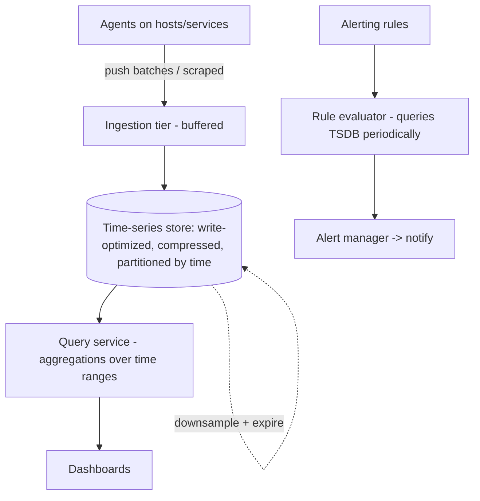

# Design a Metrics & Monitoring Platform

> Difficulty: Advanced
> Related: [03-databases/time-series-and-search-databases](../03-databases-and-data-modeling/time-series-and-search-databases.md) · [09-observability-and-operations/alerting-and-dashboards](../09-observability-and-operations/alerting-and-dashboards.md) · [10-storage/data-pipelines-and-batch-processing](../10-storage-and-content-delivery/data-pipelines-and-batch-processing.md)

A Prometheus/Datadog-style platform: ingest huge volumes of metrics, store time-series efficiently, query/aggregate for dashboards, and alert. Tests time-series databases, high-write ingestion, retention/downsampling, and alerting.

## A. Problem statement
Ingest metrics (counters, gauges, histograms) from thousands of services at high volume; store them time-series; let users query/aggregate over time ranges for dashboards; evaluate alerting rules.

## B. Requirements
**Functional:** ingest metrics (metric name + labels + value + timestamp); query by metric + label + time range with aggregations (avg/p99/rate); dashboards; alerting rules.
**Non-functional (ask):** ingest scale (millions of points/sec); query latency (dashboards responsive); retention (raw short, aggregates long); cardinality (label combinations). Durability of metrics (loss-tolerant — a few dropped points OK).
**Assumptions:** millions of points/sec, loss-tolerant, time-range + aggregation queries, retention/downsampling, alerting.

## C. Estimation
- Millions of points/sec ingest → write-optimized time-series store (see [time-series-and-search-databases](../03-databases-and-data-modeling/time-series-and-search-databases.md)).
- **Storage:** compressed (time-series compresses ~10×+) + retention/downsampling keep it bounded (see [storage-and-retention-calculations](../11-estimation-and-bottleneck-analysis/storage-and-retention-calculations.md)).
- **Cardinality is the hidden killer:** too many label combinations (high-cardinality labels like user_id) create millions of series → memory/storage blowup.

## D. API / protocol
- **Ingest:** push (agents POST batches) or pull (scrape endpoints, Prometheus-style). Agents on each host/service send metrics.
- **Query:** a query language over metric + labels + time range + aggregation (PromQL-like): `rate(http_requests{service="dms"}[5m])`.

## E. Data model
- Time-series: `(metric_name, labels) -> [(timestamp, value), ...]`, partitioned/bucketed by time.
- Write-optimized (LSM-style) ingestion; compressed on disk.
- Retention tiers: raw (high resolution, short TTL) → downsampled rollups (per-minute → per-hour, long TTL) → drop (see [data-archival-and-retention](../03-databases-and-data-modeling/data-archival-and-retention.md)).

## F. Architecture

- **Ingestion tier** buffers high-volume writes (absorb spikes; batch to the TSDB).
- **TSDB** stores series write-optimized + compressed, downsamples and expires per retention.
- **Query service** aggregates over time ranges for dashboards.
- **Rule evaluator** periodically queries the TSDB and fires alerts (burn-rate/symptom-based — see [alerting-and-dashboards](../09-observability-and-operations/alerting-and-dashboards.md)).

## G. Critical flow
Agents push/scrape metrics → ingestion buffers + batches → TSDB stores (compressed, time-partitioned) → dashboards query aggregations → the rule evaluator queries periodically and alerts on threshold/burn-rate. Old raw data is downsampled to rollups, then dropped.

## H. Bottlenecks
- **Ingest write volume:** write-optimized TSDB + batched ingestion; shard series across nodes.
- **Cardinality explosion (the classic killer):** high-cardinality labels (user_id, request_id) create millions of series → memory/storage blowup + slow queries. Mitigate: limit/forbid high-cardinality labels; aggregate; drop offending labels (see [time-series-and-search-databases](../03-databases-and-data-modeling/time-series-and-search-databases.md)).
- **Query latency over long ranges:** use downsampled rollups for long ranges (don't scan raw); pre-aggregate.
- **Storage growth:** compression + retention + downsampling.
- **Alerting at scale:** many rules evaluated frequently → efficient rule evaluation, group alerts.

## I. Failure handling
- **Metric loss:** loss-tolerant (a few dropped points acceptable); ingestion buffers absorb spikes; drop oldest under extreme overload rather than fall over.
- **Ingestion overload:** backpressure/shed low-priority metrics; sampling under extreme load.
- **TSDB node failure:** replication (some loss tolerable); re-shard.
- **Alert evaluator down:** HA; missed evaluations are a gap (monitor the monitor — "who watches the watcher").

## J. Trade-offs
| Decision | Chosen | Why |
|---|---|---|
| Store | Time-series DB (write-optimized, compressed) | Millions of points/sec, time-range queries; relational can't |
| Retention | Raw short + downsampled long + drop | Bound storage; most queries are recent/aggregate |
| Durability | Loss-tolerant | Metrics are approximate; a few dropped points are fine |
| Cardinality | Limit high-cardinality labels | Explosion is the classic failure |
| Long-range queries | Downsampled rollups | Scanning raw over months is too slow |

## K. Follow-ups
1. **Why a TSDB, not a relational DB?** → Millions of points/sec with time-range + aggregation queries, heavy compression, retention/downsampling — a relational DB would be overwhelmed and inefficient.
2. **What's cardinality explosion and how do you prevent it?** → Too many label combinations (high-cardinality labels like user_id) create millions of series → memory/storage blowup. Prevent by limiting/forbidding high-cardinality labels and aggregating.
3. **How do you keep storage bounded?** → Compression (~10×+), retention tiers, and downsampling (raw → per-minute → per-hour → drop).
4. **How do long-range dashboard queries stay fast?** → Query downsampled rollups for long ranges, not raw data; pre-aggregate.
5. **Push vs pull ingestion?** → Pull (scrape, Prometheus-style — the platform controls rate, easy service discovery) vs push (agents send — better for ephemeral/short-lived jobs). Trade-offs; many support both.
6. **Metric loss acceptable?** → Yes, loss-tolerant — a few dropped points don't matter; buffer + shed under overload rather than fall over.
7. **How does alerting work?** → A rule evaluator periodically queries the TSDB and fires on thresholds/burn-rate (symptom-based, see [alerting-and-dashboards](../09-observability-and-operations/alerting-and-dashboards.md)); an alert manager dedupes/groups/notifies.
8. **How do you handle ingest spikes?** → Buffered ingestion tier + batching; backpressure/sampling under extreme load.
9. **High-availability of the monitoring system itself?** → Replicate; "who watches the watcher" — a separate heartbeat/dead-man's-switch so a down monitoring system is itself detected.
10. **How do you scale ingestion?** → Shard series across nodes; horizontally scale the ingestion tier; batch writes.

## L. Common mistakes
Relational DB for metrics (overwhelmed); ignoring cardinality (the classic blowup); no retention/downsampling (unbounded storage); scanning raw data for long-range queries (slow); treating metrics as durable (they're loss-tolerant); no HA for the monitoring system itself.

## M. Practice exercise
Design the **alerting subsystem** at scale: thousands of rules evaluated every ~15s against a huge TSDB, with alert deduplication, grouping, silencing, and escalation. How do you evaluate rules efficiently, avoid alert storms, and apply burn-rate alerting? Compare with [alerting-and-dashboards](../09-observability-and-operations/alerting-and-dashboards.md).
