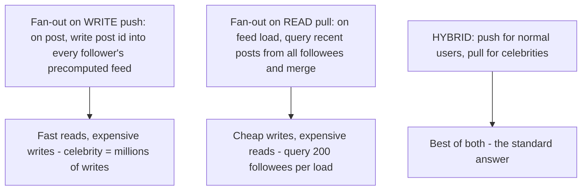
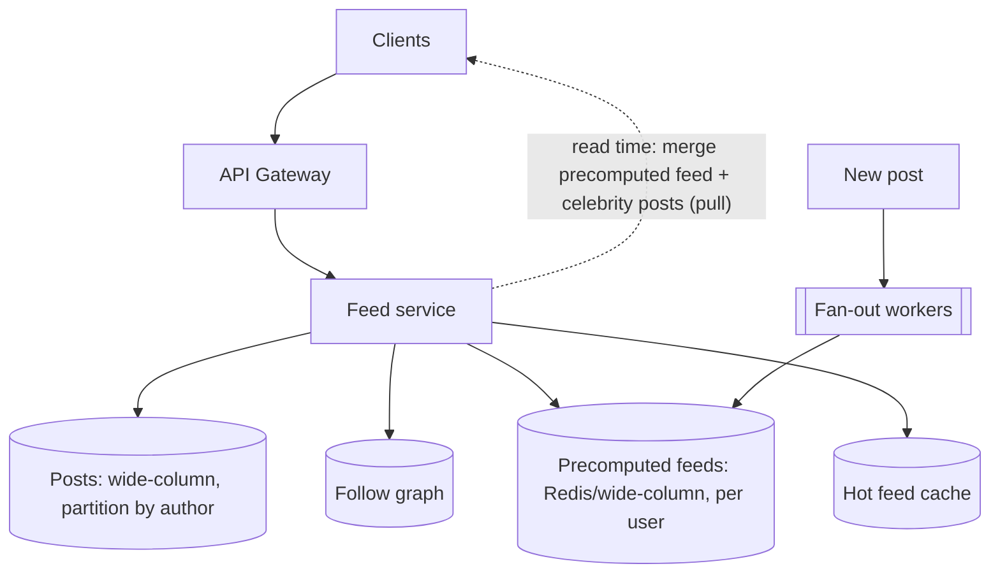
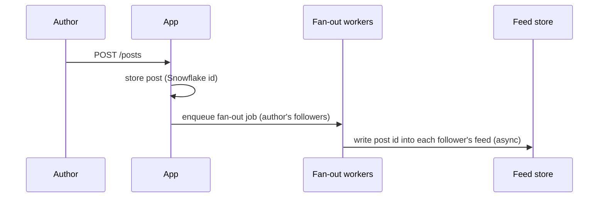
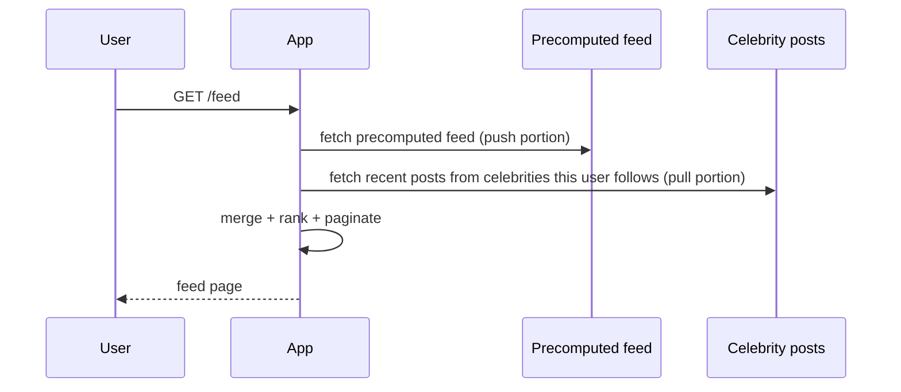

# Design a News Feed

> Difficulty: Advanced · Core SDE-2 problem
> Related concepts: [normalization-and-denormalization](../03-databases-and-data-modeling/normalization-and-denormalization.md) · [partitioning-and-sharding](../03-databases-and-data-modeling/partitioning-and-sharding.md) (hot keys) · [caching-fundamentals](../04-caching/caching-fundamentals.md)

The classic fan-out problem. It tests the push-vs-pull (fan-out-on-write vs fan-out-on-read) decision, the celebrity hot-key problem, and read-heavy caching at massive scale.

---

## A. Problem statement

Build a social news feed (Facebook/Twitter-style): users follow others; a user's feed shows recent posts from the people they follow, ranked (chronological or by relevance), loaded fast and infinitely scrollable.

## B. Requirement clarification

**Functional:** create posts; follow/unfollow; view a personalized feed of followees' recent posts; infinite scroll; (optionally) ranking by relevance, likes/comments.
**Non-functional (ask):**
- Scale? → DAU, posts/day, average followers/followees, celebrities (users with millions of followers)?
- Latency? → feed load must be **fast** (p99 < ~200ms) — read-heavy, on the critical path.
- Consistency? → eventual is fine (a post appearing a few seconds late is OK); read-your-own-post should be immediate.
- Ranking? → chronological to start; relevance-ranked as an extension.
**Scope:** post, follow, feed read. **Non-goals:** the full ranking ML, ads.
**Assumptions:** 500M users, 100M DAU, average 200 followees, celebrities exist (millions of followers), feed read-heavy, eventual consistency OK.

## C. Scale estimation

- **Feed reads:** 100M DAU × ~10 feed loads/day = 1B/day ≈ **~12,000 RPS** average; peak ×5 ≈ **~60,000 RPS** — very read-heavy → the design centers on fast feed reads.
- **Posts (writes):** say 100M posts/day ≈ ~1,200/sec — modest *writes*, but **fan-out** amplifies them massively.
- **Fan-out amplification:** a post by someone with 1,000 followers = 1,000 feed writes (push model); a celebrity with 10M followers = 10M feed writes per post — the core scaling problem.
- **Implication:** feed reads dominate; the push-vs-pull decision hinges on fan-out cost, especially the celebrity problem.

## D. API design

```
POST /posts                 -> create a post (201)
POST /users/{id}/follow     -> follow
GET  /feed?cursor=&limit=   -> personalized feed (cursor pagination, infinite scroll)
GET  /users/{id}/posts      -> a user's own posts
```
- Cursor pagination for infinite scroll (see [pagination-filtering-and-sorting](../01-networking-and-api-design/pagination-filtering-and-sorting.md)).

## E. Data modeling

- **posts:** id (Snowflake, time-ordered), author_id, content, created_at. Partition by author_id.
- **follows:** follower_id → followee_id (the social graph).
- **feed (precomputed, push model):** per-user timeline — a list of post ids (newest first), stored in a fast store (Redis/wide-column) keyed by user. This is a **denormalized read model** (see [normalization-and-denormalization](../03-databases-and-data-modeling/normalization-and-denormalization.md)).
- Post ids use Snowflake for time-ordering (see [id-generation-and-sequences](../06-distributed-systems/id-generation-and-sequences.md)).

## F. The core decision: fan-out on write vs read



- **Fan-out on write (push):** when a user posts, write the post id into each follower's precomputed feed. **Reads are fast** (feed is pre-assembled). **Writes are expensive** — a celebrity's post = millions of feed writes (write amplification; a hot "key" problem — see [partitioning-and-sharding](../03-databases-and-data-modeling/partitioning-and-sharding.md)).
- **Fan-out on read (pull):** store only posts; on feed load, query recent posts from all followees and merge/rank. **Writes are cheap**; **reads are expensive** (query + merge 200 followees per load, 60K times/sec).
- **Hybrid (the standard answer):** push for normal users (fast reads, affordable fan-out); **pull for celebrities** (don't fan out a celebrity's post to 10M feeds — instead, at read time, merge the viewer's precomputed feed with recent posts from the few celebrities they follow). This solves the celebrity hot-key problem.

**Interview-ready:** "I'd use fan-out-on-write for the common case (fast reads), but hybrid in with fan-out-on-read for celebrities to avoid millions of feed writes per celebrity post — merging precomputed feeds with celebrity posts at read time."

## G. High-level architecture



## H. Critical data flows

**Post (push fan-out, non-celebrity):**

Async fan-out (workers) so posting is fast; feeds update eventually (seconds — acceptable).

**Feed read (hybrid):**


## I. Bottleneck analysis

- **Celebrity fan-out (the headline problem):** a celebrity's post would be millions of feed writes → don't push; pull at read time (hybrid). This is the hot-key problem of feeds.
- **Feed read volume (~60K RPS):** precomputed feeds + heavy caching (hot feeds in Redis); feeds are a denormalized read model.
- **Write amplification:** push fan-out for a user with N followers = N writes; bounded for normal users, unbounded for celebrities (hence pull for them).
- **Feed store size:** per-user precomputed feeds × 500M users → large; cap feed length (store recent ~hundreds of post ids), expire inactive users' feeds (recompute on demand).
- **Ranking:** chronological is cheap (Snowflake id order); relevance ranking adds a scoring step (an extension — compute at read or precompute scores).

## J. Failure handling

- **Fan-out worker crash:** idempotent feed writes (adding a post id twice is a no-op — set semantics); at-least-once fan-out, re-run safe.
- **Feed store (Redis) down:** fall back to fan-out-on-read (query followees' recent posts) — slower but serving (graceful degradation — see [graceful-degradation](../06-distributed-systems/graceful-degradation.md)). Precomputed feeds are rebuildable.
- **Eventual consistency:** a post may take seconds to appear in followers' feeds — acceptable; the author sees their own post immediately (read their own posts directly).
- **Follow/unfollow:** eventually reflected; a backfill/trim adjusts feeds.

## K. Security and observability

- **AuthZ:** respect private accounts / blocks (don't show posts from blocked/private users to non-followers).
- **Abuse:** rate-limit posting; spam detection (separate system consuming the post stream).
- **Observability:** feed-read p99, cache hit ratio, fan-out worker lag (feed freshness), feed store size, celebrity-pull latency.

## L. Evolution of the design

- **Small:** fan-out on read (just query followees) — simplest, fine at low scale.
- **Growth:** fan-out on write (precompute feeds) for fast reads; cache hot feeds.
- **Scale:** hybrid (pull for celebrities) to solve the fan-out hot-key problem; cap feed length; expire inactive feeds.
- **Advanced:** relevance ranking (ML scoring), feed generation pipelines, multi-region, dedup/aggregation of similar posts.

## M. Interview walkthrough (abbreviated)

**I:** "Design a news feed." **C:** "Clarify: scale, average followees, do celebrities exist, ranking (chronological vs relevance), consistency?" **I:** [assumptions, including celebrities]. **C:** "Feed reads dominate (~60K RPS); posts are modest (~1,200/sec) but fan-out amplifies them. The core decision is fan-out-on-write (push: fast reads, expensive writes — a celebrity post = millions of feed writes) vs fan-out-on-read (pull: cheap writes, expensive reads — merge 200 followees per load). I'd use a **hybrid**: push for normal users (fast reads, affordable fan-out), pull for celebrities (merge their recent posts at read time) — solving the celebrity hot-key problem of millions of feed writes."
**C:** "Posting enqueues an async fan-out job (so posting is fast; feeds update in seconds — eventual consistency is fine; the author reads their own post directly for immediacy). Precomputed per-user feeds live in a fast store, heavily cached, capped to recent post ids, with inactive users' feeds expired and recomputed on demand. Posts use Snowflake ids for chronological ordering."
**I:** "A celebrity with 50M followers posts." **C:** [pull for celebrities — don't fan out]. **I:** "Feed store is down." **C:** [fall back to fan-out-on-read].

## N. Follow-up questions (with model answers)

1. **Fan-out on write vs read?** → Write (push) = fast reads, expensive writes (celebrity amplification); read (pull) = cheap writes, expensive reads (merge many followees). Hybrid: push for normal, pull for celebrities.
2. **How do you handle the celebrity problem?** → Don't push a celebrity's post to millions of feeds; pull their recent posts at read time and merge with the viewer's precomputed feed — avoiding massive write amplification/hot keys.
3. **Why is posting fast despite fan-out?** → Fan-out is async (workers); posting just stores the post and enqueues a job; feeds update in seconds (eventual).
4. **Feed store down — what happens?** → Fall back to fan-out-on-read (query followees' recent posts) — slower but serving; precomputed feeds are rebuildable.
5. **How do you keep feed storage bounded?** → Cap each feed to recent ~hundreds of post ids; expire inactive users' feeds and recompute on demand.
6. **Consistency — when does a post appear?** → Eventually (seconds) in followers' feeds (acceptable); the author sees their own post immediately by reading their own posts directly (read-your-write).
7. **Fan-out worker crashes — duplicate feed entries?** → Feed writes are idempotent (set semantics — adding a post id twice is a no-op), so at-least-once re-runs are safe.
8. **How do you rank the feed?** → Chronological via Snowflake ids (cheap) to start; relevance ranking adds a scoring step (precompute scores or score at read) — an extension.
9. **How do you handle unfollow / privacy / blocks?** → Trim/adjust feeds on follow changes (eventually); filter private/blocked authors at read time or exclude from fan-out.
10. **What's the first bottleneck?** → Celebrity fan-out write amplification (solved by pull-for-celebrities) and feed read volume (solved by precompute + cache).
11. **How big is a precomputed feed?** → Store recent post ids (hundreds), not full posts; hydrate post content from the posts store/cache at read time.
12. **Multi-region?** → Serve feeds from a nearby region; replicate feeds/posts; eventual cross-region (see [multi-region-architecture](../06-distributed-systems/multi-region-architecture.md)).
13. **How do you dedup/aggregate (e.g., "X and 5 others liked")?** → A read-time or precompute aggregation step over feed events — an extension.
14. **Why Snowflake ids for posts?** → Time-ordered (chronological feed), unique, no central bottleneck, shard-ready.
15. **Where does fan-out-on-read win outright?** → Low scale or users with few, non-celebrity followees; and as the celebrity fallback in the hybrid.

## O. Common mistakes

- Pure fan-out-on-write without handling celebrities (millions of writes per post — melts down).
- Pure fan-out-on-read at scale (querying 200 followees per load × 60K RPS — too slow).
- Not recognizing the celebrity hot-key problem (the signature issue).
- Synchronous fan-out (slow posting).
- Storing full posts in each feed (huge storage) instead of post ids.
- Demanding strong consistency (eventual is fine and far cheaper).

## P. Practice exercise

Design a **relevance-ranked feed** (not chronological): posts scored by predicted engagement (recency, affinity, post popularity). How does ranking change the push/pull decision and the feed store (do you precompute scores or score at read)? How do you keep ranking fresh as likes/comments update, and how do you page a ranked (non-chronological) feed with cursors? Compare with [normalization-and-denormalization](../03-databases-and-data-modeling/normalization-and-denormalization.md) (read models).
