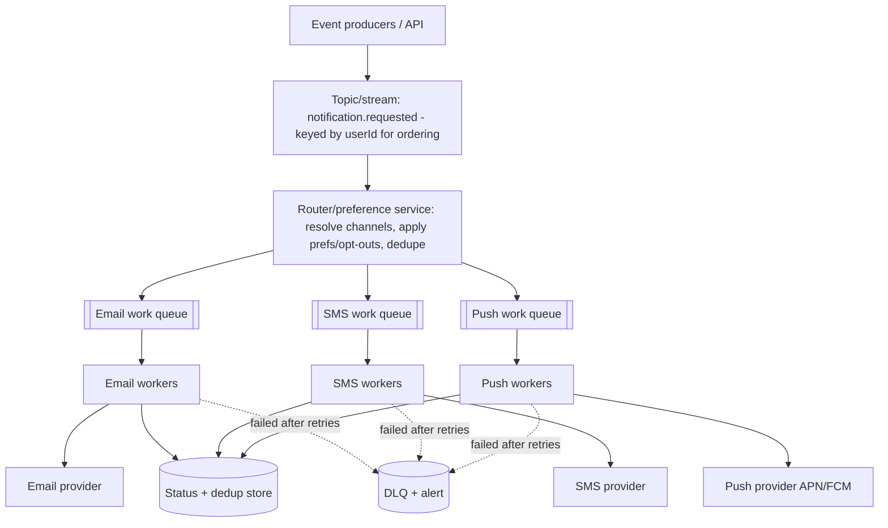
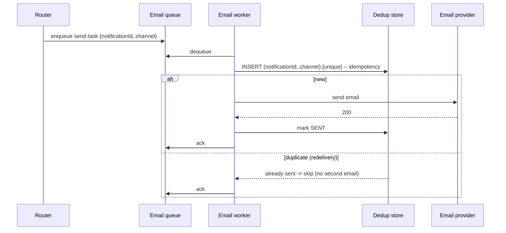

# Design a Notification Service

> Difficulty: Foundational→Intermediate · Core SDE-2 problem
> Related concepts: [queues-vs-pub-sub-vs-event-streams](../05-messaging-and-event-driven-systems/queues-vs-pub-sub-vs-event-streams.md) · [idempotency-and-deduplication](../05-messaging-and-event-driven-systems/idempotency-and-deduplication.md) · [retries-backoff-and-jitter](../05-messaging-and-event-driven-systems/retries-backoff-and-jitter.md) · [backpressure-and-consumer-lag](../05-messaging-and-event-driven-systems/backpressure-and-consumer-lag.md)

The running example of the messaging section — it exercises async processing, fan-out, delivery semantics, idempotency, retries/DLQ, and backpressure in one design.

---

## A. Problem statement

Build a service that sends notifications to users across multiple channels (email, SMS, push) in response to events, reliably and at scale, with retries, deduplication, and user preferences.

## B. Requirement clarification

**Functional:** send email/SMS/push; support templates; respect user preferences/opt-outs; retry failed sends; (optionally) scheduled/digest notifications; track delivery status.
**Non-functional (ask):**
- Scale? → notifications/day; spiky (launches, campaigns)? → assume **spiky**.
- Latency? → transactional (password reset) should be near-real-time; marketing can be delayed.
- Delivery guarantee? → **at-least-once** (don't lose a password reset) → users may get a rare duplicate → need idempotency.
- Ordering? → per-user ordering sometimes matters.
- Priority? → transactional > marketing.
**Scope:** accept notification requests → deliver across channels reliably. **Non-goals:** building the email/SMS providers (we integrate with external ones), the content/campaign authoring UI.
**Assumptions:** 50M DAU, ~5 notifications/user/day = 250M/day, spiky, at-least-once, per-user ordering for some types, priority tiers.

## C. Scale estimation

- **250M notifications/day** ≈ **~2,900/sec** average; spiky peak (×10 for a campaign) ≈ **~29,000/sec**.
- Split across channels (say 60% push, 30% email, 10% SMS).
- External providers have their own rate limits → the service must throttle to them (backpressure).
- **Storage:** delivery status/dedup records; ~250M/day × a few hundred bytes × retention → sized but manageable (time-partitioned, see [data-archival-and-retention](../03-databases-and-data-modeling/data-archival-and-retention.md)).
- **Implication:** heavy, spiky, async pipeline → queues + autoscaled workers + idempotency + DLQ + backpressure.

## D. API design

```
POST /notifications
  body: { userId, type, channel?|channels, templateId, data, priority?, idempotencyKey }
  202 Accepted: { notificationId, status: "QUEUED" }

GET /notifications/{id}        -> status (QUEUED/SENT/FAILED/...)
PUT /users/{id}/preferences    -> channel opt-ins/opt-outs, quiet hours
```
- Returns **202 Accepted** (async — see [synchronous-vs-asynchronous-processing](../02-compute-and-architecture/synchronous-vs-asynchronous-processing.md)); delivery happens in the background.
- `idempotencyKey` dedupes duplicate requests (and the pipeline dedupes redeliveries).

## E. Data modeling

- `notifications`: id, user_id, type, channel, status, template_id, created_at, priority. Time-partitioned.
- `sent_dedup`: unique `(notification_id, channel)` — the idempotency/dedup record (unique constraint). TTL'd to the retry window.
- `user_preferences`: per-channel opt-ins, quiet hours, do-not-disturb.
- Status lifecycle: QUEUED → SENDING → SENT / FAILED → (retry) → DLQ.

## F. High-level architecture


Each component: the **stream** fans out events and gives per-user ordering (keyed by userId — see [ordering-and-consumer-groups](../05-messaging-and-event-driven-systems/ordering-and-consumer-groups.md)); the **router** applies preferences/opt-outs and dedupes; **per-channel work queues** distribute send-tasks to **autoscaled workers** (scale on queue depth); workers call external providers with retries, write status, and DLQ poison messages. Priority via separate high/low-priority queues (transactional first).

## G. Critical data flows

**Send (happy path + the duplicate case):**

If the worker crashes after sending but before acking (at-least-once — see [message-delivery-semantics](../05-messaging-and-event-driven-systems/message-delivery-semantics.md)), the task is redelivered; the dedup record makes the retry a no-op → **the user gets exactly one email** (effectively-once via idempotency).

**Retry/DLQ:** provider 5xx/timeout → retry with exponential backoff + jitter (see [retries-backoff-and-jitter](../05-messaging-and-event-driven-systems/retries-backoff-and-jitter.md)); after N attempts → DLQ + alert (see [dead-letter-queues](../05-messaging-and-event-driven-systems/dead-letter-queues.md)).

## H. Bottleneck analysis

- **Spike / consumer lag:** a campaign spikes producers; workers lag. Autoscale workers on queue depth; prioritize transactional over marketing; shed/defer low-priority if needed (see [backpressure-and-consumer-lag](../05-messaging-and-event-driven-systems/backpressure-and-consumer-lag.md)).
- **External provider limits:** providers rate-limit; a concurrency limiter per provider prevents hammering it (and a recovery surge from overwhelming it). Circuit-break a down provider.
- **Dedup store:** read/written per send → size it (keys × retention), make it fast (Redis or a DB unique index).
- **Ordering:** per-user ordering via keyed partitions (not global).

## I. Failure handling

- **Duplicate delivery:** idempotency (dedup record) → exactly one send per (notification, channel).
- **Provider down:** retries with backoff; circuit breaker to fail fast; messages persist in the queue; DLQ after exhaustion; a backup provider as fallback (graceful degradation — see [graceful-degradation](../06-distributed-systems/graceful-degradation.md)).
- **Poison message (bad template/deleted user):** retried a few times → DLQ + alert; pipeline keeps flowing.
- **Backlog:** autoscale + prioritize + shed low-priority; protect providers during recovery.
- **Lost status write:** reconcile status against provider delivery receipts.

## J. Trade-offs and alternatives

| Decision | Chosen | Alternative | Why |
|---|---|---|---|
| Sync vs async | Async (202 + queue) | Sync send | Providers are slow/unreliable; decouple + retry + absorb spikes |
| Delivery semantic | At-least-once + idempotency | At-most-once | Don't lose transactional notifications; dedupe duplicates |
| Fan-out | Stream (per-user keyed) + per-channel queues | One queue | Independent channel scaling + per-user ordering + replay |
| Priority | Separate high/low queues | Single queue | Transactional must not wait behind marketing |
| Provider failure | Retry+backoff+circuit breaker+backup provider | Fail the notification | Graceful degradation; don't drop important sends |

**Two architectures:** (1) stream + per-channel work queues (above) — good separation; (2) a single queue with a channel field — simpler but couples channel scaling and loses easy per-channel prioritization. Prefer (1) at this scale.

## K. Security and observability

- **Preferences/opt-outs enforced** (compliance — CAN-SPAM/GDPR; honor unsubscribes).
- **No PII in logs**; template data handled carefully; provider credentials in a secrets manager (see [secrets-and-key-management](../08-security/secrets-and-key-management.md)).
- **Rate-limit producers** so one tenant/campaign can't flood (see [abuse-prevention-and-rate-limiting](../08-security/abuse-prevention-and-rate-limiting.md)).
- **Metrics:** per-channel send rate, delivery/failure rate, consumer lag, DLQ depth, provider latency/error rate. **Alert** on lag (users not getting notifications) and DLQ growth.

## L. Evolution of the design

- **Small:** send synchronously inline (fine at low volume).
- **Growth:** queue + workers (decouple, retry, absorb spikes).
- **Scale:** per-channel queues, autoscaling, priority tiers, idempotency, DLQ, provider circuit breakers.
- **Advanced:** scheduled/digest notifications (batch per user at their local time — see the digest exercise in [INTERVIEW-CHECKLIST](../INTERVIEW-CHECKLIST.md)), analytics via a stream, multi-provider failover, user-level rate limits (don't spam a user).

## M. Interview walkthrough (abbreviated)

**I:** "Design a notification service." **C:** "Clarify: channels, scale/spikiness, delivery guarantee, ordering, priority." **I:** "Email/SMS/push, ~250M/day, spiky, don't lose transactional ones." **C:** "That's ~3K/sec average, ~30K/sec peak during campaigns — heavy and spiky, so an async pipeline. API returns 202; a stream (keyed by userId for per-user ordering) fans out to a router that applies preferences and dedupes, then to per-channel work queues drained by autoscaled workers calling the providers. At-least-once delivery means a crash-before-ack causes redelivery, so each worker dedupes on (notificationId, channel) via a unique constraint — the user gets exactly one send. Retries use backoff+jitter; after N attempts, DLQ + alert."
**C:** "Spikes: autoscale workers on queue depth, prioritize transactional over marketing via separate queues, shed low-priority if needed, and a per-provider concurrency limiter + circuit breaker so a down/rate-limited provider doesn't block or get hammered."
**I:** "A worker crashes after sending — duplicate email?" **C:** [idempotency/dedup answer]. **I:** "A campaign floods the system." **C:** [backpressure/priority/shedding answer].

## N. Follow-up questions (with model answers)

1. **Worker crashes after sending, before ack — duplicate?** → At-least-once redelivery would resend, but the dedup record on (notificationId, channel) makes the retry a no-op → exactly one send.
2. **How do you prevent duplicate business effects?** → Idempotent sends keyed by (notification, channel), atomic unique insert before sending.
3. **A provider is down — what happens?** → Retry with backoff; circuit-break to fail fast; messages persist in the queue; fall back to a backup provider; DLQ after exhaustion. No lost notifications.
4. **How do you handle a campaign spike (consumer lag)?** → Autoscale workers on queue depth; prioritize transactional (separate queue); shed/defer marketing; limit concurrency to providers so recovery doesn't overwhelm them.
5. **How do you preserve per-user ordering?** → Key the stream by userId so a user's notifications share a partition (ordered); different users parallelize.
6. **Poison message (bad template)?** → Retry a few times → DLQ + alert; pipeline keeps flowing (head-of-line avoided).
7. **How do you respect opt-outs/preferences?** → The router checks user_preferences before enqueuing to a channel; honor unsubscribes (compliance).
8. **Transactional vs marketing priority?** → Separate high/low-priority queues; workers drain high first; shed low under load.
9. **How do you avoid spamming a user?** → Per-user rate limits / quiet hours / digest batching; dedupe near-identical notifications.
10. **How do you know a notification was delivered?** → Provider delivery receipts/webhooks update status; reconcile against the provider for drift.
11. **Scheduled/digest notifications?** → Aggregate a user's events and send at their local time (time-zone sharding) — a scheduler enqueues at the right time; idempotent so a scheduler retry doesn't double-send.
12. **Why not synchronous sends?** → Providers are slow/unreliable; sync would couple latency and fail the whole request on a provider blip. Async decouples + retries + absorbs spikes.
13. **Dedup store sizing/retention?** → Keys × retention (≥ the max retry window); TTL old keys; use Redis or a DB unique index.
14. **Exactly-once?** → Not at the delivery layer — effectively-once via at-least-once + idempotency + provider receipts/reconciliation (see [exactly-once-processing](../06-distributed-systems/exactly-once-processing.md)).
15. **How do you add a new channel (e.g., WhatsApp)?** → Add a new consumer group on the stream + a channel queue + workers + provider integration — the stream's replay lets you backfill if needed.
16. **Multi-tenant fairness?** → Per-tenant rate limits / separate queues so one tenant's campaign doesn't starve others.

## O. Common mistakes

- Synchronous sends (fragile, slow, no spike absorption).
- No idempotency → duplicate notifications on redelivery.
- One queue for all channels/priorities (couples scaling, no prioritization).
- No DLQ → poison messages block the pipeline.
- Hammering a down/rate-limited provider (no circuit breaker / concurrency limit).
- No backpressure/prioritization under campaign spikes.
- Ignoring opt-outs/preferences (compliance + UX).

## P. Practice exercise

Design the **scheduled daily digest** extension: aggregate each user's activity over the day and send one summary at their local 8 AM, for 50M users across time zones. How do you shard by time zone, schedule the sends, aggregate per user, and ensure idempotent delivery (a scheduler retry must not double-send)? Compare with the digest assessment in [INTERVIEW-CHECKLIST](../INTERVIEW-CHECKLIST.md).
