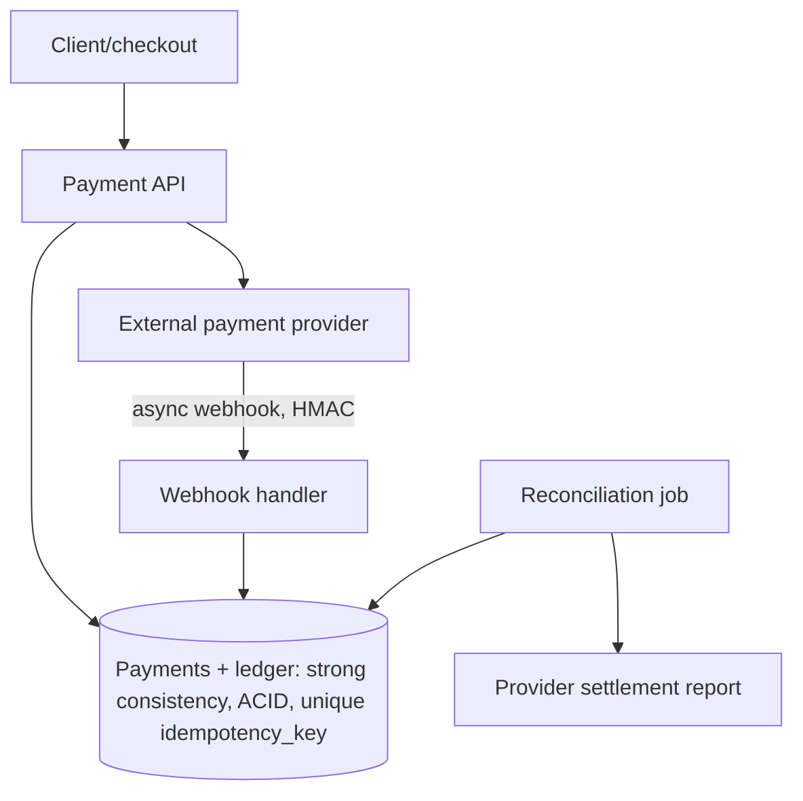
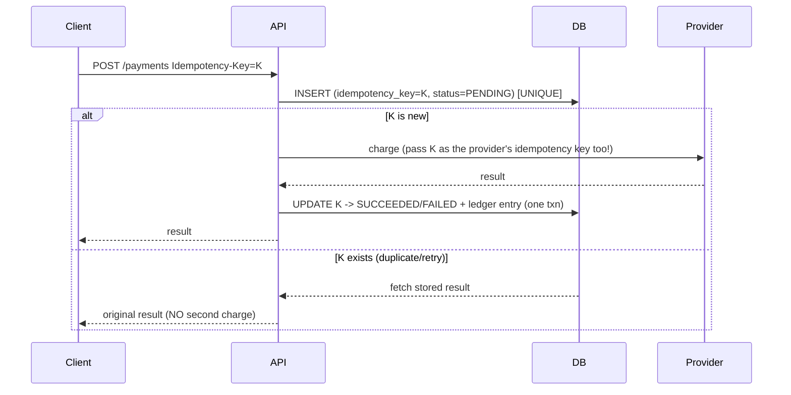

# Design a Payment System

> Difficulty: Advanced · Core SDE-2 problem
> Related concepts: [retries-and-duplicate-execution](../06-distributed-systems/retries-and-duplicate-execution.md) · [idempotency-and-deduplication](../05-messaging-and-event-driven-systems/idempotency-and-deduplication.md) · [exactly-once-processing](../06-distributed-systems/exactly-once-processing.md) · [idempotent-recovery-and-reconciliation](../07-reliability-and-resilience/idempotent-recovery-and-reconciliation.md) · [saga-pattern](../05-messaging-and-event-driven-systems/saga-pattern.md)

The ultimate correctness-and-consistency design. It's where "never double-charge," idempotency, strong consistency, sagas, and reconciliation all converge. Interviewers probe failure handling relentlessly.

---

## A. Problem statement

Build a system to process payments: charge a customer (via an external payment provider), record the transaction in a ledger, handle refunds, and guarantee a customer is never double-charged or incorrectly charged — despite retries, timeouts, and partial failures.

## B. Requirement clarification

**Functional:** charge a payment (card/wallet via a provider); record in a ledger; refunds; handle webhooks from the provider (async confirmation); idempotent create.
**Non-functional (ask):**
- Correctness: **money must be exactly right** — never double-charge, never lose a payment record. This dominates everything.
- Consistency: **strong** for the ledger/balance.
- Availability: important, but **correctness > availability** (reject rather than risk a wrong charge).
- Durability: **no data loss** (every charge recorded).
- Scale? → payments/sec; usually modest vs reads, but correctness-critical.
**Scope:** charge, ledger, refund, idempotency, reconciliation. **Non-goals:** fraud detection (mention), the actual card network (we integrate a provider like Stripe).
**Assumptions:** external payment provider; strong consistency; correctness paramount.

## C. Scale estimation

- Payments are usually **lower RPS** than reads but each is critical. Say an e-commerce peak of ~1,000 payments/sec → modest throughput, but every one must be exactly-once in *effect*.
- **Ledger storage:** every transaction + status change recorded immutably (audit) → grows steadily; time-partitioned; often **event-sourced** for a complete audit trail (see [event-sourcing-and-cqrs](../05-messaging-and-event-driven-systems/event-sourcing-and-cqrs.md)).
- **Implication:** the design is about **correctness under failure**, not raw scale. Use a strongly-consistent relational DB (ACID), idempotency keys, and reconciliation.

## D. API design

```
POST /payments
  headers: Idempotency-Key: <client-generated unique key>
  body: { amount, currency, customerId, paymentMethod, orderId }
  201: { paymentId, status: PENDING|SUCCEEDED|FAILED }
  (replay with same key -> returns the ORIGINAL result, no second charge)

GET  /payments/{id}            -> status
POST /payments/{id}/refund     -> refund (also idempotent)
POST /webhooks/provider        -> provider async confirmation (HMAC-verified)
```
- The **Idempotency-Key is mandatory** on charge — the single most important API decision (see [rest-and-api-design](../01-networking-and-api-design/rest-and-api-design.md)).
- Webhooks (HMAC-verified — see [webhooks-and-callbacks](../01-networking-and-api-design/webhooks-and-callbacks.md)) deliver the provider's final confirmation asynchronously.

## E. Data modeling

- **payments:** id, idempotency_key (UNIQUE), customer_id, amount, currency, status (PENDING→SUCCEEDED/FAILED), provider_ref, created_at. The **unique constraint on idempotency_key is the dedup backbone**.
- **ledger (immutable, append-only / event-sourced):** every debit/credit as an immutable entry → full audit trail, reconstruct balances at any time. Double-entry bookkeeping (every transaction balances).
- Strong consistency (ACID) on the payment + ledger writes; they're written in **one transaction** (co-located — see [distributed-transactions](../03-databases-and-data-modeling/distributed-transactions.md)).
- Relational DB (Postgres) — correctness/transactions over scale; definitely **not** eventually-consistent NoSQL for the ledger.

## F. High-level architecture


Components: the **payments DB** (strongly consistent, with the unique idempotency key); the **external provider** (does the actual money movement); the **webhook handler** (receives the provider's async final status); the **reconciliation job** (compares the ledger against the provider's settlement report to catch drift — the honest correctness backstop, see [idempotent-recovery-and-reconciliation](../07-reliability-and-resilience/idempotent-recovery-and-reconciliation.md)).

## G. Critical data flows

**Charge (the correctness-critical path):**

This is the safe version of the unsafe check-then-charge (see [retries-and-duplicate-execution](../06-distributed-systems/retries-and-duplicate-execution.md)):
- **Atomic unique-key insert** before charging → closes the concurrent-request race.
- **Pass K to the provider** → the provider dedupes *its* charge, closing the "charged but our write failed" window.
- **Record result + ledger in one transaction** → never "charged" without a record.
- **Replay returns the original** → client retries are safe.

**Async confirmation (webhook):** the provider's final status may arrive via webhook after the sync response; the handler (HMAC-verified, idempotent on the event id) updates the payment/ledger. Handles cases where the sync call timed out but the charge succeeded.

**The residual gap + reconciliation:** there's still a window where the provider charged but we failed to record (crash). A **reconciliation job** periodically compares our ledger with the provider's settlement report and fixes discrepancies (create the missing ledger entry, or refund an invalid charge) — flagging money differences for human review. This is why the honest answer to "guarantee exactly-once charging" is "**effectively-once via idempotency + reconciliation**," not a hard guarantee (see [exactly-once-processing](../06-distributed-systems/exactly-once-processing.md)).

## H. Bottleneck analysis

- **Correctness, not throughput, is the "bottleneck":** the design optimizes for never-double-charge. The idempotency unique-key insert + single-transaction ledger write are the critical correctness mechanisms.
- **Provider latency/availability:** charges depend on an external provider; use timeouts + idempotency (so a retry after a timeout is safe) + the webhook for async confirmation + a circuit breaker if the provider is down (fail the payment cleanly, don't double-attempt unsafely).
- **Ledger growth:** time-partition; event-sourced immutable log; archive old entries.
- **Hot row (a popular merchant's balance):** if maintaining a running balance, that row is contended — use the append-only ledger (balance = sum/projection) rather than a mutable balance row, or optimistic locking.

## I. Failure handling (the heart of this design)

- **Double charge (concurrent requests):** atomic unique idempotency-key insert → one proceeds, the other returns the original.
- **Double charge (our write fails after charging):** pass K to the provider → the retry re-charges with the same key → the provider dedupes → + reconciliation catches residual drift.
- **Double charge (client retry on timeout):** idempotency key returns the original result.
- **Charge succeeded but we think it failed (lost response):** the webhook delivers the true status; reconciliation catches it.
- **Partial failure across services (order + inventory + payment):** a **saga** with compensation — if payment fails, release inventory + cancel order; if a later step fails after payment, refund (see [saga-pattern](../05-messaging-and-event-driven-systems/saga-pattern.md)). Co-locate payment + ledger so *that* part is one local transaction.
- **No lost records:** ledger write is durable (ACID + WAL + backups/PITR — see [backups-and-point-in-time-recovery](../07-reliability-and-resilience/backups-and-point-in-time-recovery.md)).
- **Reconciliation is the backstop** for everything the above can't fully guarantee.

## J. Trade-offs and alternatives

| Decision | Chosen | Alternative | Why |
|---|---|---|---|
| Store | Strongly-consistent relational (ACID) | Eventually-consistent NoSQL | Money needs strong consistency; a stale/conflicting balance is a correctness bug |
| Idempotency | Mandatory key, atomic insert, passed to provider | Check-then-charge | The only safe way to avoid double-charge under retries/concurrency |
| Balance | Append-only ledger (projection) | Mutable balance row | Avoids hot-row contention; full audit trail; reconstructable |
| Cross-service | Saga + compensation, payment+ledger co-located | 2PC | 2PC blocks/can't include the external provider; saga stays available |
| Correctness guarantee | Effectively-once (idempotency + reconciliation) | Claim exactly-once | Exactly-once is impossible end-to-end; be honest + reconcile |
| Availability vs consistency | Reject rather than risk wrong charge (CP) | Serve anyway (AP) | Money: correctness > availability under partition |

## K. Security and observability

- **PCI/sensitive data:** don't store raw card data (tokenize via the provider); encrypt sensitive fields; strict access control (see [encryption-and-data-protection](../08-security/encryption-and-data-protection.md)).
- **Webhook security:** HMAC-verify provider webhooks; replay protection (see [webhooks-and-callbacks](../01-networking-and-api-design/webhooks-and-callbacks.md)).
- **Audit:** the immutable ledger is the audit trail; log every state change (no PII/card data in logs).
- **Observability:** payment success/failure rate, provider latency/error rate, reconciliation discrepancies (alert!), PENDING payments stuck too long (reconcile), duplicate-key hits.
- **Fraud:** mention as a separate system consuming the payment stream.

## L. Evolution of the design

- **Core:** strongly-consistent payments + ledger + idempotency + reconciliation (correctness first).
- **Multi-service checkout:** saga across order/inventory/payment with compensation.
- **Audit/temporal needs:** event-source the ledger (full history, reconstruct any balance — see [event-sourcing-and-cqrs](../05-messaging-and-event-driven-systems/event-sourcing-and-cqrs.md)); CQRS for balance/statement read models.
- **Scale:** partition by customer/merchant; the ledger grows but RPS is usually modest; reconciliation scales incrementally.
- **Multi-provider:** route to multiple providers (failover/cost); each charge keyed per provider; reconciliation per provider.

## M. Interview walkthrough (abbreviated)

**I:** "Design a payment system." **C:** "The dominant requirement is correctness — never double-charge, never lose a record — so correctness beats raw scale, and I'll favor strong consistency (reject rather than risk a wrong charge). RPS is usually modest; the hard part is failure handling."
**C:** "API: POST /payments with a mandatory Idempotency-Key. The safe charge flow: atomically insert the idempotency key (unique constraint) before charging — this closes the concurrent-request race; call the provider passing the same key so it dedupes its charge; record the result + a ledger entry in one transaction so we never say 'charged' without a record; a replay with the same key returns the original result. The ledger is append-only/double-entry for a full audit trail; the balance is a projection, avoiding hot-row contention."
**C:** "Residual gaps — the provider charged but our write crashed — are caught by (a) the provider's async webhook delivering the true status and (b) a reconciliation job comparing our ledger with the provider's settlement report, flagging money differences for review. So it's *effectively-once via idempotency + reconciliation*, not a hard exactly-once guarantee."
**I:** "Walk me through why naive check-then-charge is unsafe." **C:** [the three failure modes from [retries-and-duplicate-execution](../06-distributed-systems/retries-and-duplicate-execution.md)]. **I:** "Checkout spans order, inventory, payment." **C:** [saga + compensation, co-locate payment+ledger].

## N. Follow-up questions (with model answers)

1. **How do you guarantee no double-charge?** → You can't give an absolute guarantee; effectively-once via: atomic unique idempotency-key insert (closes the concurrent race), pass the key to the provider (dedupes the external charge), record result+ledger in one transaction, replay returns the original, and reconciliation catches residual drift.
2. **Why is check-then-charge unsafe?** → Concurrent requests both pass the check; a write-after-charge failure re-charges on retry; a client retry after a timeout re-charges. It's non-atomic and non-idempotent.
3. **The provider charged but our DB write failed — now what?** → The async webhook delivers the true status; reconciliation (ledger vs settlement report) detects the orphan charge and creates the missing record. The idempotency key passed to the provider prevents a *second* charge on retry.
4. **Strong or eventual consistency?** → Strong for the ledger/balance; a stale/conflicting balance risks a wrong charge. Correctness > availability (CP) for money.
5. **Mutable balance row or ledger?** → Append-only ledger (balance = projection) — avoids hot-row contention and gives a full audit trail; a mutable balance row is a contended hot row and loses history.
6. **Checkout spans order + inventory + payment — how?** → Saga with compensation (release inventory + cancel order on payment failure; refund if a later step fails); co-locate payment+ledger so that part is one local transaction; avoid 2PC (can't include the external provider).
7. **How do you handle the provider being down?** → Timeout + circuit breaker (fail the payment cleanly); idempotency makes a later safe retry possible; don't blindly re-attempt (could double-charge without the key).
8. **Refunds?** → Also idempotent (keyed); recorded as ledger entries; reconciled.
9. **Why reconciliation if you have idempotency?** → Idempotency prevents most duplicates, but crash windows and external-system edge cases leave residual drift; reconciliation is the honest backstop that *verifies* correctness, flagging money differences for humans.
10. **How do you store card data?** → You don't — tokenize via the provider (PCI); encrypt any sensitive fields; strict access control; no card data in logs.
11. **Webhook security?** → HMAC-verify the provider's signature + replay protection; idempotent on the event id.
12. **Stuck PENDING payments?** → A reconciliation/sweep queries the provider for the true status and resolves them (succeeded/failed), idempotently.
13. **Event sourcing the ledger — why?** → Full audit trail + reconstruct any balance at any time (regulatory); pair with CQRS read models for current balances/statements.
14. **Multi-provider failover?** → Route to multiple providers; key each charge per provider; reconcile per provider; a down provider fails fast and a retry can go to a backup (with its own key).
15. **Exactly-once?** → Impossible at the delivery/charge layer; effectively-once via idempotency (incl. at the provider) + reconciliation — be explicit that reconciliation closes the final gap.
16. **How do you scale the ledger?** → Partition by customer/merchant; time-partition for retention; RPS is usually modest, so correctness mechanisms (not throughput) dominate.

## O. Common mistakes

- Check-then-charge (the classic double-charge bug).
- No idempotency key / not passing it to the provider.
- Eventually-consistent store for the ledger/balance.
- Mutable balance row (hot-row contention, no audit trail).
- Claiming exactly-once with no reconciliation.
- Storing raw card data.
- 2PC across services including the external provider.
- Auto-fixing money discrepancies without human review.

## P. Practice exercise

Design a **wallet/account-transfer system** (move money from account A to B atomically) where A and B may be on different shards. Compare: keeping both on one shard (local transaction), a saga (debit → credit with compensation), and the correctness guarantees of each. How do you prevent a transfer from double-debiting on retry, and how does reconciliation verify total money is conserved? Compare with [distributed-transactions](../03-databases-and-data-modeling/distributed-transactions.md).
