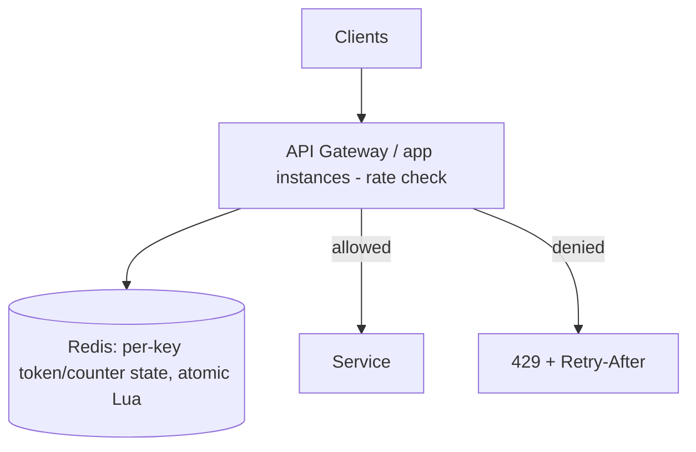
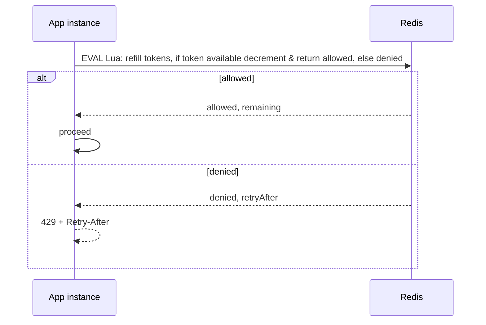

# Design a Rate Limiter

> Difficulty: Foundational · Core SDE-2 problem
> Related concepts: [rate-limiting](../01-networking-and-api-design/rate-limiting.md) · [redis-design-and-failure-modes](../04-caching/redis-design-and-failure-modes.md) · [abuse-prevention-and-rate-limiting](../08-security/abuse-prevention-and-rate-limiting.md)

A deceptively deep problem: it tests algorithms, distributed shared state, atomicity, and the fail-open/closed decision. A frequent standalone question and a component in almost every system.

---

## A. Problem statement

Build a service/component that limits how many requests a client can make in a time window (e.g., 100 req/min per API key), rejecting excess with `429`. It must work across many application servers.

## B. Requirement clarification

**Functional:** enforce a configurable limit per key (user/API key/IP); return 429 + Retry-After on exceed; support different limits per endpoint/tier.
**Non-functional (ask):**
- Where enforced? → at the API gateway/edge and/or per-service.
- Accuracy vs performance? → does a small overshoot matter (soft) or must it be strict (hard)?
- Scale? → RPS across all app servers; the limiter must not become a bottleneck.
- Distributed? → yes — many app instances, so per-instance counters won't work for a global limit.
- Fail-open or fail-closed if the limiter store is down?
**Scope:** the limiting mechanism (algorithm + distributed state). **Non-goals:** the full abuse-detection system (mention).
**Assumptions:** limit per API key, ~50 app instances, high RPS, strict-ish global limit, Redis-backed.

## C. Scale estimation

- If the service does **100,000 RPS** and every request is rate-checked, the limiter does ~100K ops/sec.
- A single Redis node handles ~100K ops/sec (heuristic) — near the limit, so consider sharding the limiter state by key or a local pre-check (below).
- Per-key state is tiny (a counter + timestamp, ~tens of bytes); even millions of keys fit in a few hundred MB of Redis.
- **Implication:** the limiter's own throughput and the hot-key risk are the scaling concerns; the state is small.

## D. API / interface

As a component, the interface is `allow(key, limit, window) → {allowed, remaining, retryAfter}`. As a service behavior:
```
Any request -> rate check
  allowed:  proceed
  denied:   429 Too Many Requests
            headers: Retry-After, X-RateLimit-Remaining, X-RateLimit-Reset
```

## E. Data modeling (the algorithm choice)

The core is the algorithm (full treatment in [rate-limiting](../01-networking-and-api-design/rate-limiting.md)):

| Algorithm | State per key | Note |
|---|---|---|
| **Token bucket** | tokens + last-refill timestamp | Allows bursts up to bucket size; smooth average. **Default.** |
| Leaky bucket | queue/level | Smooths to a steady rate; delays |
| Fixed window | count + window start | Simple but 2× boundary burst |
| Sliding window counter | current + previous window counts | Accurate, cheap approximation |

**Recommend token bucket** (allows controlled bursts, bounds average) or sliding-window-counter (if boundary accuracy matters). State lives in Redis keyed by the client key.

## F. High-level architecture (distributed)



- **Shared state in Redis:** since ~50 instances each see only part of the traffic, per-instance counters would let a client do 50× the limit. A **shared store (Redis)** holds the authoritative per-key state.
- **Atomic check-and-decrement:** implemented as a single **Lua script** (or atomic `INCR` + expiry) so two instances can't both think a token is available (race → over-limit). Atomicity is the crux.
- **Enforced at the gateway** (reject early, before wasting app capacity) and/or per-service for business limits.

## G. Critical data flow


The Lua script does refill + check + decrement **atomically** in one round trip — no race, one network hop.

## H. Bottleneck analysis

- **Redis throughput / hot key:** at very high RPS, the limiter's Redis can be a bottleneck, and a single huge-tenant key is a **hot key** (one Redis node — see [stampedes-hot-keys-and-penetration](../04-caching/stampedes-hot-keys-and-penetration.md)). Mitigate: shard limiter state by key across Redis nodes (consistent hashing), or a **hybrid local-pre-check** — each instance keeps a local token bucket sized to its fair share, reconciled with Redis periodically (approximate but far fewer Redis ops).
- **Per-request latency:** each check adds a sub-ms Redis round trip; the hybrid reduces this.
- **The limiter must not be a SPOF/bottleneck** — hence the fail-open/closed decision and sharding.

## I. Failure handling

- **Redis down — the key decision:** **fail-open** (allow traffic, risk backend overload — better for user-facing availability) or **fail-closed** (reject, protect the backend — better for abuse-critical paths). State it explicitly and make it configurable; often fail-open with a **local fallback cap** per instance so you're not fully unprotected. (See [rate-limiting](../01-networking-and-api-design/rate-limiting.md).)
- **Clock issues:** token refill uses elapsed time; use a monotonic source / Redis server time to avoid skew issues (see [clock-skew-and-logical-clocks](../06-distributed-systems/clock-skew-and-logical-clocks.md)).
- **Race on check:** prevented by the atomic Lua script.
- **Hot key:** sharded keys / local pre-check.

## J. Trade-offs and alternatives

| Decision | Chosen | Alternative | Why |
|---|---|---|---|
| Algorithm | Token bucket (or sliding window counter) | Fixed window | Allows bursts, bounds average; fixed window has 2× boundary flaw |
| State | Redis (shared, atomic) | Per-instance counters | Per-instance allows N× the limit for a global cap |
| Atomicity | Lua script / INCR+expiry | Read-then-write | Avoids the check race |
| Redis down | Fail-open + local cap (configurable) | Fail-closed | Availability for user-facing; closed for abuse-critical |
| Extreme scale | Hybrid local pre-check + periodic Redis reconcile | Pure Redis per request | Fewer Redis ops, defuses hot keys; approximate |

## K. Security and observability

- Rate limiting *is* a security control (DoS, brute force — see [abuse-prevention-and-rate-limiting](../08-security/abuse-prevention-and-rate-limiting.md)); choose the **key dimension** by the abuse (per-account for brute force, per-IP for anonymous DoS, per-API-key for fair use).
- **Metrics:** 429 rate per key/endpoint, Redis latency, limiter error rate, fail-open activations.
- **Observability:** emit remaining/limit headers so clients self-throttle; alert if 429s spike (abuse or mis-set limits).

## L. Evolution of the design

- **Single server:** in-memory token bucket — trivial.
- **Multiple servers:** Redis-backed shared state (the main design).
- **Very high RPS:** shard Redis by key + hybrid local pre-check to cut Redis load and hot keys.
- **Global/multi-region:** per-region limits (cross-region strict limits are latency-expensive) or regional buckets reconciled centrally.

## M. Interview walkthrough (abbreviated)

**I:** "Design a rate limiter." **C:** "Clarify: enforced where, strict or soft, distributed across how many instances, and fail-open vs closed when the store is down?" **I:** "Per API key, ~50 instances, strict-ish global limit." **C:** "Per-instance counters won't work — a client would get 50× the limit — so I need shared state in Redis. Algorithm: token bucket (allows bursts, bounds average); fixed window has the 2× boundary flaw. The check-refill-decrement must be atomic — a Lua script in one round trip — or two instances race and both allow. Enforce at the gateway, return 429 + Retry-After."
**C:** "At very high RPS, Redis throughput and hot keys (one big tenant) become the bottleneck — I'd shard limiter state by key and/or add a local per-instance pre-check reconciled with Redis periodically. If Redis is down, I'd fail open with a local fallback cap for user-facing paths, fail closed for abuse-critical ones — an explicit, configurable decision."
**I:** "Redis is down — allow or block?" **C:** [the fail-open/closed answer]. **I:** "A single tenant sends most traffic." **C:** [hot-key answer].

## N. Follow-up questions (with model answers)

1. **Why not per-instance counters?** → Each instance sees only part of the traffic, so a client gets up to N× the limit; a global limit needs shared state.
2. **Token bucket vs fixed window?** → Token bucket allows controlled bursts and bounds the average; fixed window allows a 2× burst across the window boundary.
3. **How do you avoid the check-and-decrement race?** → An atomic Lua script (or `INCR`+expiry) so refill+check+decrement is one atomic op.
4. **Redis is down — allow or block?** → Fail-open with a local fallback cap for user-facing availability; fail-closed for abuse-critical endpoints. Make it explicit/configurable.
5. **A single key gets most traffic (hot key).** → Shard limiter state by key (consistent hashing) and/or a local per-instance pre-check reconciled with Redis periodically.
6. **How do you rate-limit at very high RPS without the limiter being the bottleneck?** → Hybrid: local token bucket per instance (sized to its share) + periodic Redis reconcile — far fewer Redis ops, approximate.
7. **What's the right key dimension?** → Match the abuse: per-account for brute force, per-IP for anonymous DoS, per-API-key for fair use; often combine.
8. **How do clients know their limit?** → Return `X-RateLimit-Remaining/Reset` and `Retry-After` so well-behaved clients self-throttle.
9. **Sliding window log vs counter?** → Log is accurate but stores every timestamp (memory-heavy); counter is a cheap weighted approximation — prefer counter at scale.
10. **Multi-region rate limiting?** → Per-region limits (strict cross-region limits cost ~100ms+ per check); or regional buckets reconciled centrally, accepting approximate global enforcement.
11. **How do you handle different tiers (free vs paid)?** → Config maps key → limit; the limiter reads the applicable limit per key.
12. **What if the Lua script / Redis is slow?** → Tight timeout + fail-open fallback so the limiter can't hang requests (Little's Law); monitor Redis latency.
13. **Clock skew affecting refill?** → Use Redis server time / monotonic elapsed time, not each instance's wall clock.
14. **How do you test it?** → Load test at/above the limit; verify global enforcement across instances and the fail-open/closed behavior under a simulated Redis outage.
15. **Leaky bucket vs token bucket?** → Leaky bucket enforces a steady output rate (queues/delays); token bucket permits bursts — token bucket is usually better UX for APIs.

## O. Common mistakes

- Per-instance counters for a global limit (N× overshoot).
- Fixed window where strict limits matter (2× boundary burst).
- Non-atomic check-then-decrement (race → over-limit).
- No fail-open/closed decision for a Redis outage.
- Ignoring the hot-key problem at scale.
- Letting the limiter hang requests when Redis is slow (no timeout).

## P. Practice exercise

Design a rate limiter that supports **multiple simultaneous limits per request** (e.g., 10 req/sec AND 1,000 req/hour AND 10,000 req/day per API key), all enforced atomically. How do you check all three limits in one atomic Redis operation, and what do you return when one is exceeded but others aren't? How does this change the state model and the Lua script?
