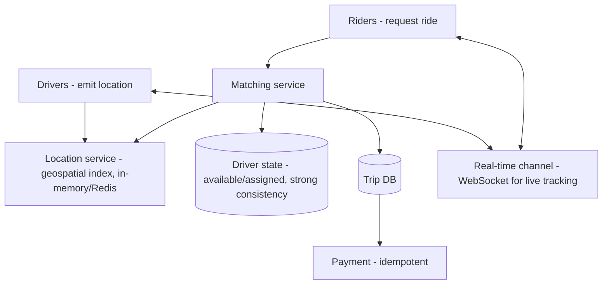
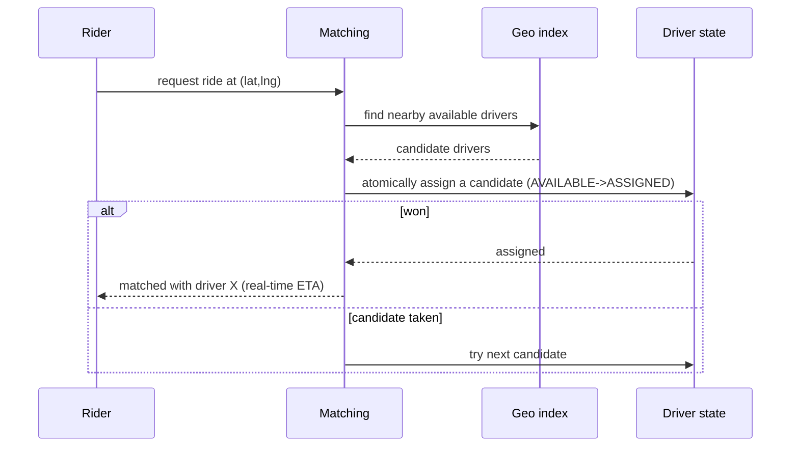

# Design a Ride-Hailing System

> Difficulty: Advanced
> Related: [03-databases/consistency-models](../03-databases-and-data-modeling/consistency-models.md) · [chat-messaging-system](./chat-messaging-system.md) (real-time) · [payment-system](./payment-system.md)

An Uber/Lyft-style system. Distinct challenges: real-time location tracking of drivers, geospatial matching (find nearby drivers), and avoiding double-assigning a driver. Tests geospatial indexing, real-time updates, and per-entity consistency.

## A. Problem statement
Riders request a ride; the system finds a nearby available driver, matches them, tracks the ride in real time, and handles payment on completion.

## B. Requirements
**Functional:** drivers broadcast location; riders request a ride; match rider → nearest available driver; real-time location tracking during the trip; fare calculation + payment; (surge pricing as extension).
**Non-functional (ask):** real-time (location updates, matching in seconds); scale (millions of drivers/riders, high-frequency location updates); no double-assigning a driver (consistency on driver state); geospatial queries (find nearby).
**Assumptions:** millions of concurrent drivers emitting location frequently, real-time matching, no double-assignment.

## C. Estimation
- **Location updates:** millions of drivers × an update every few seconds → **huge write volume** of location data (high-write, loss-tolerant — a slightly stale location is OK).
- **Matching queries:** geospatial "find drivers within X km" — needs a geospatial index.
- **Trips:** modest volume, but driver assignment must be exactly-once (no double-assign).

## D. Architecture

## E. The three core problems
1. **Geospatial indexing (find nearby drivers):** index driver locations spatially so "drivers within X km of (lat, lng)" is fast. Use a **geospatial index** — geohashing (encode lat/lng into a prefix string so nearby points share prefixes) or a quadtree/S2 cells, stored in Redis (geo commands) or a spatial index. Partition by geographic region (a city's drivers together — a natural shard key).
2. **Real-time location updates (high-write, loss-tolerant):** millions of drivers emit frequently; store the latest location in-memory (Redis), eventually-consistent (a slightly stale location is fine — see [consistency-models](../03-databases-and-data-modeling/consistency-models.md)). Don't durably persist every ping (loss-tolerant, high-volume — like metrics).
3. **No double-assignment (strong consistency on driver state):** when matching, atomically transition a driver AVAILABLE → ASSIGNED (`UPDATE ... WHERE status='AVAILABLE'`) so two riders can't be matched to the same driver (like seat booking / inventory — see [transactions-and-isolation](../03-databases-and-data-modeling/transactions-and-isolation.md)).

## F. Critical flow — match a ride

## G. Bottlenecks
- **Location write volume:** in-memory geospatial store (Redis), eventual, loss-tolerant; don't persist every ping durably; partition by region.
- **Geospatial query performance:** geohash/quadtree index + regional partitioning (query only the relevant cells, not all drivers).
- **Matching contention:** atomic driver-state transition prevents double-assign; a popular area has more contention (handle like a hot region).
- **Real-time tracking:** WebSocket channel for live location to rider/driver (like [chat](./chat-messaging-system.md)'s connection layer).
- **Surge pricing (extension):** compute supply/demand per region (time-windowed aggregation — like [metrics](./metrics-monitoring-platform.md)).

## H. Failure handling
- **Stale location:** acceptable (eventual); a driver's last-known location is used (bounded staleness).
- **Double-assignment:** prevented by atomic driver-state transition.
- **Driver disconnects mid-trip:** detect via missed heartbeats; handle gracefully (reassign if before pickup; support path if during).
- **Payment on completion:** idempotent (see [payment-system](./payment-system.md)); the trip fare is computed from the recorded path.
- **Matching service crash:** stateless matching; driver state in a consistent store; retry matching.

## I. Trade-offs
| Decision | Chosen | Why |
|---|---|---|
| Location store | In-memory geospatial (Redis), eventual, loss-tolerant | Huge write volume; slight staleness OK |
| Geo index | Geohash/quadtree + regional partition | Fast "nearby" queries; natural sharding by city |
| Driver assignment | Atomic state transition (strong) | No double-assignment |
| Real-time | WebSocket channel | Live tracking (like chat) |
| Consistency | Per-entity: strong for assignment, eventual for location | Weakest-correct per path |

## J. Follow-ups
1. **How do you find nearby drivers efficiently?** → A geospatial index (geohashing or quadtree/S2 cells): nearby points share prefixes/cells, so "within X km" queries scan only relevant cells; partition by region.
2. **How do you handle millions of high-frequency location updates?** → Store the latest location in-memory (Redis), eventually consistent and loss-tolerant (don't durably persist every ping); partition by region. Like high-write metrics.
3. **How do you prevent assigning one driver to two riders?** → Atomically transition driver state AVAILABLE → ASSIGNED (conditional update); one request wins; strong consistency on driver state.
4. **Why is strong consistency only on driver *state*, not location?** → A stale location is harmless (bounded staleness, eventual); a double-assignment is a correctness bug (strong). Per-path consistency (see [consistency-models](../03-databases-and-data-modeling/consistency-models.md)).
5. **Real-time tracking?** → A WebSocket channel pushes live driver location to the rider (and vice versa) — like the [chat](./chat-messaging-system.md) connection layer.
6. **Surge pricing?** → Compute supply/demand per region over a time window (time-windowed aggregation, like [metrics](./metrics-monitoring-platform.md)); the surge read before booking can be eventual.
7. **A driver disconnects mid-trip?** → Detect via missed heartbeats; before pickup → reassign; during trip → support flow / continue tracking on reconnect.
8. **How do you shard?** → By geographic region (a city's drivers/riders together) — a natural key; cross-region trips are rare.
9. **Fare + payment?** → Compute from the recorded trip path; charge via an idempotent payment flow on completion (see [payment-system](./payment-system.md)).
10. **Matching in a hot area (airport, concert)?** → More contention on nearby drivers; atomic assignment ensures correctness; may need demand-based matching/queueing.

## K. Common mistakes
Durably persisting every location ping (huge, unnecessary — it's loss-tolerant); no geospatial index (scanning all drivers); strong consistency on location (needless cost); read-check-then-assign a driver (double-assignment); not partitioning by region.

## L. Practice exercise
Design the **geospatial matching index** in detail for a city with 100K active drivers emitting location every 4 seconds. Choose geohash vs quadtree, how you update the index on each ping cheaply, how you query "nearest available drivers," and how you partition by region. Compare with [consistency-models](../03-databases-and-data-modeling/consistency-models.md) (per-path consistency).
