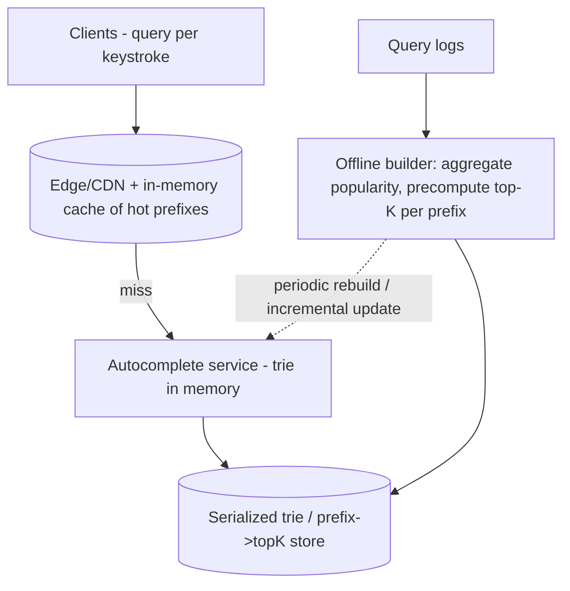

# Design Search Autocomplete (Typeahead)

> Difficulty: Intermediate
> Related: [04-caching/caching-fundamentals](../04-caching/caching-fundamentals.md) · [10-storage/search-indexing-and-search-engines](../10-storage-and-content-delivery/search-indexing-and-search-engines.md) · [00-foundations/latency-throughput-and-capacity](../00-foundations/latency-throughput-and-capacity.md)

Suggest completions as a user types (Google/search-box autocomplete). Tests ultra-low-latency reads, prefix data structures (trie), ranking, and heavy caching. Extremely read-heavy with a tight latency budget.

## A. Problem statement
As a user types a prefix, return the top-K most relevant completions, in a few milliseconds, updating on each keystroke.

## B. Requirements
**Functional:** given a prefix, return top-K completions ranked by popularity/relevance; update suggestions as popularity changes.
**Non-functional (ask):** latency (**very low — <50-100ms**, per keystroke); scale (huge QPS — a query per keystroke); freshness (how fast new/trending terms appear); ranking (by frequency/popularity).
**Assumptions:** massive read QPS, sub-100ms, top-10 completions, popularity-ranked, near-real-time trending.

## C. Estimation
- A query per keystroke → QPS is a large multiple of searches. If 1B searches/day and ~5 keystrokes each → ~5B autocomplete queries/day ≈ **~60,000 QPS** average, much higher at peak → the design is **cache-first, read-optimized**.
- Prefix data is relatively small (top terms per prefix) → fits in memory/cache.

## D. API
```
GET /autocomplete?prefix=xyz&limit=10 -> [ranked completions ]
```

## E. Data structure — the trie (prefix tree)
- A **trie** maps prefixes → completions; each node stores the top-K completions for that prefix (precomputed), so a lookup is a direct prefix walk returning the precomputed top-K — O(prefix length), very fast.
- Precomputing top-K per node avoids ranking at query time (which would be too slow).
- Built offline from query logs (popularity); served from memory/cache.

## F. Architecture

- **Read path:** cache (hot prefixes) → in-memory trie → precomputed top-K. Sub-millisecond for cached prefixes.
- **Build path (offline/async):** aggregate query popularity from logs, precompute top-K per prefix, publish to the serving tier. New/trending terms appear after a rebuild/incremental update (eventual freshness — acceptable).
- **Heavy caching** at every layer (CDN/edge + in-memory) because it's read-dominated and latency-critical.

## G. Critical flow
Keystroke → GET /autocomplete?prefix → cache hit returns top-K instantly; miss → trie walk returns precomputed top-K → cache it. Ranking is precomputed offline, not at query time.

## H. Bottlenecks
- **Latency budget (tight):** precompute top-K (no query-time ranking); cache aggressively; keep the trie in memory; serve from the edge for geographic latency.
- **Read QPS (huge):** cache-first; the serving tier is read-only and horizontally scalable (stateless + replicated trie).
- **Freshness vs cost:** real-time trending requires frequent rebuilds/incremental updates (cost) vs periodic (staler). Hybrid: periodic full rebuild + a fast path for trending terms.
- **Trie size / build time:** sharded by prefix if huge; incremental updates for popularity shifts.

## I. Failure handling
- **Build pipeline down:** serve the last-built trie (stale suggestions — acceptable; it's not correctness-critical).
- **Cache down:** fall back to the in-memory trie (still fast); the trie is rebuildable.
- **Eventual freshness:** new terms lag until the next build — acceptable for autocomplete.

## J. Trade-offs
| Decision | Chosen | Why |
|---|---|---|
| Ranking | Precomputed top-K per prefix (offline) | Query-time ranking too slow for the latency budget |
| Data structure | Trie (prefix tree) | Fast prefix lookups; precomputed top-K per node |
| Caching | CDN/edge + in-memory, aggressive | Read-dominated, latency-critical |
| Freshness | Periodic rebuild (+ fast path for trending) | Real-time is costly; near-real-time usually fine |

## K. Follow-ups
1. **How do you meet the tight latency budget?** → Precompute top-K per prefix (no query-time ranking), keep a trie in memory, cache hot prefixes at the edge/in-memory, serve read-only and horizontally scaled.
2. **Why precompute instead of ranking at query time?** → Ranking per keystroke across many candidates would blow the <100ms budget; precomputed top-K per prefix makes a query an O(prefix) walk.
3. **How do new/trending terms appear?** → Periodic (or incremental) rebuild from query logs updates popularity; eventual freshness is acceptable; a fast path can inject trending terms sooner.
4. **How do you handle huge read QPS?** → Cache-first (edge + in-memory), read-only replicated serving tier; it's one of the most read-dominated systems, so caching is the primary lever.
5. **Build pipeline is down?** → Serve the last-built trie (stale suggestions) — not correctness-critical.
6. **Trie too big for one node?** → Shard by prefix (first characters) across nodes; route a prefix to its shard.
7. **Personalized autocomplete?** → Blend global precomputed suggestions with a per-user layer (recent/own queries) at read time — more complex, more state.
8. **Typo tolerance / fuzzy matching?** → Add edit-distance/fuzzy matching (like a search engine) — heavier; often a separate fuzzy layer.
9. **How fresh must trending be?** → Depends on product; most tolerate minutes; real-time trending needs streaming popularity updates (cost).
10. **How is this related to a search engine?** → Autocomplete is a specialized prefix+ranking problem; a full search engine (inverted index) handles the actual search after selection (see [search-indexing-and-search-engines](../10-storage-and-content-delivery/search-indexing-and-search-engines.md)).

## L. Common mistakes
Ranking at query time (too slow for the budget); not caching (read-dominated → cache is essential); expecting real-time freshness everywhere (costly; near-real-time is usually fine); not precomputing top-K; one giant un-sharded trie at extreme scale.

## M. Practice exercise
Design **personalized autocomplete**: blend global trending suggestions with the user's own recent searches, within the same tight latency budget. Where does the per-user state live, how do you merge global + personal top-K fast, and how do you keep it cheap at huge QPS? Compare with [news-feed](./news-feed.md) (read models) and [caching-fundamentals](../04-caching/caching-fundamentals.md).
