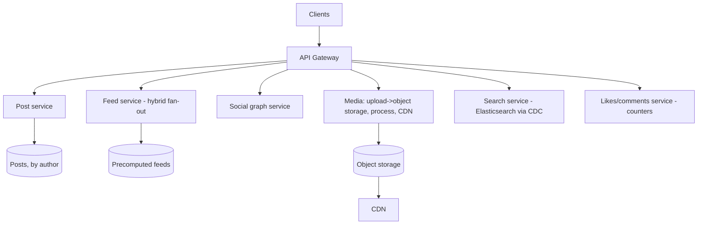

# Design a Social Media Platform

> Difficulty: Advanced
> Related: [news-feed](./news-feed.md) · [file-storage-service](./file-storage-service.md) · [10-storage/image-and-video-processing](../10-storage-and-content-delivery/image-and-video-processing.md)

A broad design (Instagram/Twitter-style) composing several subsystems: posts + media, the news feed (fan-out), the social graph, likes/comments, and search. Tests composition and knowing which sub-design dominates.

> Composes [news-feed](./news-feed.md) (the hardest part), [file-storage-service](./file-storage-service.md)/[image-and-video-processing](../10-storage-and-content-delivery/image-and-video-processing.md) (media), and [search](../10-storage-and-content-delivery/search-indexing-and-search-engines.md).

## A. Problem statement
A platform where users post content (text + media), follow others, see a feed, like/comment, and search. Read-heavy, with viral/celebrity scale.

## B. Requirements
**Functional:** create posts (text + images/video); follow/unfollow; news feed; likes/comments; user profiles; search (users, posts, hashtags).
**Non-functional (ask):** scale (hundreds of millions of users, celebrities); read-heavy; feed latency fast; media delivery global; eventual consistency OK for feeds/counts.
**Assumptions:** 500M users, celebrities exist, read-heavy, media-heavy, eventual consistency for feeds/likes.

## C. Estimation
- Feed reads dominate (tens of thousands RPS); posts modest but fan-out amplifies (celebrity problem — see [news-feed](./news-feed.md)).
- Media is huge (object storage + CDN, petabytes).
- Likes/comments counts are high-write but loss-tolerant/eventual.

## D. Architecture (composition)

Each piece is a sub-design covered elsewhere:
- **News feed** (the dominant/hardest part): hybrid fan-out (push for normal, pull for celebrities) — see [news-feed](./news-feed.md).
- **Media:** upload to object storage (pre-signed), async process (thumbnails/transcode), serve via CDN — see [image-and-video-processing](../10-storage-and-content-delivery/image-and-video-processing.md), [file-storage-service](./file-storage-service.md).
- **Social graph:** follows (who follows whom) — a graph/relational store; drives feed fan-out.
- **Likes/comments:** high-write counters (write-behind, eventual — see [write-behind-and-write-around](../04-caching/write-behind-and-write-around.md)); comments stored + paginated.
- **Search:** Elasticsearch fed via CDC — see [search-indexing-and-search-engines](../10-storage-and-content-delivery/search-indexing-and-search-engines.md).

The SDE-2 skill here is **composition + knowing the feed is the hard part** and the celebrity fan-out dominates; don't try to deeply design all five in 45 minutes — clarify which to focus on.

## E. Data model (key entities)
- `posts(id Snowflake, author_id, text, media_keys[], created_at)` — by author.
- `follows(follower, followee)` — social graph.
- `feeds` — precomputed per-user timelines (post ids).
- `likes/comments` — counts (write-behind) + comment rows (paginated).
- Media in object storage; search index via CDC.

## F. Critical flows
- **Post with media:** upload media (pre-signed → object storage → async process) → create post → async fan-out to followers' feeds (hybrid: pull for celebrities).
- **Feed read:** merge precomputed feed (push) + celebrity posts (pull), hydrate post content + media URLs (CDN), ranked/paginated — see [news-feed](./news-feed.md).
- **Like:** increment a write-behind counter (eventual, loss-tolerant).

## G. Bottlenecks
- **Celebrity fan-out** (the headline — see [news-feed](./news-feed.md)): hybrid push/pull.
- **Feed read volume:** precompute + cache.
- **Media delivery:** CDN (petabytes, global).
- **Like/comment write volume:** write-behind counters, eventual.
- **Search sync:** CDC → index, eventual.

## H. Failure handling
- Feed store down → fall back to fan-out-on-read; precomputed feeds rebuildable.
- Media processing failure → DLQ; post shows a placeholder until processed.
- Counts loss-tolerant (approximate likes OK).
- Eventual consistency throughout (feeds, counts, search) — the author sees their own post immediately.

## I. Trade-offs
| Decision | Chosen | Why |
|---|---|---|
| Feed | Hybrid fan-out | Celebrity problem (see news-feed) |
| Media | Object storage + async process + CDN | Petabytes, global, CPU-heavy processing off the path |
| Counts | Write-behind, eventual | High-write, loss-tolerant |
| Search | Elasticsearch via CDC | Full-text at scale, eventual |
| Consistency | Eventual (feeds/counts/search) | Read-heavy; cheaper, acceptable |

## J. Follow-ups
1. **What's the hardest part?** → The news feed, specifically celebrity fan-out — hybrid push (normal users) / pull (celebrities) to avoid millions of feed writes per celebrity post (see [news-feed](./news-feed.md)).
2. **How do you serve media globally?** → Upload to object storage (pre-signed), async thumbnail/transcode, serve via CDN with signed/versioned URLs (see [image-and-video-processing](../10-storage-and-content-delivery/image-and-video-processing.md)).
3. **How do you handle huge like/comment write volume?** → Write-behind counters (increment in memory, batch-flush), eventual + approximate — loss-tolerant.
4. **How do you keep search in sync?** → CDC from the posts/users DB → Elasticsearch; eventual; rebuildable (see [search-indexing-and-search-engines](../10-storage-and-content-delivery/search-indexing-and-search-engines.md)).
5. **How does the social graph scale?** → Follows in a graph/relational store, sharded; it drives feed fan-out (celebrity = huge follower set).
6. **Consistency model?** → Eventual for feeds/counts/search (cheaper, acceptable); read-your-own-post immediate.
7. **How would you scope this in 45 minutes?** → Clarify which subsystem to focus on (usually the feed); acknowledge the others as sub-designs rather than deeply designing all five.
8. **Feed store down?** → Fall back to fan-out-on-read; precomputed feeds are rebuildable.
9. **Media processing failure?** → DLQ; show a placeholder until processed; idempotent processing.
10. **Multi-region?** → CDN for media (global), regional feed/post replication, eventual cross-region (see [multi-region-architecture](../06-distributed-systems/multi-region-architecture.md)).

## K. Common mistakes
Trying to deeply design all subsystems (scope it — the feed dominates); missing the celebrity fan-out problem; serving media without a CDN; synchronous like counts (should be write-behind); demanding strong consistency (eventual is fine and far cheaper).

## L. Practice exercise
Scope and design just the **"explore/trending" subsystem** (surface popular/trending posts globally, not from people you follow). How is this different from the follow-based feed, how do you compute trending (popularity over a time window), and how do you keep it fresh and cached? Compare with [news-feed](./news-feed.md) and [metrics-monitoring-platform](./metrics-monitoring-platform.md) (time-windowed aggregation).
