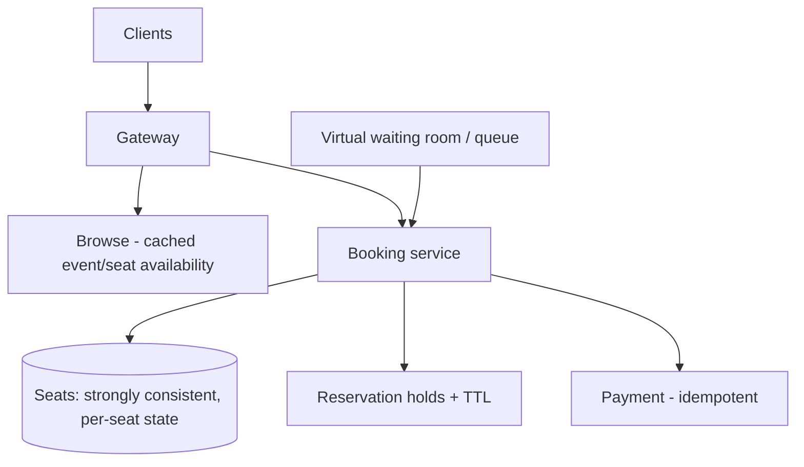
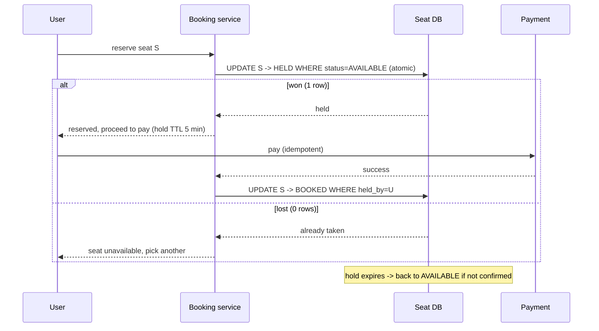

# Design a Ticket Booking System

> Difficulty: Advanced
> Related: [03-databases/transactions-and-isolation](../03-databases-and-data-modeling/transactions-and-isolation.md) · [03-databases/consistency-models](../03-databases-and-data-modeling/consistency-models.md) · [e-commerce-platform](./e-commerce-platform.md)

A Ticketmaster/BookMyShow-style system. The defining challenge: **no double-booking a seat under massive concurrency** (a flash-sale for a popular event). The purest test of concurrency control and strong consistency.

## A. Problem statement
Users browse events, select seats, and book them. The absolute requirement: a seat is sold to exactly one person, even when thousands try to book the same popular event's seats simultaneously.

## B. Requirements
**Functional:** browse events/seats; reserve a seat (temporary hold during checkout); confirm booking (payment); release expired holds.
**Non-functional (ask):** **no double-booking (strong consistency, the dominant requirement)**; handle flash-sale spikes (a hot event = massive contention on its seats); fair access; booking is write-critical.
**Assumptions:** popular events cause extreme concurrency on specific seats; correctness (no double-book) over availability.

## C. Estimation
- Browse is read-heavy (cache). Booking a hot event = extreme contention on a small set of seats (hot rows) → the concurrency control is the whole design.
- Modest overall RPS, but spiky and correctness-critical.

## D. Architecture

## E. The core: preventing double-booking
A seat has states: AVAILABLE → HELD (temporary, during checkout) → BOOKED. The transition must be **atomic** so two users can't both get the same seat:
- **Atomic conditional update:** `UPDATE seats SET status='HELD', held_by=?, hold_expires=now()+5min WHERE seat_id=? AND status='AVAILABLE'` → 0 rows = already taken. One winner (see [transactions-and-isolation](../03-databases-and-data-modeling/transactions-and-isolation.md)).
- **Hold then confirm:** the HELD state reserves the seat during checkout (payment); if payment completes → BOOKED; if the hold expires (TTL) → back to AVAILABLE (so abandoned carts don't lock seats forever).
- **Strong consistency** on seat state (not eventual) — a stale read enabling a double-book is unacceptable (CP — see [consistency-and-cap-theorem](../06-distributed-systems/consistency-and-cap-theorem.md)).

## F. Critical flow — reserve → confirm

## G. Bottlenecks
- **Hot seats/event (extreme contention):** everyone contends on the same seats → hot rows. Mitigate: atomic conditional updates (one winner per seat), a **virtual waiting room / queue** to admit users gradually (rate-limit entry to the booking flow so the DB isn't swamped), and caching browse availability (approximate — confirm atomically at reserve).
- **Browse read load:** cache seat-availability (approximate; the atomic reserve is the source of truth).
- **Hold expiry:** a background job (or TTL) releases expired holds so seats aren't stuck.
- **Payment during the hold:** the hold TTL must exceed payment time; idempotent payment.

## H. Failure handling
- **Double-booking:** prevented by the atomic conditional update (one winner).
- **Payment fails after hold:** the hold expires (or is released) → seat returns to AVAILABLE.
- **User abandons checkout:** hold TTL releases the seat.
- **Crash during booking:** the hold persists with its TTL; either confirmed or expired — never a lost or double-booked seat (strong consistency + atomic transitions).
- **Overload (flash sale):** the virtual waiting room sheds/queues excess users rather than melting the DB.

## I. Trade-offs
| Decision | Chosen | Why |
|---|---|---|
| Consistency | Strong (CP) on seat state | A stale read → double-book; correctness > availability |
| Seat transition | Atomic conditional update (hold → book) | Guarantees one winner; no read-check-then-write |
| Holds | Temporary with TTL | Reserve during checkout; auto-release abandoned |
| Flash-sale | Virtual waiting room / queue | Admit gradually; protect the DB from the hot-event stampede |
| Browse | Cached (approximate) | Read-heavy; atomic reserve is the truth |

## J. Follow-ups
1. **How do you prevent double-booking a seat?** → Atomic conditional update of seat state (AVAILABLE → HELD → BOOKED) so exactly one concurrent request wins; strong consistency on seat state; never read-check-then-write.
2. **Why strong consistency here (not eventual)?** → A stale/replica read could let two users book the same seat — a correctness failure. Correctness > availability (CP).
3. **How do holds work?** → A HELD state with a TTL reserves the seat during checkout; confirm → BOOKED; expire → AVAILABLE (so abandoned carts don't lock seats).
4. **A popular concert sells out in seconds — how do you survive the stampede?** → A virtual waiting room/queue admits users gradually (rate-limit entry), so the booking DB isn't swamped; atomic transitions ensure correctness; cache browse availability.
5. **Hot rows (everyone wants the same seats)?** → Atomic conditional updates (one winner per seat) + the waiting room to throttle entry; the contention is inherent, so you throttle and serialize per seat.
6. **Payment fails after a hold?** → The hold expires/releases → seat returns to AVAILABLE; payment is idempotent.
7. **Crash mid-booking?** → The hold (with TTL) persists; the seat is either confirmed or auto-released — never double-booked or lost (strong consistency).
8. **How do you release expired holds?** → A TTL / background sweep returns HELD-but-expired seats to AVAILABLE.
9. **How do you show availability without hammering the DB?** → Cache approximate availability for browsing; the atomic reserve is the source of truth (a cached "available" seat may fail the atomic reserve — handle gracefully).
10. **How is this different from e-commerce inventory?** → Similar atomic-decrement idea, but seats are *specific* (seat 14C, not "1 of N"), holds + checkout flow are central, and contention concentrates on exact seats — a sharper concurrency problem.

## K. Common mistakes
Read-check-then-write (double-booking); eventual consistency on seat state (double-booking); no hold TTL (abandoned carts lock seats forever); no waiting room for flash sales (DB melts); trusting cached availability as the source of truth.

## L. Practice exercise
Design the **virtual waiting room** for a flash-sale event: 1M users arrive at 10:00 for 10,000 seats. How do you admit users fairly and gradually into the booking flow, communicate their queue position, prevent the booking DB from being swamped, and handle users who leave the queue? Compare with [rate-limiting](../01-networking-and-api-design/rate-limiting.md) and [e-commerce-platform](./e-commerce-platform.md) (flash-sale inventory).
