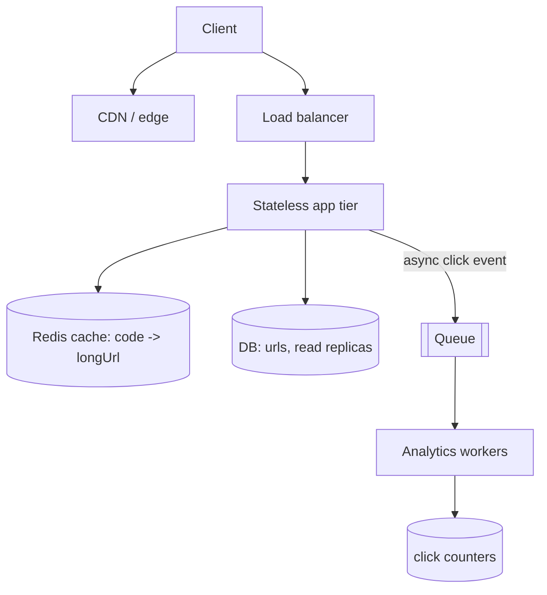
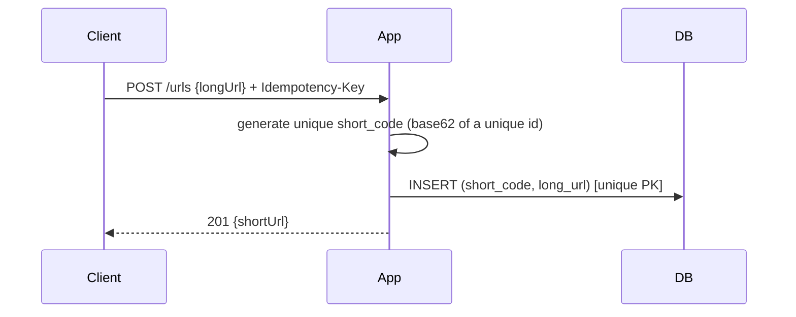
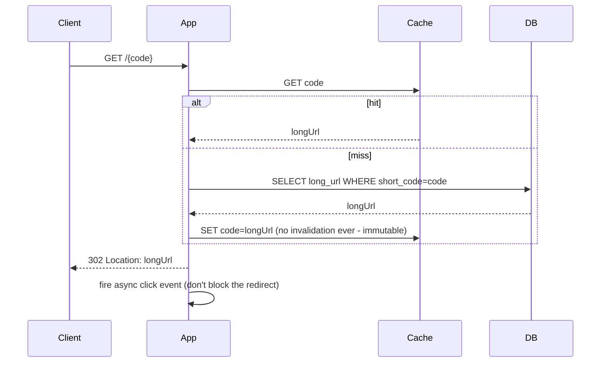

# Design a URL Shortener

> Difficulty: Foundational · Core SDE-2 problem
> Related concepts: [id-generation-and-sequences](../06-distributed-systems/id-generation-and-sequences.md) · [caching-fundamentals](../04-caching/caching-fundamentals.md) · [cdn-and-edge-caching](../10-storage-and-content-delivery/cdn-and-edge-caching.md)

The canonical warm-up design. It's "easy" but a strong candidate uses it to show estimation, read-heavy caching, collision-free ID generation, and knowing when *not* to add complexity.

---

## A. Problem statement

Build a service that takes a long URL and returns a short code; visiting the short URL redirects to the original. Optionally: custom aliases, expiry, and click analytics. (TinyURL/bit.ly.)

## B. Requirement clarification

**Functional:** create a short URL from a long one; redirect short→long; optionally custom alias, expiry, analytics (click counts).
**Non-functional (ask these):**
- Scale? → say **100M new URLs/day**... (push back — that's huge; assume a more realistic **10M/day** unless told otherwise).
- Read:write ratio? → very **read-heavy** (redirects ≫ creations); assume **100:1**.
- Latency? → redirects must be fast (**p99 < 50–100ms**) — it's on the user's critical path.
- Durability? → a mapping must not be lost (a dead link is bad), but it's not money-critical.
- Code length/charset? → short, URL-safe (base62).
**Scope:** create + redirect + basic analytics. **Non-goals:** user accounts/UI, spam detection (mention as extension).
**Assumptions:** 10M creates/day, 100:1 read ratio, codes immutable once created, 5-year retention.

## C. Scale estimation

- **Writes:** 10M/day ≈ **~120 writes/sec** average; peak (×5) ≈ **~600/sec**.
- **Reads (redirects):** 100× → ~12,000 RPS average; peak ≈ **~60,000 RPS** (reads dominate — the design centers on fast reads).
- **Storage:** 10M/day × 365 × 5yr = ~18B URLs; each row ~500 bytes (code, long URL, metadata) → ~9 TB; ×3 replication ≈ **~27 TB** — large but a single logical store (or lightly sharded) handles it; fits before needing heavy sharding for years if trimmed. (Short code itself ~7 base62 chars.)
- **Key space:** base62, 7 chars = 62⁷ ≈ **3.5 trillion** combinations — ample.
- **Bandwidth:** redirects are tiny (a 302 with a Location header) → negligible.

**Implication:** modest writes, huge reads → **cache-first redirect path**; the mapping is **immutable**, so caching is trivial (no invalidation) — a big win.

## D. API design

```
POST /urls
  body: { longUrl, customAlias?, expiresAt? }
  201: { shortCode, shortUrl }
  409: alias taken

GET /{shortCode}
  302 Found, Location: <longUrl>   (redirect)
  404 if not found / expired

GET /urls/{shortCode}/stats
  200: { shortCode, longUrl, clicks, createdAt }
```
- `POST /urls` uses an **idempotency key** so a client retry doesn't create two codes for the same request (see [rest-and-api-design](../01-networking-and-api-design/rest-and-api-design.md)).
- Redirect is a `302` (or `301` if permanent — but 302 lets you count clicks and change targets).

## E. Data modeling

Table `urls`:
```
short_code  VARCHAR  PRIMARY KEY   -- base62
long_url    TEXT
created_at  TIMESTAMP
expires_at  TIMESTAMP NULL
owner_id    NULL                   -- if accounts added
```
- Lookup is by `short_code` (PK) → point lookup, trivially fast/indexed.
- Analytics (clicks) are **not** incremented synchronously on the read path (that would add a write per redirect) — see data flow. Store counts in a separate counter (incremented async).
- Consistency: the mapping is immutable → eventual consistency is fine for reads; creates need uniqueness (handled by key generation).

## F. High-level architecture


Each component's reason: cache (absorb the 100:1 reads — immutable so no invalidation), replicas (extra read capacity + availability), queue+workers (click analytics off the redirect path), CDN (optionally cache popular redirects at the edge). The DB write rate is tiny, so **no sharding needed for years**.

## G. Critical data flows

**Create (write):**


**Redirect (read — the hot path):**


**Key-generation choice (the interesting decision):**
- **Option A — counter/ID → base62:** maintain a unique monotonic id (e.g., Snowflake or a DB sequence / ticket-ranges — see [id-generation-and-sequences](../06-distributed-systems/id-generation-and-sequences.md)), base62-encode it → guaranteed unique, **no collision checks**. Downside: codes are somewhat guessable/sequential (fine for most; add a hash/salt if enumeration matters).
- **Option B — random code + collision check:** generate a random base62 code, check the DB for collision, retry if taken. Simpler conceptually but needs a read+conditional-insert (unique constraint) per create and retries under contention.

**Recommend Option A** (base62 of a unique id): avoids collision checks entirely and scales writes cleanly. State the enumeration trade-off.

## H. Bottleneck analysis

- **Redirect read load (the main pressure):** absorbed by the cache (immutable mapping → ~100% hit ratio achievable for the hot set) + replicas + optionally CDN. This is why the design is cache-first.
- **DB on cache miss:** point lookups by PK — cheap; replicas handle misses.
- **Analytics writes:** moved off the redirect path (async queue + workers), so clicks don't add a synchronous write per read. Counter updates batched/write-behind (loss-tolerant — see [write-behind-and-write-around](../04-caching/write-behind-and-write-around.md)).
- **Write rate:** tiny (~600/sec peak) → single primary fine; no sharding for years.
- **Key generation:** must be collision-free without a central bottleneck → Snowflake/ticket-ranges.

## I. Failure handling

- **Redis down:** redirects fall back to the DB (replicas) with a concurrency limiter so the sudden read load doesn't overwhelm it; mapping is immutable so no staleness risk (see [redis-design-and-failure-modes](../04-caching/redis-design-and-failure-modes.md)).
- **Create retry (timeout):** idempotency key returns the original code (no duplicate).
- **Analytics loss:** click counts are loss-tolerant (write-behind); a lost increment is acceptable (approximate counts).
- **Expired/invalid code:** 404.
- **DB primary failover:** replica promoted; writes are rare so impact is minimal.

## J. Trade-offs and alternatives

| Decision | Chosen | Alternative | Why |
|---|---|---|---|
| Key generation | Base62 of unique id (Snowflake/ticket) | Random + collision check | No collision checks, scales writes; accept guessability |
| Redirect code | 302 | 301 (permanent) | 302 allows click counting + changing targets; 301 caches harder in browsers |
| Analytics | Async queue + write-behind counters | Sync increment on redirect | Keeps the hot read path fast; counts approximate |
| Store | Single DB + replicas + cache | Shard from day 1 | Write rate is tiny; sharding is premature |
| Cache invalidation | None needed | TTL/invalidation | Mapping is immutable → the easiest caching ever |

**Two plausible architectures:** (1) the above (DB + cache + replicas) for realistic scale; (2) a pure KV store (DynamoDB-style) if writes were enormous — but at 10M/day a relational DB + cache is simpler and sufficient.

## K. Security and observability

- **Abuse:** rate-limit creation per client (prevent spam/mass creation); optionally scan long URLs against malware lists (mention as extension). Prevent open-redirect abuse by validating URLs.
- **Enumeration:** if guessable codes are a concern, use a salted hash or random codes.
- **Metrics:** redirect p99, cache hit ratio, create rate, 404 rate, DB read load.
- **Logs/traces:** per-redirect trace for latency debugging; correlation id.

## L. Evolution of the design

- **1 → 10× reads:** rely on cache + add replicas + CDN edge caching for popular codes.
- **Writes grow enormous:** move the mapping to a KV/wide-column store; Snowflake IDs already shard-ready.
- **Analytics grow:** stream click events to a data pipeline / TSDB for rich analytics (see [data-pipelines-and-batch-processing](../10-storage-and-content-delivery/data-pipelines-and-batch-processing.md)).
- **Global users:** CDN + multi-region read replicas for low-latency redirects (writes stay centralized).

## M. Interview walkthrough (abbreviated 35–45 min script)

**I:** "Design a URL shortener."
**C:** "Let me clarify — scale and read:write ratio?" **I:** "~10M new/day, very read-heavy." **C:** "So ~120 writes/sec, ~12K+ redirect RPS at peak. Reads dominate; the design is cache-first. Durability matters (no dead links) but it's not money-critical, so eventual consistency on reads is fine."
**C:** "APIs: POST /urls (with an idempotency key so retries don't duplicate), GET /{code} → 302, GET stats. Data model: table keyed by short_code → long_url, point lookups."
**C:** "Architecture: client → LB → stateless app → Redis cache → DB (+replicas); redirect checks cache first, falls back to DB on miss, repopulates — and since the mapping is immutable, no invalidation, so the cache is nearly 100% effective. Click analytics go async via a queue so they don't slow the redirect."
**C:** "Key generation: base62 of a Snowflake-style unique id — no collision checks, scales writes, shard-ready. Trade-off: codes are somewhat guessable; I'd salt/hash if enumeration matters."
**I (follow-up):** "Redis is down." **C:** "Redirects fall back to DB replicas with a concurrency limiter; immutable mapping means no staleness. Slower but serving."
**I:** "10× the reads?" **C:** "Cache + replicas + CDN edge caching for popular codes; writes are still tiny. I would *not* shard yet." ... (continues into follow-ups below).

## N. Follow-up questions (with model answers)

1. **Why 302 not 301?** → 302 lets you count clicks and change the target; 301 is cached hard by browsers (fewer requests reach you, can't recount or redirect elsewhere). Trade-off: 302 = more load.
2. **How do you generate codes without collisions?** → Base62-encode a unique id (Snowflake/sequence/ticket-ranges) → no collision checks. Random+check needs retries + a unique constraint.
3. **How do you prevent enumeration of codes?** → Salted hash or random codes if guessability is a concern; otherwise sequential is fine.
4. **Redis is down — what happens?** → Fall back to DB replicas with a concurrency limiter; immutable mapping → no staleness.
5. **How do you handle click analytics at scale without slowing redirects?** → Fire an async event per redirect; workers aggregate counts (write-behind, approximate). Never increment synchronously on the hot path.
6. **When would you shard the DB?** → Only when write rate/data size exceeds a single primary — not at 10M/day. Snowflake IDs make future sharding clean.
7. **Custom aliases — how?** → User supplies the code; check the unique constraint (409 if taken). Only custom-alias creates need a collision check.
8. **Expiry — how?** → `expires_at` column; return 404 if past; a cleanup job (or TTL) removes expired rows; cache entries get a TTL matching expiry (the only case needing cache TTL).
9. **How do you make redirects globally fast?** → CDN edge caching of popular codes + multi-region read replicas; writes stay centralized.
10. **What's the first bottleneck?** → Redirect read volume → cache absorbs it; next, DB read capacity on misses → replicas.
11. **Could you serve stale data?** → The mapping is immutable, so "stale" doesn't apply; analytics counts can be approximate.
12. **How big is the key space?** → base62⁷ ≈ 3.5 trillion — ample; grow code length if needed.
13. **How do you prevent abuse (spam creation)?** → Rate-limit creation per client/API key; optionally malware-scan URLs.
14. **What if two creates race for the same custom alias?** → The unique PK/constraint makes one fail → 409; atomic insert prevents a double-grant.
15. **Why not NoSQL from the start?** → At 10M/day a relational DB + cache is simpler and sufficient; NoSQL/KV is justified only if writes become enormous.
16. **How do you count clicks exactly?** → You generally don't need exact — approximate (write-behind) is fine; for billing-grade counts, use a durable event stream + idempotent aggregation.

## O. Common mistakes

- Treating it as write-heavy (it's read-heavy — design the redirect path).
- Random-code-with-collision-check as the only option (counter/Snowflake avoids it).
- Incrementing click counts synchronously on the redirect (slows the hot path).
- Sharding from day 1 (writes are tiny — premature).
- No idempotency on create (duplicate codes on retry).
- Forgetting the cache is trivial here (immutable mapping, no invalidation) — a key insight to voice.

## P. Practice exercise

Design a **custom-branded short-link service** for enterprises where each tenant has its own domain (`go.acme.com/xyz`), per-tenant analytics dashboards, and link expiry. How does multi-tenancy change the data model and key generation? How do you serve many custom domains? (Hint: tenant-scoped codes, per-tenant analytics, domain → routing.) Compare with [multi-tenant-isolation](../08-security/multi-tenant-isolation.md).
