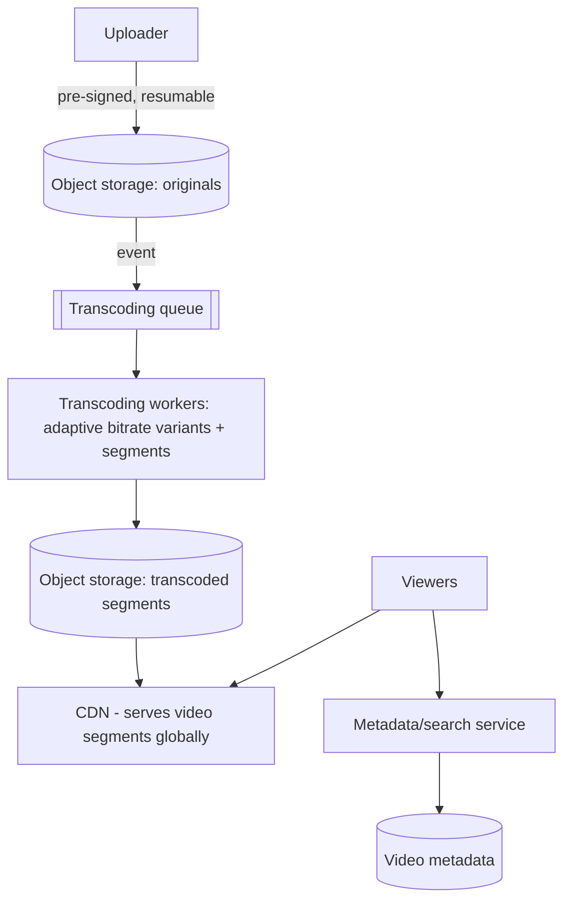

# Design a Video Streaming Platform

> Difficulty: Advanced
> Related: [10-storage/image-and-video-processing](../10-storage-and-content-delivery/image-and-video-processing.md) · [10-storage/cdn-and-edge-caching](../10-storage-and-content-delivery/cdn-and-edge-caching.md) · [10-storage/object-storage-and-file-uploads](../10-storage-and-content-delivery/object-storage-and-file-uploads.md)

A YouTube/Netflix-style platform: upload, transcode, and stream video globally. Tests massive media processing (transcoding), adaptive bitrate streaming, CDN-dominated delivery, and the read:write asymmetry (upload once, stream millions of times).

## A. Problem statement
Users upload videos; the platform transcodes them into multiple qualities; viewers stream them smoothly worldwide, adapting to their bandwidth. (Plus metadata, search, recommendations — but delivery + processing dominate.)

## B. Requirements
**Functional:** upload video; transcode to multiple resolutions/bitrates; stream (adaptive bitrate); metadata/search; (recommendations as extension).
**Non-functional (ask):** scale (uploads/day, concurrent viewers — millions); streaming latency (fast start, no buffering); global delivery; storage (petabytes); processing (CPU-heavy transcoding).
**Assumptions:** large upload volume, millions of concurrent viewers, global, adaptive bitrate.

## C. Estimation
- **Delivery dominates:** millions of concurrent viewers × multi-Mbps streams → enormous egress bandwidth → **CDN is non-negotiable** (serving from origin would be impossible — see [traffic-and-bandwidth-calculations](../11-estimation-and-bottleneck-analysis/traffic-and-bandwidth-calculations.md)).
- **Storage (petabytes):** originals + multiple transcoded variants (~1.5× original) × replication → object storage, tiered (see [image-and-video-processing](../10-storage-and-content-delivery/image-and-video-processing.md)).
- **Read:write asymmetry:** a video is uploaded once, streamed millions of times → optimize relentlessly for read/delivery.

## D. Architecture

- **Upload:** pre-signed, resumable (large files) to object storage — see [object-storage-and-file-uploads](../10-storage-and-content-delivery/object-storage-and-file-uploads.md).
- **Transcoding (async, CPU-heavy):** workers transcode the original into multiple resolutions/bitrates and segment them (HLS/DASH chunks) for adaptive streaming — see [image-and-video-processing](../10-storage-and-content-delivery/image-and-video-processing.md). Autoscaled on queue depth; often GPU/specialized compute.
- **Delivery via CDN:** viewers fetch small video segments from the nearest edge; the player adapts quality to bandwidth. The CDN serves the overwhelming majority of traffic (origin offload).
- **Metadata/search:** separate, modest-scale services.

## E. Adaptive bitrate streaming (the key delivery concept)
Video is transcoded into multiple qualities and chopped into small segments (a few seconds each). The player downloads a manifest, then fetches segments, **switching quality adaptively** based on measured bandwidth (drop to a lower bitrate if the connection slows → no buffering). This is why delivery is many small segment requests via CDN, not one giant file. Enables fast start (fetch the first low-res segment quickly) and smooth playback.

## F. Critical flows
- **Upload → publish:** resumable upload to object storage → transcoding job → variants/segments stored → metadata marked ready → available to stream (processing is async; the video appears after transcoding).
- **Stream:** player gets the manifest → fetches segments from the CDN, adapting bitrate to bandwidth; the CDN serves from the nearest edge.

## G. Bottlenecks
- **Delivery bandwidth (the dominant one):** CDN serves it; origin only sees cache misses. Without a CDN, impossible.
- **Transcoding compute (CPU/GPU-heavy):** async worker fleet, autoscaled on queue depth; the biggest *compute* cost. Pre-generate variants (video is too slow for on-demand).
- **Storage (petabytes):** object storage + tiering; store popular videos' variants hot, archive rarely-watched.
- **Fast start / buffering:** adaptive bitrate + CDN edge + small initial segments.
- **Live streaming (if required):** real-time transcoding + low-latency delivery — much harder.

## H. Failure handling
- **Transcoding failure:** retry; DLQ for un-transcodable videos; the video stays "processing" until done.
- **CDN edge miss/failure:** falls back to origin (object storage); multi-CDN for resilience.
- **Upload interruption:** resumable multipart (re-upload missing parts).
- **Partial processing:** publish only after all required variants are ready (status lifecycle).

## I. Trade-offs
| Decision | Chosen | Why |
|---|---|---|
| Delivery | CDN (edge segments) | Millions of concurrent streams — origin can't; global latency |
| Processing | Async transcoding, pre-generated variants | CPU-heavy, slow; async keeps uploads fast; video too slow for on-demand |
| Streaming | Adaptive bitrate (segments) | Smooth playback across varying bandwidth; fast start |
| Storage | Object storage + tiering | Petabytes; archive rarely-watched |
| Read:write | Optimize for delivery | Upload once, stream millions of times |

## J. Follow-ups
1. **Why is a CDN non-negotiable here?** → Millions of concurrent multi-Mbps streams = enormous egress; the origin can't serve it, and global viewers need edge proximity. The CDN serves nearly all traffic; origin only sees misses.
2. **How does adaptive bitrate work?** → Transcode into multiple qualities, chop into small segments; the player fetches segments and switches quality based on measured bandwidth → no buffering + fast start.
3. **Why transcode asynchronously?** → Transcoding is CPU/GPU-heavy and slow (minutes); doing it on the upload path would block uploads. Async worker fleet, autoscaled on queue depth; the video publishes when ready.
4. **Pre-generate variants or on-demand?** → Pre-generate for video (too slow for on-demand); store all variants' segments; this costs storage/compute even for unwatched variants.
5. **How do you handle the read:write asymmetry?** → Upload once, stream millions of times → optimize relentlessly for delivery (CDN, pre-generated segments, caching); upload/processing is the cheaper, async side.
6. **Storage at petabyte scale?** → Object storage + tiering: popular videos' variants hot, rarely-watched archived to cold storage.
7. **Live streaming?** → Real-time transcoding + low-latency segment delivery — significantly harder than VOD; mention as an extension.
8. **Transcoding failure?** → Retry; DLQ for un-transcodable; the video stays processing; idempotent transcoding (keyed by video+variant).
9. **CDN resilience?** → Multi-CDN or fallback to origin on edge miss/failure; versioned segment URLs avoid stale caches.
10. **How is this like the DMS/image pipeline?** → Same upload→object-storage→async-process→CDN pattern, but with heavy transcoding + adaptive-bitrate segmentation and delivery dominating everything.

## K. Common mistakes
Serving video from the origin (impossible at scale — need a CDN); synchronous transcoding (blocks uploads); serving one giant file instead of adaptive segments; not optimizing for the read:write asymmetry; blobs/metadata confusion (video in object storage, metadata in a DB).

## L. Practice exercise
Design the **transcoding pipeline** in detail: 1M video uploads/day, each transcoded to 5 bitrate variants + segmented. How do you scale the (CPU/GPU-heavy) worker fleet, prioritize (new uploads vs re-transcodes), handle failures/DLQ, and keep it idempotent? Estimate storage. Compare with [image-and-video-processing](../10-storage-and-content-delivery/image-and-video-processing.md).
