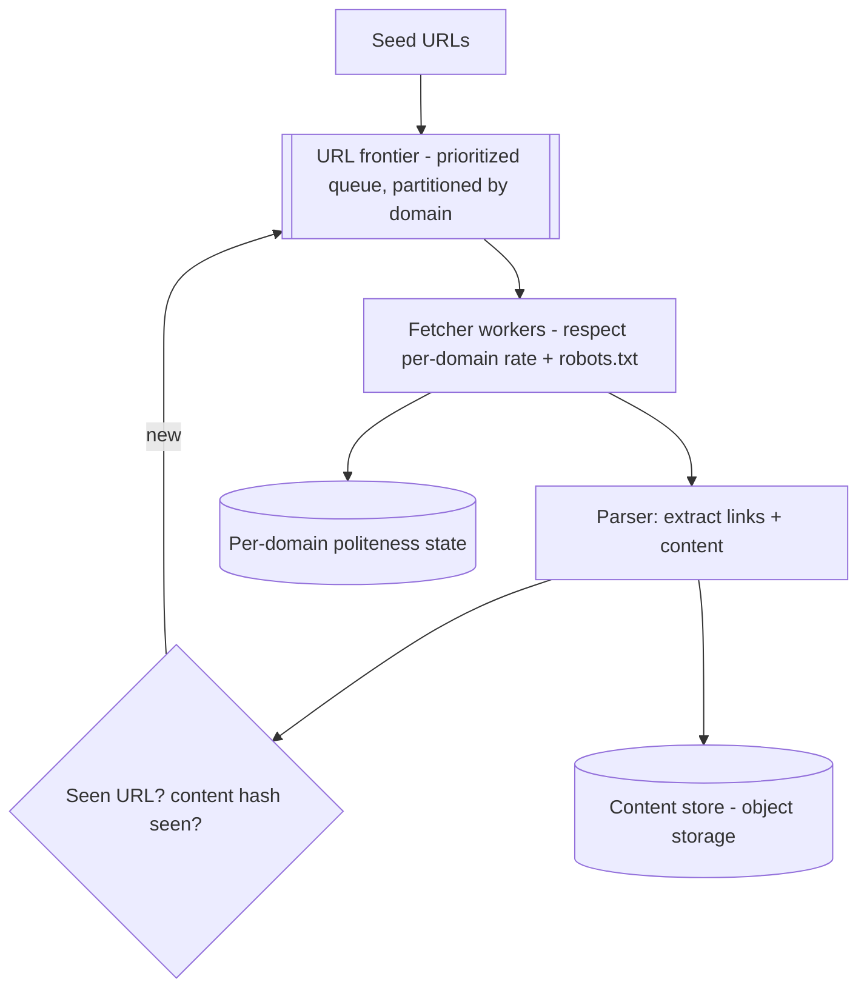

# Design a Web Crawler

> Difficulty: Intermediate→Advanced
> Related: [05-messaging/queues-vs-pub-sub-vs-event-streams](../05-messaging-and-event-driven-systems/queues-vs-pub-sub-vs-event-streams.md) · [05-messaging/backpressure-and-consumer-lag](../05-messaging-and-event-driven-systems/backpressure-and-consumer-lag.md) · [10-storage/object-storage-and-file-uploads](../10-storage-and-content-delivery/object-storage-and-file-uploads.md)

A system that systematically fetches and processes web pages at scale (search indexing, archiving). Tests large-scale queue processing, politeness/rate-limiting per domain, dedup, and backpressure.

## A. Problem statement
Crawl the web (or a large set of sites): start from seed URLs, fetch pages, extract links, follow them, store content — at scale, politely (don't overload any site), without re-crawling duplicates endlessly.

## B. Requirements
**Functional:** fetch pages from a URL frontier; parse + extract links; enqueue new URLs; store content; respect robots.txt; re-crawl periodically for freshness.
**Non-functional (ask):** scale (pages/sec, total pages); politeness (per-domain rate limits — don't hammer a site); dedup (don't crawl the same URL/content repeatedly); freshness (how often to re-crawl); storage for billions of pages.
**Assumptions:** billions of pages, polite per-domain crawling, dedup URLs + content, periodic re-crawl.

## C. Estimation
- Billions of pages; say target 1,000 pages/sec → needs many crawler workers.
- **Storage:** billions × ~100KB/page → petabytes → object storage; URL metadata/dedup in a scalable store.
- Politeness caps per-domain throughput (can't just max out — a popular domain limits you).

## D. API / interface
Mostly an internal system. Interfaces: seed injection, status/metrics. Core components exchange URLs via a queue (the "frontier").

## E. Data model
- **URL frontier (queue):** URLs to crawl, prioritized (importance/freshness).
- **Seen-URL set:** dedup (have we queued/crawled this URL?) — a huge set → bloom filter + a store (see [stampedes-hot-keys-and-penetration](../04-caching/stampedes-hot-keys-and-penetration.md) for bloom filters).
- **Content store:** fetched pages in object storage; `content_hash` for content dedup (same content at different URLs).
- **Per-domain state:** last-crawl time + rate (politeness).

## F. Architecture

- **Frontier partitioned by domain** so politeness (per-domain rate limit) is enforced per partition and one slow/large domain doesn't block others.
- **Dedup** before enqueuing (bloom filter + set) so URLs aren't crawled repeatedly; content_hash dedups identical content at different URLs.
- Workers autoscale on frontier depth (see [backpressure-and-consumer-lag](../05-messaging-and-event-driven-systems/backpressure-and-consumer-lag.md)), bounded by politeness.

## G. Critical flow
Dequeue a URL → check robots.txt + per-domain rate (wait if too soon) → fetch → parse → extract links → dedup each (bloom filter) → enqueue new URLs → store content (dedup by content_hash) → update per-domain state. Re-crawl: periodically re-enqueue URLs based on freshness policy.

## H. Bottlenecks
- **Politeness caps throughput per domain:** you can't crawl one site faster than polite; parallelism comes from crawling *many* domains concurrently (partition by domain).
- **Dedup set size (billions):** bloom filter (space-efficient "probably seen") + a backing store; false positives skip a few URLs (acceptable).
- **Frontier management:** prioritization (crawl important/fresh URLs first), avoiding infinite link loops/traps (depth limits, dedup).
- **Storage (petabytes):** object storage + tiering.
- **Crawler traps / spider traps:** infinite URL spaces (calendars, dynamic params) → URL normalization + depth/pattern limits.

## I. Failure handling
- **Fetch failures/timeouts:** retry with backoff; after N, drop or defer the URL.
- **Worker crash:** at-least-once (URL redelivered); dedup makes re-fetch harmless (idempotent — content overwritten by hash).
- **Politeness violation risk:** per-domain state must be respected even across workers (shared per-domain rate state).
- **Trap detection:** limits prevent infinite crawling.

## J. Trade-offs
| Decision | Chosen | Why |
|---|---|---|
| Frontier | Partitioned by domain, prioritized | Per-domain politeness + priority; isolate slow domains |
| Dedup | Bloom filter + store | Billions of URLs; space-efficient; false positives acceptable |
| Content | Object storage + content-hash dedup | Petabytes; dedup identical content |
| Parallelism | Across domains (not within) | Politeness caps per-domain rate |

## K. Follow-ups
1. **How do you crawl politely?** → Per-domain rate limits + robots.txt; partition the frontier by domain so each domain's rate is enforced and parallelism comes from many domains.
2. **How do you avoid re-crawling the same URL endlessly?** → A seen-URL dedup set (bloom filter + store) checked before enqueuing; URL normalization.
3. **How do you handle billions of URLs in the dedup set?** → Bloom filter (space-efficient, "probably seen") backed by a store; accept rare false positives (skip a few URLs).
4. **A crawler trap (infinite URL space)?** → URL normalization + depth/pattern limits + dedup catch most; detect abnormal per-domain growth.
5. **How do you prioritize what to crawl?** → Priority frontier (importance/PageRank-like signals, freshness); crawl high-value/stale URLs first.
6. **How do you re-crawl for freshness?** → Re-enqueue URLs on a freshness schedule (frequently-changing pages more often).
7. **How do you scale throughput despite politeness?** → Crawl many domains concurrently (partition by domain); you can't exceed polite per-domain rates, so breadth across domains is the lever.
8. **Worker crash?** → At-least-once redelivery; dedup + content-hash make re-fetch idempotent.
9. **Content dedup (same page, different URLs)?** → Hash content; store once per content_hash, map URLs to it.
10. **Where is content stored?** → Object storage (petabytes), tiered; metadata/dedup in a scalable store.

## L. Common mistakes
Ignoring politeness (hammering sites / getting blocked); no dedup (infinite re-crawl / traps); trying to parallelize within one domain (politeness-capped); storing pages in a DB (petabytes → object storage); no trap detection.

## M. Practice exercise
Design the **freshness/re-crawl scheduler**: 1B pages, some change hourly, most rarely. How do you decide re-crawl frequency per URL (change-rate estimation), prioritize the frontier, and bound total crawl rate under politeness? Compare with [job-scheduler](./job-scheduler.md).
