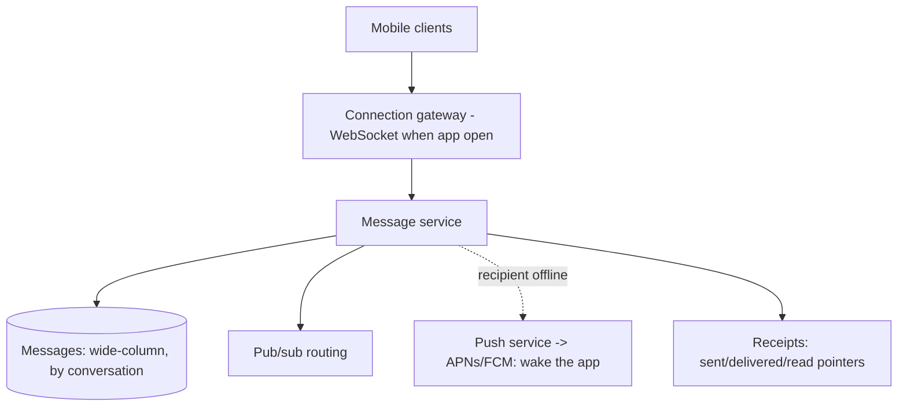

# Design a WhatsApp-like Messaging Platform

> Difficulty: Advanced
> Related: [chat-messaging-system](./chat-messaging-system.md) (the base design) · [02-compute-and-architecture/stateless-vs-stateful-services](../02-compute-and-architecture/stateless-vs-stateful-services.md)

Builds on the [chat system](./chat-messaging-system.md), adding WhatsApp specifics: mobile-first delivery (push to offline devices), delivery/read receipts (double ticks), end-to-end encryption, and massive scale.

> This extends [chat-messaging-system](./chat-messaging-system.md) — read that first. Here we focus on the WhatsApp-specific additions.

## A. Problem statement
A mobile messaging app: 1:1 and group chats, real-time delivery, delivery/read receipts (ticks), offline delivery to mobile devices (push notifications), end-to-end encryption, media, at massive scale (billions of messages/day).

## B. Requirements (deltas vs base chat)
**Functional additions:** delivery + read receipts (sent/delivered/read ticks); push to offline mobile devices (wake the app); end-to-end encryption; media messages; last-seen/online presence.
**Non-functional:** massive scale (billions of messages/day); mobile constraints (intermittent connectivity, battery → push notifications, not constant polling); E2E encryption (server routes ciphertext).
**Assumptions:** billions of messages/day, mobile-first, E2E encrypted, receipts, media.

## C. Estimation
Similar to [chat](./chat-messaging-system.md) but larger: billions of messages/day → tens of thousands+ writes/sec, wide-column store, massive persistent connections + push infrastructure for offline devices.

## D–F. Design (deltas on the chat base)
The core (WebSocket gateway + message service + wide-column store partitioned by conversation + pub/sub routing + presence) is the [chat design](./chat-messaging-system.md). WhatsApp-specific additions:

- **Offline delivery via mobile push (APNs/FCM):** when a recipient's app isn't connected, send a push notification to wake it; on reconnect, the app fetches queued messages (by its last-delivered pointer). This is the key mobile addition — you can't keep a persistent socket to a backgrounded phone.
- **Receipts (ticks):** `sent` (server stored), `delivered` (recipient's device received), `read` (recipient opened). Each is an event updating a per-message/per-user pointer, routed back to the sender. Group receipts aggregate per member.
- **End-to-end encryption:** clients encrypt messages; the server routes/stores ciphertext and **cannot read content**. Key exchange (e.g., Signal protocol) is client-side; the server stores public keys and routes encrypted payloads. Consequence: the server can't do content search/moderation; media is also E2E encrypted.
- **Media:** encrypted blobs uploaded to object storage (pre-signed), message references the key; recipient downloads + decrypts (see [image-and-video-processing](../10-storage-and-content-delivery/image-and-video-processing.md)).

## G. Critical flows
- **Send to offline recipient:** store message → recipient offline (presence) → send a push via APNs/FCM → recipient's app wakes, connects, fetches queued messages → delivery receipt flows back (double tick). Read receipt when opened.
- **E2E:** sender encrypts with the recipient's key → server stores/routes ciphertext → recipient decrypts. Server never sees plaintext.

## H. Bottlenecks (deltas)
- **Push fan-out to billions of devices:** push infrastructure (APNs/FCM) scale + batching; group messages → push per offline member (cap group size / rate).
- **Receipts amplification:** group read receipts = many events per message → aggregate; make receipts best-effort/eventual.
- **E2E key management:** distributing/rotating per-device keys at scale; multi-device support (each device has keys).
- Plus all [chat](./chat-messaging-system.md) bottlenecks (connections, write volume, hot conversations, ordering).

## I. Failure handling (deltas)
- **Offline → push fails:** retry push; the message persists; delivered on next app open.
- **E2E key issues:** if a recipient's keys changed (new device), re-establish keys; show a security notice.
- Plus chat failure handling (reconnect + fetch-missed, idempotent dedupe, per-conversation ordering).

## J. Trade-offs (deltas)
| Decision | Chosen | Why |
|---|---|---|
| Offline delivery | Mobile push (APNs/FCM) + fetch-on-reconnect | Can't hold a socket to a backgrounded phone |
| Encryption | End-to-end (server routes ciphertext) | Privacy; cost: no server-side search/moderation |
| Receipts | Eventual, aggregated for groups | Avoid amplification; best-effort is fine |

## K. Follow-ups
1. **How do you deliver to an offline mobile user?** → Store the message; send a push notification (APNs/FCM) to wake the app; on reconnect it fetches queued messages by its last-delivered pointer. You can't keep a socket to a backgrounded phone.
2. **How do delivery/read receipts work?** → sent/delivered/read events update per-message/per-user pointers routed back to the sender (double tick / blue tick); group receipts aggregate per member and are eventual/best-effort.
3. **How does E2E encryption affect the design?** → The server routes/stores ciphertext and can't read messages; key exchange is client-side; the server can't do content search/moderation; media is encrypted too.
4. **Multi-device E2E?** → Each device has its own keys; messages are encrypted per recipient device; key management/sync across a user's devices adds complexity.
5. **Group messages to offline members?** → Push per offline member (cap group size / rate-limit pushes); fan-out amplification — handle like the [chat hot-partition problem](./chat-messaging-system.md).
6. **How is ordering/no-loss handled?** → Same as [chat](./chat-messaging-system.md): per-conversation partition + message ids + offline fetch pointer + clientMsgId dedupe.
7. **Media messages with E2E?** → Encrypt the media client-side, upload the ciphertext to object storage (pre-signed), send a message referencing the key; recipient downloads + decrypts.
8. **Receipts amplification in big groups?** → Aggregate receipts; make them eventual/best-effort; don't route every member's receipt synchronously.
9. **How do you scale push?** → Rely on APNs/FCM (managed) + batching; your push service maps users→devices and sends efficiently.
10. **Why can't the server search messages?** → E2E encryption — it only has ciphertext. Search (if any) is client-side on decrypted data.

## L. Common mistakes
Assuming a constant socket to mobile devices (need push for offline); ignoring E2E's consequence (no server-side search/moderation); synchronous group receipt fan-out (amplification); not reusing the chat base (ordering/no-loss/dedupe still apply).

## M. Practice exercise
Design **multi-device sync** for E2E messaging: a user has a phone + laptop + tablet, all must receive messages and stay in sync, each with its own encryption keys. How do you fan out per device, manage keys, and keep read state consistent across devices? Compare with [chat-messaging-system](./chat-messaging-system.md) and [cloud-file-sync](./cloud-file-sync.md).
