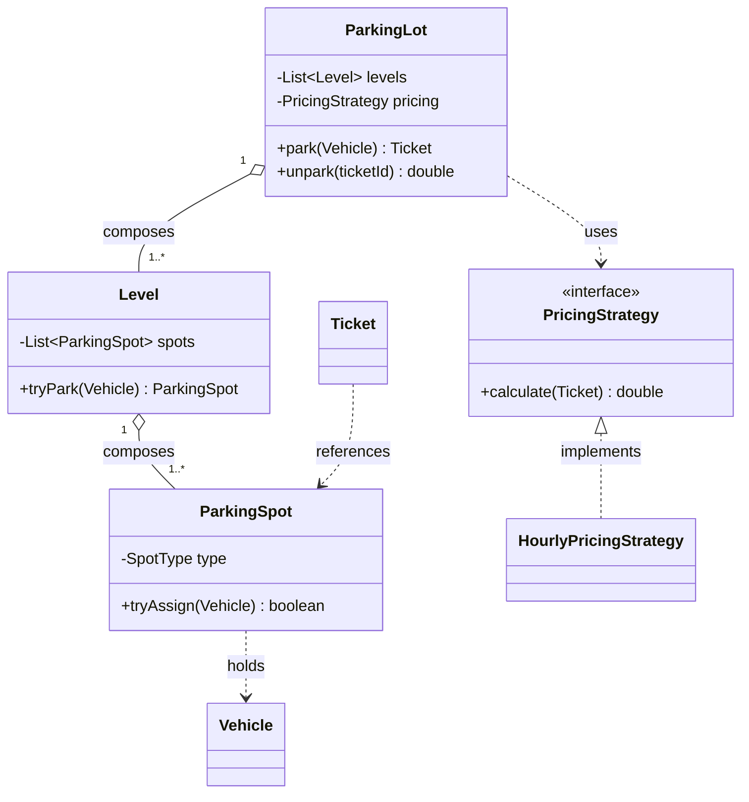

# UML Primer for LLD Interviews

You'll be asked to "draw the classes." You don't need formal UML — you need a clear class diagram you can sketch in 2 minutes and narrate. This is the 20% of UML that covers 95% of LLD rounds.

---

## A class box
```
┌──────────────────────┐
│      ClassName        │   <- name
├──────────────────────┤
│ - field: Type         │   <- attributes (- private, + public, # protected)
├──────────────────────┤
│ + method(arg): Return │   <- operations
└──────────────────────┘
```
In an interview, even just the class name + key fields + key methods is enough. Don't waste time on every getter.

---

## The relationships (this is what interviewers look for)

| Relationship | Meaning | Arrow | Example |
|--------------|---------|-------|---------|
| **Association** | "uses / knows" | plain line → | Order → Customer |
| **Aggregation** | "has-a", parts can live independently | hollow diamond ◇— | Team ◇— Player |
| **Composition** | "owns", parts die with the whole | filled diamond ◆— | House ◆— Room |
| **Inheritance** | "is-a" | hollow triangle △— | Dog —▷ Animal |
| **Realization** | "implements an interface" | dashed + triangle ⇠△ | CardPayment ⇠ PaymentStrategy |
| **Dependency** | "temporarily uses" (param/local) | dashed arrow ⇢ | Service ⇢ Logger |

**Multiplicity** on the ends: `1`, `0..1`, `1..*`, `*`. Read "ParkingLot 1 —— 1..* Level" as "one lot has one or more levels."

Interview tip: say the relationship in words as you draw it — "a lot **composes** many levels; a level **composes** many spots; a ticket **references** a spot." That narration is what gets scored.

---

## Composition vs Aggregation (the one they probe)
- **Composition** (filled diamond): the whole owns the part's lifecycle. Destroy the `ParkingLot` and its `Spot`s are meaningless/gone. Strong ownership.
- **Aggregation** (hollow diamond): the part exists independently. A `Player` can exist without a `Team`; moving them to another team is fine.
- When unsure, call it association — the key is knowing composition = lifecycle ownership.

---

## A worked example (Parking Lot) in Mermaid



(GitHub and the Kiro artifact panel render Mermaid. In a whiteboard round, draw the boxes and the diamonds/triangles by hand — the shapes above tell you which.)

---

## How to narrate a diagram (30 seconds)
1. Name the top-level orchestrator and what it owns (composition).
2. Point out the interfaces (the seams where behavior varies) and who implements them.
3. Call out the one or two key associations (who references whom).
4. State multiplicities for the important pairs ("one show has many seats").

That narration demonstrates you understand the *design*, not just the drawing.

---

## What to skip under time pressure
- Getters/setters, trivial DTO fields.
- Every method signature — show the 1–3 that matter.
- Formal UML correctness (exact arrowheads). Clarity > notation purity.
